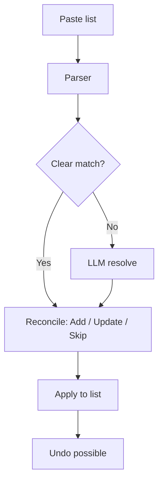
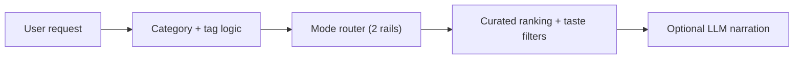
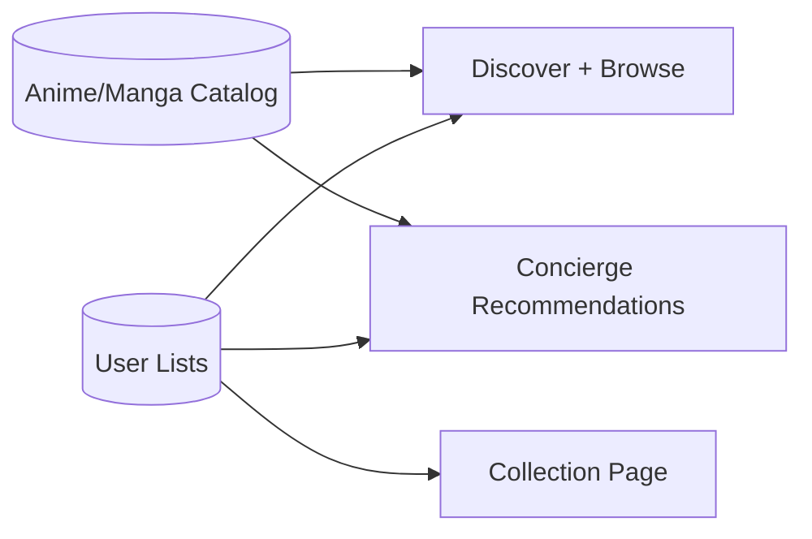
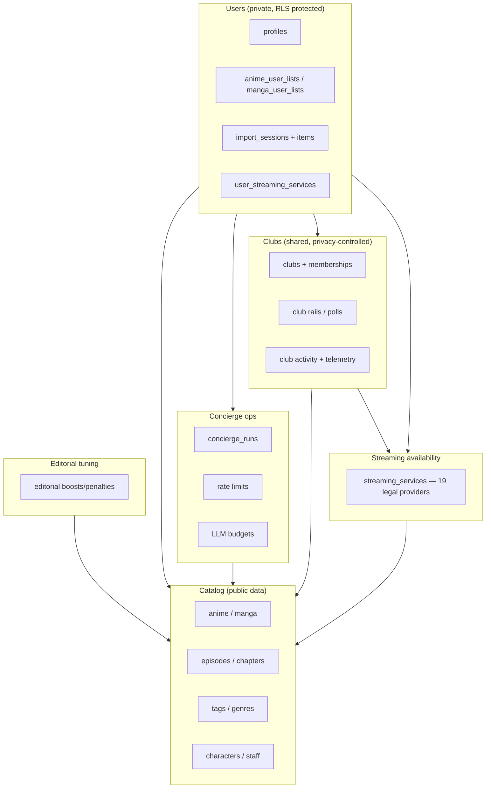
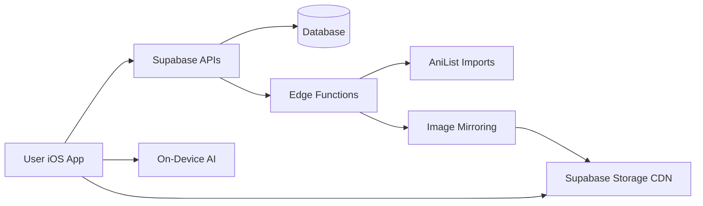
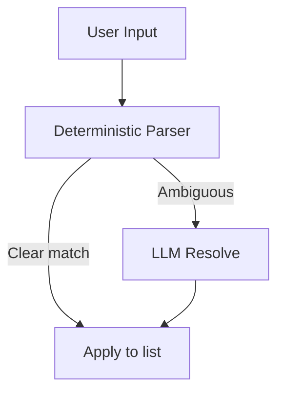

# Kuro — Current State (Plain English)

> **Design polish, 9 October — a saved shelf is the original homepage again; not accepted yet.** The empty mountain page is unchanged. Once you have anime, Home shows wide scenes, your episode, and a light plus. Once you have manga, Home shows equal covers with the chapter sitting on the cover and a dark plus. Coming up is the first line under Anime and Manga. Nothing was deployed or sent to TestFlight.

> **Design polish, 9 October — empty and saved Home are different; not accepted yet.** Before you save anything, Home is the mountain invitation. After you save anime or manga, that medium becomes the white shelf again: a large title, your place in it, then the other titles. The two pages are not the same layout. Nothing was deployed or sent to TestFlight.

> **Design polish, 9 October — Home continues; not accepted yet.** The picture no longer stops in a hard line under the last sentence. KURO, HOME, search, profile, Anime, and Manga are easier to see. Find opens Discover, which is where a first title is found. The import sheet uses the same type as the invitation. A few real titles can be saved on the signed-in list so the filled Home can be reviewed. Nothing was deployed or sent to TestFlight.

> **Design polish, 9 October — invitation type; not accepted yet.** “Your next story starts here” is set as a light cover line with a short black rule, the same kind of rule under Anime or Manga. Find and Import are two separate actions: a small spaced label, the words, a line, and an arrow. The picture still runs behind the clock and the header. Nothing was deployed or sent to TestFlight.

> **Design polish, 9 October — picture continues through the top of the phone; not accepted yet.** On Home, the mountain or first title’s art runs behind the clock, KURO and HOME as well as the page. The selected Anime or Manga word is still a window into that same picture. Headlines, Find and Import or episode advance, other titles, dates and club notes sit as ink on a soft wash lower on the page. Find, Import, advance and Undo still work as before. The look is on the simulator and in the Home screenshots for you to judge. It is not a finished design approval. Nothing was deployed or sent to TestFlight. A MyAnimeList account test is still blocked because no test account is available.

> **Fresh conversation ready, 8 October — HANDOFF SAVED; IMPLEMENTATION STATUS UNCHANGED.** A new Claude Code or Codex conversation can continue in the same local folder using the handoff and its paste-ready prompt. It includes the original designs, local work missing from main, the backend already live and the simulator already installed. The new visual polish still needs implementation; remaining real import journeys still need checking. Nothing was pushed, deployed or reinstalled for this handoff. [Full handoff](docs/handoffs/2026-10-08-fresh-session/HANDOFF.md) · [Paste-ready prompt](docs/handoffs/2026-10-08-fresh-session/START_PROMPT.md).

> **Design polish, 8 October — plan ready; screens are not redesigned yet.** You asked for the empty Home to feel alive through a large image, headline and gentle animation; a cleaner neutral palette; and a complete Profile rethink. The plan carries that same visual language through populated Home and details. Current working behavior stays protected, but the earlier technical checks do not mean the design is accepted. [Full plan](docs/plans/2026-10-08-native-design-polish.md).

> **Backend and new Home, 8 October — deployed and visibly running; remaining journeys are still being checked.** Your exact approved server changes are deployed. Live checks confirm imports keep existing choices, apply only reviewed updates, recover retries, protect later edits and support Stop/Undo; test accounts and import data are gone afterward. Private club updates and removal notifications pass. Deleted-account uploads are blocked and origin files are gone, but a previously cached public picture stayed available during the observation window; that limitation remains recorded. The Home layout was present but hidden and unfinished in places. Its visual repairs are built, and a Library query error that kept Home hidden is fixed. The installed simulator now shows Home after restoring the development account. The final Manga switch correction is installed and checked in the visible simulator. The MyAnimeList login is dismissed: a controlled MAL user account is needed only for testing that account connector. Other checks can continue. No TestFlight or global rollout. [Evidence and remaining work](docs/handoffs/2026-10-08-backend-integration/approved-deployment-live-evidence.md). Earlier notes are historical.

> **Import review, 8 October — MORE REPAIRS NEEDED; BACKEND DEPLOYMENT ON HOLD.** This deeper review found27 issues and reproduced six database problems locally. Duplicate IDs are mostly handled, but existing Kuro choices can be overwritten, some MAL statuses are rejected, interrupted imports have no visible recovery, and successful saves can leave screens stale. The review specifies keep-existing by default, explicit changes, lasting results, Stay/View imported choices and safe restart/stop behavior. The old local test passes did not prove those actual journeys. No application repair or live change was made in this review; the old deployment draft must not be applied. Simulator remains the target, with no TestFlight. [Complete findings and repair plan](docs/handoffs/2026-10-08-backend-integration/import-user-journey-review.md). Earlier readiness notes are historical.

> **Backend work, 8 October — repaired and checked locally; not deployed.** We can access Supabase through its existing login, and two read-only checks confirm we can verify account/file cleanup. The live backend is missing16 calls needed by Home and imports, and six deployed handlers lack reviewed fixes. The complete prepared set is three SQL changes and six named handlers. It preserves exact chapter/episode selections, avoids Undo touching a replacement entry, and refuses older Undo items that lack the needed identity. Independent source review and118 focused database assertions pass; unchanged tests are reused. The live RAG feature already runs at5%, so its fixes are included without changing rollout. The exact production changes still need approval, then real simulator and live checks. No TestFlight. [Full findings and next execution](docs/handoffs/2026-10-08-backend-integration/backend-integration.md). Earlier conflicting notes are historical.

> **MAL setup, 8 October — REGISTERED AND INSTALLED.** Your published MAL registration is configured in the simulator app. The build and sign-in work, and Profile now offers Connect and import MAL. It pauses safely because the live Home/import backend is not installed yet. Connecting MAL and testing recovery still require that reviewed backend change, then your provider consent. No backend deployment or TestFlight upload occurred. Earlier banners are historical where superseded.

> **Latest checks, 8 October — SIGN-IN AND RESTART WORK.** The actual Kuro app signs in, restores the same account after restart, and signs out correctly. The previous callback test could open an older preview with the same link scheme; I corrected that evidence and verified the real callback on a separate simulator without deleting the previews. The simulator is signed in for further testing. You report MAL registration complete; its public Client ID is still needed to configure the connector. Home/import server integration and full live journeys remain open. Nothing was deployed or uploaded to TestFlight.

> **Latest access work, 7 October — SIGNED IN / RESTART PROBLEM OPEN.** I created the requested reusable development account, kept its password private, and signed the simulator in. Restarting the app still loses the signed-in screen, so restore has not passed. The simulator is signed in again. MAL registration is open in the sidebar for you to finish manually; its client ID is still needed. No existing account or backend configuration changed, and nothing went to TestFlight. Earlier notes about empty login fields are superseded.

> **Latest simulator work, 7 October — LOCAL CHECKS PASS / NOT FINISHED.** The native tests now all have passing results; only failed/changed tests were repeated. Database checks and the exact Home/import installation rehearsal passed locally, including keeping existing notes, progress and migration records. The latest app is installed in the simulator with its sign-in form open. The live database still needs the reviewed Home/import changes; no live data or rollout changed. A signed-in simulator account, approval of that exact production change and MAL registration/consent are still needed to exercise the real workflows. TestFlight and a physical phone are outside this task.

> **Latest simulator checks, 7 October — still in progress.** Permission to test is clear. The real SDK passed 19 sign-in/restore/account-safety cases, and 6 import retry/Undo cases passed. I fixed two test setup problems and an independent reviewer checked the fixes; production safety rules were kept. These tests use controlled responses, so the real signed-in Home journey remains unproved. Live Supabase is missing the new Home, tracking and import functions. The exact two-migration server change is prepared for approval, with global flags kept off. The simulator sign-in handoff is pending; native UI control timed out after the separate test clone ran. No live account or data was changed and no TestFlight upload occurred. [Checks and next steps](docs/handoffs/2026-10-07-integrated-release-evidence/simulator-auth-import-recovery.md). Older status notes below are historical.

> **Current target: simulator only.** Max asked for no TestFlight upload. Kuro1.0build17 is installed and visibly running on the iPhone 17 Pro simulator. Supabase access now works; its current backend is missing the new Home functions and tester flags, so the Home migration is not yet integrated live. The read-only account-ID audit found no malformed IDs, casing problems or collisions; no customer data was changed. MAL registration needs the user to finish the form because the browser tool blocks that page. Apple agreements and physical-phone checks are outside this simulator task. The app has not been released.

> **Access refresh, 7 October — NOT RELEASED.** Xcode27.0 first-launch validation passes. Actual package81tests, Home snapshot5cases and credential/permission contract3cases PASS. Native compilation errors (missing KuroCore import and duplicate Home declaration) and three outdated test fixtures are repaired and independently source-accepted. The broader native runner stalled after its logged host exited; it was interrupted and has no finalized acceptance result. No whole-native PASS is claimed. Physical iPhone “Max” is paired/booted on iOS26.6; one development and one distribution signing identity are present. Existing ASC key4Y9VLAQLQN returns403 `FORBIDDEN.REQUIRED_AGREEMENTS_MISSING_OR_EXPIRED`; the Account Holder must review agreements, then team/app/upload permissions can be checked. Fastlane references an absent older key. Supabase administration and controlled MAL registration/consent are still unavailable. No credential changes, backend deployment, upload or physical installation. Earlier license/hardware absence notes are superseded by these observations.

> **Latest implementation: improved and checked locally, still NOT RELEASED.** Testing now matches the stage: run the checks that prove each changed behavior, then qualify the final app and live services once. MyAnimeList account import for Anime and Manga is implemented, but still needs a registered app and controlled sign-in. Old screen actions cannot become another account’s edits. Focused tests of real tracking, account actions and import rules pass, and ten local database suites pass253assertions. Phone testing needs the Xcode license accepted; deployment, TestFlight and provider testing need securely configured access and a physical iPhone. No app or server was released. [Complete execution record and remaining requirements](docs/handoffs/2026-10-07-integrated-testflight-execution.md).

> **Integrated release, 7 October: still NOT COMPLETE.** The approved release now includes the modular migration and Home/series together. Tracking and personal offline recovery work through one Library owner; local tests exercise actual recovery code. Imports/chat lifetimes and model ownership are clearer. The app has not been newly deployed or uploaded to TestFlight. Final phone/live database tests, MAL account connection/import, signing and installed release evidence still need completion. [Full executor,114findings, success gates and future rules](docs/handoffs/2026-10-07-integrated-testflight-execution.md). Earlier dated claims below remain history, not release acceptance.

> **Modular migration, 7 October: still unfinished.** The latest import, cache, test-checker, timestamp and script-path repairs passed their focused checks. A real import was applied and undone on the approved live project, then both temporary accounts were deleted. These repairs have not been deployed or sent to the App Store. Some architecture and screen checks remain; server deployment access and the configured release key are missing. Older dated notes describe earlier work.

> **Home repair, 7 October: improved locally, still unfinished.** The main save, retry, import, season-data and club-privacy problems have source fixes. The local package tests, real Home/SQLite fast-tap test, AniList import fixtures and artwork/story worker checks pass. That does not prove the phone screens or live servers: the latest database checks cannot start, and Xcode needs its license accepted before native tests. I left the Mac's shared-memory resources alone as requested. Nothing from this repair was deployed or switched on globally. [Repair details and remaining checks](docs/handoffs/2026-10-07-home-series-evidence/REPAIR_LEDGER.md).

**Home and details started locally (7 October 2026):** The selected Home can appear in the pager, and Anime and Manga details can use the new layout, only when a switch that is off by default is turned on. Progress taps are written to a file on the phone before the screen says they were saved. The database changes are prepared and tested on a throwaway database, not applied to the live project. A MyAnimeList file export can be read; connecting a MyAnimeList account is not available and is not described as working. Large-scale load tests and a phone walkthrough were not run, so this is not a finished release.

**Codebase reorganized on this Mac (5 October 2026):** The modular plan was carried out locally (not committed, not released, nothing changed on the live servers); the "has not started" note in the entry below is out of date. The old all-in-one data file (`SupabaseService`, 13 files) is gone. Each area of the app (sign-in, saved titles, catalogue, Discover, search, Collection, releases, providers, friends' activity, clubs, imports, Concierge, Taste, telemetry) now has one clear owner in its own folder, all connected in one place, and saved titles live in a small tested package. What users may notice once this ships: ratings save correctly again (the app used to send 10–100 where the database only accepts 1–10); an import never applies itself automatically to a title you already track, and cannot be applied until your list has loaded (this closes a gap where it could overwrite an existing entry); leaving or losing access to a club clears that club's private data on your phone; signing out stops the old account's work before anything else, and deleting your account clears the phone only after the server confirms. Screens now open details, the list editor and club pages through one shared navigation path, and the detail pages share their common parts; this has only been checked by tests of the rules, not by tapping through on a simulator or phone. Prepared but not deployed: safer server-side account deletion and imports, and three club privacy fixes. Still open: a few owner decisions (club privacy, user-id format, club error codes), screen/phone testing, and any capacity testing; the Home/detail plan's own goals are not met by this work. Exact test results and check status: [execution ledger](docs/plans/2026-10-05-modular-architecture-execution-ledger.md).

**Modular codebase execution brief (2026-10-05):** [Claude Code execution brief](docs/plans/2026-10-05-modular-architecture-plan.md) now starts with the prompt to implement the full architecture using several coordinated specialist agents and an independent reviewer. Priorities are safe/correct behavior 35%, maintainability 25%, compatibility 20%, useful verification 10% and simplicity 10%. Every required success gate must pass; a score cannot excuse a failure. Account-switch safety comes first, followed by clear ownership, one Library writer, useful modules, actual screen/backend integration and retirement of the old shared service. Testing targets important failures and runs broader checks on the final integrated code, rather than repeatedly testing everything. Includes no work-duration estimates or schedules. This updates the execution instructions only; app refactoring and its checks have not started.

**Production handout (2026-10-05):** Created a start-ready Claude Code document for the selected Home and detail redesign. It first requires a database/call audit, then the same two larger waves. It includes thousands-of-users tests, safe fast/offline edits, club-removal privacy, faithful AniList/MyAnimeList imports and exact visual-reference files. This is the implementation contract, not a completed app update; no native/backend work or production release happened.

**Home/detail master plan finalized (2026-10-04):** The existing master plan is ready for another executor: first build the data/import/sync foundation, then wire and qualify Home and both detail pages. It includes every control, real personalized import results, season/source matching, story copy, music, private-club comments, offline progress, errors and tests. The design stays as currently selected. Planning is complete for this scope; the native app/database work has not started and nothing was released.

**Master-plan retention (2026-10-04):** At Max’s request, the existing singular series/Home master plan now explicitly lists ID-based Anime/Manga matching and real Manga story overview copy in its decision register. Existing detailed requirements and success criteria are retained. Documentation-only; no prototype/native/backend changes. v0.8 remains INCOMPLETE, exactly two waves/16 tasks, native/backend NOT STARTED.

**Manga story overview (2026-10-04):** All six books in the local Library preview now have a short introduction to their actual story. Longer context stays behind About this story. The liked homepage stays as it is. Checked the six pages, opening/closing without changing chapters, and the existing anime season descriptions. Anime-to-manga matching should use verified source IDs and adaptation links; names only help search. The importer has part of this foundation, but missing links still need a safe retry path. This is a browser prototype change, not a native app or database release; the two-wave plan remains incomplete.

**iPad preview recovery (2026-10-03, 21:34 Berlin):** Owner reported the replacement link did not work. The previous8814 listener and temporary binary were absent; the cage-sustained-copy-when link did not resolve. Restored the same45-file allowlisted preview with official Cloudflare2026.9.3 in the visualization runtime folder, using a detached subprocess rather than a foreground chat-terminal session. Current link: https://ratio-yarn-raise-scholarships.trycloudflare.com/instrument.html?switch=poster&medium=manga. Original automatic stop remains4October02:39 Europe/Berlin; no renewed duration, recurring service or expanded public files. Fresh HTTP200 for HTML/CSS/Instrument/Library modules and404 for .env/current-state docs. Browser tool is currently unavailable, so no new screenshot, Safari or iPad visual proof claimed. No UI/native/backend source changes; two-wave v0.8 implementation plan remains INCOMPLETE and unstarted.

**Temporary preview restored (2026-10-03):** Browser/app restart stopped the earlier preview and removed its temporary binary/screenshot. The old trees-marc-amongst-obtain link is unavailable. Restored the same45-file design-only allowlist via official Cloudflare2026.9.3; current link: https://cage-sustained-copy-when.trycloudflare.com/instrument.html?switch=poster&medium=manga&embed=1. Only the remaining authorized duration is used, still stopping4October02:39 Europe/Berlin. No account/backend data, share-scope expansion, recurring automation or TTL renewal. Replacement public page and loaded artwork verified; original Coming Up local/browser checks remain valid.

**Coming Up is visible sooner (3 October 2026):** Added a small illustrated Coming Up strip beneath the Anime/Manga switch, before your current titles. It shows what is next and how many releases are in the calendar. Tap once to reach the full calendar below. Your six reads and chapter buttons keep their size. Unknown dates stay labelled pending; empty accounts and Taste show no invented schedule. Checked small and regular phone browser sizes, keyboard access and busy/unknown-date states. The same temporary phone link reflects the change after refresh. This is a browser design preview; the native app and backend are unchanged. Your review of the new strip is still open.

**Temporary iPhone preview (3 October 2026):** Shared the current sample design through a temporary public link: https://trees-marc-amongst-obtain.trycloudflare.com/instrument.html?switch=poster&medium=manga&embed=1. It shows the phone layout directly and supports the current detail pages. Only preview files/artwork/fonts are shared. Checked public loading and phone-width rendering. It stops by4October02:39 Berlin time, or earlier if the studio Mac/server stops. Native app/backend unchanged.

**Library tracking reworked for review (3 October 2026):** Removed the chosen-book bar and repeated Open buttons. Each book now has its own chapter counter and advance button beneath equal artwork. Its cover and title open details. You can update any book immediately without selecting it or leaving Home. Checked local phone fit, correct pages, independent updates, failure/completion/Undo and empty/caught-up states. The new proposal still needs your review; native app/backend unchanged.

**Choose and open are independent (3 October 2026):** Tap any part of a book to choose its chapter controls without leaving Home. Every book has a separate generous Open button beneath it, so its details are nearby. Opening another book does not change your chosen read or chapter. Closing returns focus to its Open button. This adds a little shelf height. Checked local phone layouts, independent selection/navigation, keyboard/focus and chapter failure/completion/Undo. Native app/backend unchanged; physical-device touch testing remains open.

**Open a book directly (3 October 2026):** Tap anywhere on a book—cover, title or chapter—to open its detail page. The shared chapter controls follow the book you opened. Closing returns you to that book without changing progress. The bar’s Details button remains an optional shortcut. Checked phone fit, correct pages, keyboard/focus return and chapter failure/completion/Undo in the local browser prototype. Native app and backend unchanged; physical touch gestures still need device testing.

**Library is easier to tap (3 October 2026):** A book’s cover, name and chapter now all do the same thing: select its reading controls. Details is a separate labelled button beside the selected name. This removes the need to aim at nearby areas with different actions. Checked small and regular phone layouts, detail opening/focus return, keyboard selection, chapter failure, completion and Undo. This is a local browser preview; native app/backend unchanged.

**Library is the selected Manga direction (3 October 2026):** You chose Library. It is now the default Manga Home in the local Instrument preview. Covers keep equal sizes, with aligned title/chapter labels and a clearer selection frame. The shared controls have a readable Next button and show the available chapter total when known. Arrow keys choose another cover without changing progress. Checked phone fit, title selection, failure, completion, Undo, unknown totals, details/clubs/navigation and reduced motion. Open `manga-library.html`. This is browser design work; the native app and backend have not changed.

**Four genuinely different Manga Home proposals (3 October 2026):** You rejected Crosscut's offset and unequal artwork. The new comparison uses equal artwork frames in each option: Library with one shared chapter control area, Chapter Board for tracking several reads at once, Reading Journal organised by sample recency, and Club Room for shared versus solo reading. Each works with chapter updates, failure, completion, Undo, title details and private club access. Checked phone fit and reduced motion. The expandable comparison notes explain the purpose and tradeoff for each. Recency/activity is fictional. These remain proposals; the native app, backend and default Home have not changed.

**New Manga composition for review (3 October 2026):** You rejected the previous Edition, Contact and Index choices. The new local Crosscut proposal changes the composition: artwork panels alternate in width, with chapter controls fitted into their edges and names/readers in the white space below. Poster, Anime and Sunday Club keep their existing design. Preview `manga-crosscut.html`; previous choices are marked rejected. Checked small-phone fit, chapter updates, failure, completion and Undo, unknown chapter totals, busy releases, empty accounts and reduced motion. This is a new proposal, not an approved native redesign or backend change.

**Three complete Manga Home choices (3 October 2026):** Built Edition, Contact and Index as local previews you can compare side by side. Edition gives two priority reads a publication spread; Contact makes all six artworks a dark gallery; Index makes a longer reading list quick to scan. Each has chapter controls, upcoming releases, Sunday Club, existing details and Taste. Tested narrow-phone fit, failed chapter changes, completion and Undo, busy release dates, new accounts and caught-up states. They are proposals for review. The existing default Home, native app and backend are unchanged.

**Fresh design inspiration (3 October 2026):** Added a visual reference board with actual examples from mymind, !Boring, Panels, MusicHarbor and Sublime. Each example explains one idea for Kuro: distinctive artwork, satisfying chapter changes, readable collections, multiple releases and private club thoughts. The board works at phone widths and opens the original sources. The existing Home has not changed; this is research for the next design decision, not a finished app redesign. Videos and images need internet, and native touch/haptics have not been tested.

**Manga reading jackets (2026-10-02, v53):** The two lead covers have more room, with chapter controls attached as small paper bookmarks. The other four reads fit into two compact columns, making more of the library visible at once. Artwork, chapter progress, new chapters and club readers stay connected. Phone fit, failure/undo, caught-up and empty-account behavior passed local checks. This remains a design proposal; the released app is unchanged.

**Lighter Manga reading layout (2026-10-02, v52):** The large dark shelf was rejected. Manga Home now pairs two full covers with chapter numbers and a small update key in the margin. The other four reads form a compact list below. The composition uses spacing, cover proportions and chapter placement rather than a colored block. Coming Up and Sunday Club stay available afterward. Narrow phone fit, progress, undo, failed updates and club access passed local checks. This is a new visual proposal; the released application is unchanged.

**Manga ink shelf proposal (2026-10-02, v51):** You rejected the previous Manga spreads. This version presents all current reads together on one continuous dark shelf, with full artwork, a chapter action and club readers for each title. The shelf reaches the page edges; Anime retains its existing design. Phone fit, failed changes, completion, undo, unknown chapter totals and club access passed local checks. This is a new proposal awaiting your review, and it has not changed the released app.

**New Manga proposal (2026-10-02, v50):** Manga now uses reading spreads with a full cover beside your chapter number, new-chapter notice and club readers. The chapter action remains one tap; local failure, completion, undo and phone-size checks passed. Anime keeps its existing layout. The artwork inside the Anime/Manga words is currently taken from the first fixed sample title, so it is not yet different for each real user. A stable pick from each person's active list is proposed for the real app. This is a local design proposal awaiting review; the released app is unchanged.

**Poster selected and polished (2026-10-02, v49):** You chose the Poster direction. The preview now opens with its artwork-filled Anime/Manga lettering. The type is slightly larger, the other medium stays readable, the selection line is finer, and card/button corners are more consistent. Anime and Manga still have distinct layouts. Phone-width, switching, keyboard, reduced-motion and Home/Taste checks passed locally. This polish is ready for your review; it has not changed the released app.

**Five different visual styles (2026-10-02, v48):** The comparison now shows five directions: a dark cinematic Home, bold artwork-filled lettering, a glass control on the artwork, vertical page-edge tabs, and compact tactile keys. Each is interactive and scrollable, with reasoning tucked under the preview. All five work with Anime and Manga at narrow phone width and support keyboard selection and reduced motion. These are local proposals awaiting your choice; the released app is unchanged.

**Frames and pages material study (2026-10-02, v47):** The switch now has two custom forms: smoked glass for Anime and folded paper for Manga. They sit on the page without toggle boxes; the chosen form settles into place and its label stays clear. Labels and buttons work even when the generated image fails. Local phone fit, selection, reduced motion and image failure/recovery checks passed. New artwork and its prompt are saved in the project. This remains an unapproved browser proposal; the released app is unchanged.

**Five compact switch options (2026-10-02, v46):** The rejected header switch is replaced in the comparison by five approaches: Margin, Exposure, Relay, Interlock and Signature. Each sits below navigation, keeps both media one tap away and uses a different material or layout. Brief reasoning is available beneath each preview. All five passed local phone-fit, tap/keyboard and reduced-motion checks. These are proposals for review; the released app is unchanged.

**Compact Home switch (2026-10-02, v45):** Anime/Manga now share one small control in the header, leaving more space for titles below. The separate selector row is removed. Phone fit, equal tap targets, keyboard switching, Taste navigation and reduced-motion behavior were checked locally. This remains a design proposal, not a change to the released iOS app.

**Two replacement switch choices (2026-10-02, v44):** The rejected generated banner is replaced in the comparison by Shelf and Masthead. Shelf gathers sample title covers into two choices; Masthead gives the current medium a larger editorial name. Both switch between Anime and Manga. Phone-width, keyboard and reduced-motion checks passed locally. These remain proposals; the iOS app and backend are unchanged.

**Custom editorial switch (2026-10-02, v43):** The switch now uses an original generated scene that changes from painted Anime to inked Manga, with editorial typography and real text buttons. Phone sizing, selection and missing-image recovery were checked. The new artwork, fonts, license and generation prompt are saved in the project. This remains a local design proposal.

**New Manga Home direction (2026-10-02, v42):** Manga now opens like a folio: two full covers, chapter controls attached as bookmarks, your club readers beneath, and compact rows for the rest of your list. The other medium is a small edge tab beside the page heading. Sunday Club is retained. Phone layouts and simulated progress failures were checked. This is a local design proposal awaiting review.

**New switch choices (2026-10-02, v41):** The three rejected switches have been replaced with a film-and-paper ribbon, a turning media dial, and expanding artwork windows. Each is interactive in the local comparison. Phone fit, taps and keyboard access were checked. These are design proposals awaiting your review, not changes to the released app.

**Manga desk and switch studies (2026-10-02, v40):** Local Manga Home now uses wide reading cards with full-cover artwork, prominent bookmark counts and club-reader context. Coming-up material refined; Sunday Club rendering retained. Added `tools/design-directions/switch-options.html` with three live proposed switch styles: Splice, Fold and Lens. Query parameters select each style; none is owner-approved yet. Moved the existing page-swipe handlers inside the prototype closure to fix their inaccessible state references. Checked 320px fit, matched main heights, chapter failure/retry/Undo, all three medium tap paths and Fold keyboard arrows. Browser proposal only; no native/backend change.

**Manga materials and motion (2026-10-02, v39):** Local Manga Home adds a low-opacity wash from the two featured artwork palettes, softer card/control outlines, bookmark-shaped chapter accents, settling cover presses and a restrained chapter-number page-turn animation. Shelf artwork receives a once-per-session reveal through the existing observer; Reduce Motion disables nonessential motion. Checked 320px fit, chapter increment/Undo and reduced-motion CSS; JavaScript syntax/diff checks passed. Browser prototype only.

**Manga Home shelf refinement (2026-10-02, v38):** Local Manga Home replaces the plain shared spread with two matched individual book frames, artwork-derived paper materials, inset chapter controls and coordinated compact shelf tiles. Covers retain their full composition; reader/new-chapter context remains available. Anime unchanged. Browser checks: equal main-card heights, no horizontal overflow at 320/390px, 44px main progress targets, simulated failure/retry/Undo. Prototype only; native/backend/offline execution remains planned.

**Horizontal detail and offline plan (2026-10-02, v37):** Corrected the owner request to a shallow full-width Anime image, rather than a taller portrait header. Manga retains a compact book opening and refined bookmark/next-chapter controls. Plan v0.8 remains INCOMPLETE with the same two waves; adds durable account-scoped progress outbox, idempotent revision-checked server writes, reconnect/backoff, account isolation, Undo and conflict criteria. Inspected native progress writes have no durable queue; offline support is planned, not implemented. Local browser checks: 320px Anime/Manga fit and simulated chapter failure/retry/Undo; no native/backend changes.

**Home/Taste and import planning (2026-10-02, v36):** Local detail artwork is larger and joined to the Anime header; Manga uses a larger book-like cover. Existing recommendation cards now live on a separate Taste view, with Home reserved for tracking, upcoming and clubs. New-account Home has an honest import-first empty state. The existing two-wave plan is extended to v0.7 (INCOMPLETE) with structured resumable import, incremental Home revisions, release evidence/precision, provider permission and coverage gates, data contracts and failure/performance criteria. AniList current published terms restrict competing tracker use; expansion requires resolving permission. No native/backend execution or release.

**Anime opening polish (2026-10-02, v35):** Local Instrument Anime details now give the cover up to 160px of width, retain the artwork-derived header colour, and show one season-specific hook before an expandable synopsis. Manga presentation is unchanged. Verified 320/390px dialog fit, synopsis disclosure and season-specific copy switching; JavaScript syntax and diff checks pass. Browser prototype only, not native or deployed. The existing two-wave plan remains INCOMPLETE.

**Artwork continuity and Manga structure (2026-10-02, v34):** Local Instrument now shares saved artwork palettes between Home and details, preserving the approved AoT blue and Demon Slayer teal. Added deterministic `build_art_materials.py` and generated `instrument-art-materials.js` (24 artwork palettes; minimum measured white/base contrast 7.41:1). Manga has chapter bookmarks without Parts navigation. Jujutsu Kaisen links Anime and Manga internally; the finished-season guide never changes reading or anime progress. Missing season images use series artwork; chapter mappings remain unverified. Existing plan v0.6 stays INCOMPLETE with native/backend waves NOT STARTED. No native changes or deployment.

**Detail refinement (2026-10-02, v33):** Local prototype introductions now follow the inspected season/part. Club presentation is artwork-led with “Between us.”, expandable member statuses, retained spoiler disclosures and a redesigned “Leave a thought” entry. Source review confirms flat shared-club title comments/editing/reactions, not reply threads or individual-club rooms; persisted season spoiler scope remains planned. Existing plan v0.5 stays INCOMPLETE. No native/backend changes.

**Detail clubs and manga handoff (2026-10-02, v32):** Local detail prototype now separates shared-club watching/reading/finished activity from club-only comments, with collapsed spoilers and a local-only editable comment preview. Season manga guides distinguish start, end and recommended continuation; unverified chapters remain unknown. Existing two-wave plan is v0.4 and INCOMPLETE. Browser checks covered 320/390/768px fit, empty comment validation, save/edit, failure/retry, spoiler disclosure, new-account omission and reduced-motion navigation. Native/backend/privacy enforcement and exact chapter mappings remain unimplemented by this change.

**Detail polish (2026-10-02, v31):** Local browser detail mockups now have a compact artwork-lit opening, connected season content, next-episode/chapter-first rows, separate completion action, floating Undo and portrait/bio feedback. Extra copy expands on demand; Manga keeps paper styling. Existing series plan extended to v0.3, still INCOMPLETE with two waves. Cover thumbnails and OP/ED stamps are honest artwork fallbacks; no verified chapter mapping or new ingestion. Approved Home markers retained. Native/backend unchanged.

**Detail preview and plan extension (2026-10-02, v30):** Extended the existing [Series and Home rebuild draft](docs/plans/2026-10-02-series-and-home-rebuild-DRAFT.md) to v0.2, still INCOMPLETE with the same two waves and 16 tasks. Added season-scoped detail hierarchy, cast/credits, music source verification, manga continuation mapping, bounded enrichment/caching and failure-path success criteria. Browser cards now open richer details; Jujutsu Kaisen and Chainsaw Man are the main examples. New `instrument-detail-data.js` and seven public catalogue character images support fixtures. Spotify buttons are labelled search links; exact continuation chapters remain unverified. Approved Home markers retained. No native/backend/production implementation.

**iPad review (1 October):** The new !Boring reference board shows screens and animated examples from Calculator, Habits, Timer, Weather and Camera. The existing Home is also available through an approved temporary link for 12 hours. Selected reference ideas are now applied in the Home browser prototype; the native app remains unchanged.

**Current visual preview (2 October, v29):** Saved the selected artwork design. Main Anime images show only the white Season 1/2 tab; small covers show S1/S2. Removed all season-number rows from these cards. Tap to see the full season overview. This season treatment is selected; the wider plan remains incomplete. Local browser prototype only.

**Series rebuild planning (2026-10-02):** [Series and Home rebuild draft](docs/plans/2026-10-02-series-and-home-rebuild-DRAFT.md) is explicitly **INCOMPLETE**, with 16 tasks in exactly two waves: catalogue/import foundation, then UI integration and staged delivery. Both waves are NOT STARTED. The draft includes dependencies, success criteria, failure cases, open decisions and space for further owner requirements. No execution or deployment is authorized by the draft.

**Latest review (26 September):** [Read the short visual brief](docs/research/2026-09-26-kuro-plan/MAX_BRIEF.pdf) or [the complete research and plan](docs/research/2026-09-26-kuro-plan/KURO_FULL_REVIEW.pdf). The new audit covers the app, server functions, database and maintenance workers. Small list edits trigger broad reloads; account changes and failed requests need better isolation; background recommendation jobs do substantial repeated work. Some data needed for trustworthy releases/music is missing or stale. The execution prompt is a draft until the screens are agreed. Nothing was implemented or deployed.

**Latest owner direction — 26 September 2026:** Animation belongs to welcome/authentication only. Preserve top navigation and swiping; persist Anime/Manga selection across screens and requests; make Home distinct from Discover/search. Collection is a visual shelf with statuses and optional named shelves. Social relationships are club-only; profiles show identity by default and activity only when enabled. Earlier first-login, Home, agenda, Collection and email concepts, including the moving-landscape Home, are withdrawn. Exact screen layouts and navigation order remain to agree. No implementation or rollout is authorized by these planning documents.

**Approved welcome reference (2026-09-25):** Max confirmed GitHub `b943e457` on `codex/kuro-onboarding-no-tv` as the intended welcome/onboarding: painted scene, grouped wordmark/headline, TV removed. Preserve that composition; the separate local 72%-height composition edits remain untouched and are not the approved baseline. Email/auth logic matches the reference; improvement proposals concern the form and signed-in experience. The GitHub upload is verified, while TestFlight/public release and installed visual equivalence remain unverified. The detailed review now consolidates market, monetization and design decisions; no app implementation.

**Last updated:** 2026-10-31 (October work saved as local commits, not pushed; codebase reorganized 2026-10-05; Home browser prototype 2026-10-02; installed-app status is separate)

This file explains the app in everyday language for non-technical readers. It is meant to be a complete, easy overview of how Kuro works today.

**Current inventory:** 247 app Swift files, 33 package Swift files and 245 SQL migrations are in the repo today.
**Current rollout note:** streaming/provider availability remains staged behind `streaming_availability_v1` at 0%; the live watch/read path still uses `external_links`.
Historical notes below describe what changed at the time; they are not current inventory counts.

**Revised research for Max:** Start with [the two-page visual brief](docs/research/2026-09-25-anime-tracking/MAX_VISUAL_BRIEF.pdf): product priorities first, revenue second. The [47-page detailed report](docs/research/2026-09-25-anime-tracking/RESEARCH_AND_DECISIONS.pdf) draws on 110 source records across 37 hosting domains, with 18 product and 10 monetization decisions. Six research lanes broadened coverage beyond AniList to MAL, MyAniList, Anime-Planet, MangaBaka, Kitsu, LiveChart, other forums and app reviews. Proposed direction: dependable history, easy daily use and optional depth; keep Kuro free and test useful book referrals or clearly labelled publisher-funded samples. Revenue examples are assumptions, not earnings forecasts. No features or partnerships were launched.

**Earlier design review:** retained as evidence. The previous screen studies are withdrawn; use the current brief linked above. Approved welcome stays, animation stops at authentication, and signed-in screens need a new agreed visual pass.

**What the fresh checks found:** Taste and club/friend features are enabled, while personalized discovery, extra realm shelves and provider filters remain switched off for normal rollout. The catalogue is large, but upcoming-release information is sparse: only five future anime dates, none within a week, and no manga schedule dates. This needs a data-quality investigation before a reliable personal calendar can launch. Existing progress/list functions also need targeted checks, including a rating-scale mismatch that can cause saves to fail. The phone has build 19; the source says build 17, so they cannot be assumed identical. Its screen preview remained black, and current TestFlight/public-release status was not verified. No app behavior or live data was changed.

---

## 1) Rule: Always keep this file updated

Every time the app changes (design, features, backend, data, schedules, etc.), this file must be updated. Add a new line to the **Change Log** at the bottom with the date and a short summary.

For the technical “source of truth” and auto-generated inventories, see `CURRENT_APP_STATE.md`.

If you need the *literal code* in one place for another model to read, see:
- `archive/CURRENT_APP_STATE_CODEBASE.md` (auto-generated; very large)

---

## 2) What Kuro is (in one paragraph)

Kuro is a curated anime + manga app. It lets users browse premium picks, keep lists, create private clubs with friends, teach Kuro their taste through a simple card ritual, and use a "Concierge" chat to import their watch list or get recommendations. The app is fast, clean, and focuses on high‑quality discovery.

**At a glance**
- Clean editorial design
- No adult content by default
- Taste Deck: a calm one-card-at-a-time ritual teaches Kuro what you love, know, and don't want — your picks already shape which cards you get dealt next, and a fully personalized New to You rail is staged behind a flag
- Private clubs for watching together with friends
- Concierge uses deterministic routing first, with optional AI for ambiguity and narration
- On-device AI for smart search, description condensing, and disambiguation support
- Local Mac synopsis worker continuously improves weak descriptions and writes enhanced copy back to the backend (without overwriting raw source text)
- Separate local Mac catalog-safety worker scans catalog records for pornographic signals and writes safety states/open-gap reports (independent from synopsis pipeline)
- Images are mirrored to a CDN for speed
- Shows cached content with an offline banner; this is not a promise that list edits can be saved offline

---

## 3) How the app is organized (screens)

The app has 5 swipeable pages that follow a natural discovery flow:

1. **Taste** (swipe left from Discover): the Taste Deck — a calm, full-screen ritual that shows one title at a time. You tap NOT FOR ME, I KNOW THIS, or CALLS TO ME (long-press for a synopsis, undo if you change your mind). After 12 cards, a quiet "Kuro is listening." summary confirms your signals were heard, and a "Your leanings" sheet shows what Kuro has learned so far. Since the taste-math upgrade (July 31, 2026, evening), these signals build a real taste profile on the server — a weighted sketch of the genres, themes, and tones you lean toward and the ones you avoid, where your distinctive tastes count for more than generic ones, recent signals count for more than old ones, and no single title or franchise can dominate. The deck already uses it: each session deliberately mixes safe ground with new territory (well-known canon, acclaimed picks, and hidden gems across different genre families), explores a little on purpose, and never re-deals anything you've listed, judged, or passed. A fully personalized `New to You` rail on Discover is built and verified, but still staged behind a flag. The Concierge used to live here; it moved (see below).
2. **Discover** (main page, opens by default): Shows 6 curated sections on first load (your personalized picks, what's airing today, essentials, trending, and manga counterparts). A "Show More" button reveals 7 additional sections (classics, current season, top rated, just added, etc.). Once you expand, it stays expanded across launches. The `New to You` rail now rotates per user on the server, so it stops repeating the same titles all the time; a fully taste-personalized version of this rail — matching candidates against your taste sketch while the editors' picks always keep most of the vote — is built, verified against live data, and staged behind a feature flag (`personalized_new_to_you_v1`, currently off). By default, ancillary anime entries like specials, music videos, and TV shorts are hidden from normal discovery.
3. **Browse** (swipe right from Discover): Explore the full catalog with filters (genre, status, length, decade, format, sort).
4. **Collection** (swipe right from Browse): Your personal list of anime/manga. The live app uses status filters, type filters, search, and sorting — including natural language search of *your own collection* ("show me action anime from 2020") via on-device AI. The newer provider/language availability filtering work remains staged behind `streaming_availability_v1` at 0% and is not part of the default-on production path.
5. **Clubs** (rightmost page): Private groups (2–20 members) for watching together. Create a club, invite friends with a code or a `kuro://join/...` link (opens the join sheet pre-filled), share curated watchlists (rails), see weekly highlights, vote in polls, and react to items (fire/heart/eyes/100). Club owners control privacy settings, and friend-activity visibility now strictly follows those settings on the server (a privacy gap was closed in July 2026). The club list shows member counts, recent activity previews, and unread dots. When sharing is set to "progress", you'll see pace tracking ("3 ep behind the group") once a club has at least 3 members — duo clubs see an honest "Activity unlocks at 3 members" note. Milestone cards celebrate when all members finish a title. Club activity also shows up on anime/manga detail pages. You can add anime/manga directly to a club rail from the Rails tab or via the "Add to Club..." context menu on any card. **Social activity**: when you open an anime or manga detail page, you can now see which of your club friends are also tracking that title, read their comments, and react with thumbs up/down. This replaces the old club chat tab with more relevant, title-level conversations. **Shared streaming** (staged): a "SHARED" toggle on club rails that shows titles available on services all members share is built but remains behind the `streaming_availability_v1` flag at 0%.

**Concierge** is no longer a pager page. It lives in two places now: a Concierge row in the Profile sheet, and the `kuro://concierge` link — both open it as a sheet, and a pre-filled prompt still works. Everything it did before (list imports, mood recommendations, undo) is unchanged.

**Search** is not a page — it opens as a sheet from the magnifying glass icon in the header, available from any page. It is a structured catalog search (title/keyword with filters); natural-language understanding ("show me action anime from 2020") applies to searching *your Collection*, not the global search sheet. Default anime search now also hides ancillary formats like specials, music videos, and TV shorts so the mainline results come first.

Profile is a small menu in the top-right corner with Concierge and Clubs shortcuts. (Setting your streaming subscriptions — Crunchyroll, Netflix, Funimation, HIDIVE, etc. — is built but still staged behind the `streaming_availability_v1` flag at 0%, so it is not visible in the live app yet.)

**Onboarding** (first launch): a short intro ends with a "Teach Kuro your taste" card that drops new users straight into the Taste Deck, so the app starts learning from the very first session.

**Header today:**
- Left: KURO wordmark
- Center: current page name in an animated window, with 5 dot indicators below
- Right: search icon + profile menu
- When on Concierge (legacy layout), a small chat icon appears next to the title.

### How to push a new TestFlight build

Run `fastlane beta` from the project root. This auto-increments the build number, archives the app, and uploads to TestFlight. No password or 2FA needed — it uses an API key stored at `~/.appstoreconnect/private_keys/AuthKey_7L84A7P9X7.p8`. The Fastlane config files are in `fastlane/Appfile` and `fastlane/Fastfile`.

---

## 3.1) Design style (today)

- Minimal, editorial look
- Glass‑like UI surfaces
- Serif titles, light typography
- Focus on premium / classic content

---

## 3.2) On-Device AI (Apple Foundation Models)

Kuro now uses Apple's built-in AI that runs directly on your device (no internet needed for these features). This means faster responses and better privacy since your data never leaves your phone for these tasks.

The concierge stack handles four things:

1. **Deterministic routing + heuristics first** for fast and stable recommendations.
2. **Disambiguation support** when multiple titles collide (for example, “Hunter x Hunter 1999” vs “Hunter x Hunter 2011”).
3. **Synopsis condensing**: Long plot descriptions get automatically shortened into 2-sentence hooks that are spoiler-free and easy to scan.
4. **Smart search**: You can search your collection using everyday language instead of picking filters manually.

---

## 3.3) New features added in this session

### Smart Descriptions
Long plot summaries from AniList are often several paragraphs. The app now automatically condenses them into short, spoiler-free 2-sentence hooks using on-device AI. This makes browsing feel faster and cleaner.

### Smart Search
Instead of tapping through genre filters and dropdowns, you can now type things like "show me action anime from 2020" or "short comedy manga" when searching *your own collection*, and the app understands what you mean. This uses the on-device AI to interpret your query. (The global search sheet from the header uses structured catalog search, not natural language.)

### What to Watch/Read Next
When you open an anime or manga detail page, there is now a personalized "Next Up" section. It looks at your progress and suggests what episode or chapter to continue with, so you spend less time figuring out where you left off.

---

## 3.4) Offline detection

The app now notices when you lose your internet connection and shows a small "OFFLINE" banner at the top of the screen. When your connection comes back, the banner disappears automatically. This way you always know whether the app can reach the server.

---

## 3.5) App lifecycle handling

The app now properly handles being sent to the background (when you switch to another app) and coming back to the foreground. Previously, data could become stale or connections could break if you left the app for a while. Now it refreshes gracefully when you return.

---

## 4) Concierge (the assistant)

The Concierge is designed to:
- **Import** lists quickly (e.g. “AoT completed, JJK ep 12”) and apply them to your list.
- **Recommend** new anime or manga based on your mood.

It works in two layers:
1. **Smart rules first** (fast, cheap, predictable).
2. **LLM fallback** only when needed (to resolve ambiguous titles or narrate recommendations).

There are built-in usage limits so it can’t be abused.

**On the Concierge page (today):**
- A short intro card explains what it does.
- Four quick actions:
  - From your library
  - From clipboard
  - Try an example import
  - Describe a vibe
- The Concierge no longer takes over the full screen. Everything stays inline in the chat conversation, which makes it feel faster and more natural:
  - Import results appear as inline confirm bubbles (with cover art)
  - Recommendation results appear as scrollable editorial-style horizontal rails
  - Confirmations are inline buttons (not separate screens)
  - Success shows as a brief toast with undo
  - Internal mode names are hidden; users see curated titles and subtitles.

**Adult content:** filtered out by default.

---

## 4.1) How an import works (simple steps)

1. You import from your library or paste a list.
2. The concierge parser tries to match titles.
3. Each matched item is classified as one of three actions:
   - **Add** — brand new to your collection.
   - **Update** — already in your collection but with newer progress (e.g. more episodes watched).
   - **Skip** — already in your collection with the same or better progress (duplicate).
4. If something is unclear, it shows an inline clarify flow (status/title/intent) in the same message.
5. After confirmation, your list updates in place. A toast confirms success and supports Undo.
6. High-confidence imports (score >= 0.85) can auto-apply immediately with an undo toast.

---

## 4.2) How recommendations are chosen

- The system prefers **classics** and **premium picks** (internally `premium_picks`, surfaced in UI as **The Cut**).
- It avoids adult content by default.
- If you say "like X", it finds similar titles first.
- The LLM only adds wording or resolves ambiguity.
- Your prompt is routed into **up to 2 curated rails**:
  - Rail A: the best-fit vibe set for your request
  - Rail B: an expanded classics set (when available)
- The server selects from **23 configured modes** (v8), including:
  - Mecha, Mystery/Detective, Music & Performance, Historical, School/Coming-of-Age, Shoujo/Josei, plus core modes.
- The concierge now shows curated copy (for example, "The Cut", "Soft Evenings", "Dark, Not Empty") and suppresses raw internal taxonomy names.
- Roughly **50 curated rails** across anime/manga are active after dedupe/quality pruning.
- Negative genre filtering supported: "action but no romance", "fantasy without harem". Excluded genres now also suppress conflicting modes in routing (not just item filtering).
- 30+ abbreviations in the parser (up from 10): OP, DB/DBZ/DBS, SAO, NGE/Eva, LOTGH, etc.
- **German-first support**: inflection handling, intent keywords, and curated EN/DE recommendation copy.
- The modes are configurable in the database (`public.concierge_config.config.modes`) so we can tune them without redeploying the app.

---

## 4.3) Cost + abuse protection (so the Concierge cannot be exploited)

Kuro is built so it won't "accidentally bankrupt you" if someone spams the chat:
- **Deterministic-first**: most requests are handled by rules + database queries (no LLM call).
- **Rate limits**: frequent callers get temporarily blocked.
- **Daily token budgets** (per day):
  - **Per user**: 50,000 tokens/day
  - **Global**: 1,000,000 tokens/day

If budgets are exceeded, the app should keep working but the LLM-heavy behaviors get reduced (for example: less narration / fewer disambiguation calls).

---

## 5) Where the data comes from

Kuro’s anime and manga catalog is mostly imported from **AniList**. This includes:
- anime / manga titles
- episodes / chapters
- staff / characters
- tags / genres

This data is stored in Supabase (the backend database).

There are two main ways the database is populated:
1. **Bulk AniList imports** (scripts or edge functions)
2. **Image mirroring** (moves posters to Supabase Storage)

---

## 6) How images work (CDN + caching)

- The app **mirrors** images into Supabase Storage.
- Those images are then served from a CDN-like public storage URL.
- The app also caches images locally for speed.

This means posters are fast, stable, and don’t rely on AniList’s servers at runtime.

**Mirroring backlog unblocked (2026-07-31):** coverage was stuck at fixed ceilings (anime 2.8%, manga 1.4%, characters 0.2%, staff 0.5% — measured July 31). Three fixes landed: the mirror jobs now only queue images that are actually still remote (instead of re-scanning the same fixed windows), a database safeguard prevents imports from ever replacing a mirrored image with a remote URL again, and viewing a title can bump its images to the front of the queue. Coverage should now climb steadily on its own.

---

## 7) Scheduled jobs (automated maintenance)

Automated jobs that run on a schedule:
- **Concierge housekeeping**: daily, deletes old logs/metrics (90-day retention for club telemetry).
- **Image mirroring**: 5 jobs spaced 15 minutes apart every night (anime/manga in three windows, then characters, then staff) — copies remote images into our CDN.
- **Taste profile drain**: every 15 minutes, recomputes queued users' taste profiles from their latest signals (small batches, errors captured per user).
- **Outbound link ledger cleanup**: daily, deletes click-ledger rows older than 90 days.
- **Bulk AniList imports**: scheduled catalog refreshes (run with a secret key for safety).

Manual runs are still possible for image mirroring and imports when needed.

---

## 8) The backend (Supabase) in plain terms

Supabase stores:
- the full catalog
- user lists and profiles
- concierge sessions + logs
- metrics and rate limits

Supabase also runs the Concierge server logic and provides secure APIs.

**Usage limits (plain English):**
- Per‑user and global daily budgets are enforced for AI usage.
- This prevents expensive overuse.

---

## 8.2) What data is stored about a user

- A **profile** row (your account basics)
- Your **anime/manga list** entries (status, progress, rating)
- Your **taste signals and taste profile** (deck choices and list activity, condensed into weighted likes/dislikes; only you can read your profile)
- Your **streaming subscriptions** (which services you use — Crunchyroll, Netflix, etc.; staged feature, not yet visible in the app)
- Concierge **import sessions** (so you can undo)
- Concierge **logs** (for improving the parser and debugging)
- **Club memberships** and your activity within clubs
- **Outbound link taps** (which watch/read/provider links you tap, kept 90 days — this is the click ledger that may later power affiliate links; no ads, ever)

No one else can read your private list data because of row‑level security. Club data is shared only with club members, and the club owner controls exactly what is visible — and the server now strictly enforces those sharing settings for friend activity (fixed July 2026). Your streaming subscription data is deleted when you delete your account (GDPR compliant).

---

## 8.3) What to update when things change

Whenever you change the app or backend, update these two files:
- `CURRENT_APP_STATE.md` (technical)
- `CURRENT_APP_STATE_PLAIN.md` (plain English)

Then add a line to the Change Log at the bottom.

---

## 8.1) Simplified data model

---

## 8.4) Database (high-level view)

This is a simplified map (not every table/column, just the big groups):

If you need the full table/column-level definition, use:
- `CURRENT_APP_STATE.md` (schema + object maps)
- `archive/CURRENT_APP_STATE_CODEBASE.md` (all migrations included)

---

## 9) Simple system diagram

---

## 10) Concierge flow (simple view)

---

## 11) Where to find things (non-technical)

- **App UI code:** `Kuro/Views/`
- **Main navigation:** `Kuro/ContentView.swift`
- **Data + API calls:** one folder per area since 5 October 2026: `Kuro/Identity/` (sign-in, sign-out, account deletion), `Kuro/Library/` + `Packages/KuroModules/` (your saved titles), `Kuro/Catalog/`, `Kuro/Discovery/`, `Kuro/Search/`, `Kuro/Collection/`, `Kuro/Releases/`, `Kuro/Providers/`, `Kuro/Social/`, `Kuro/Clubs/`, `Kuro/Imports/`, `Kuro/Concierge/`, `Kuro/Taste/`, `Kuro/Telemetry/`. Everything is connected in one place: `Kuro/Composition/AppComposition.swift`. The old all-in-one `SupabaseService.swift` no longer exists. Map and how-to: `docs/modules/README.md`.
- **Backend SQL changes:** `supabase/migrations/`
- **Legacy DB fixes:** `supabase/migrations/20260206143000_fix_legacy_tags_and_comments.sql`
- **Foundation schema:** `supabase/migrations/20250109_remote_applied_placeholder.sql` (baseline core tables; already in prod migration history)                                                                                        
- **Legacy SQL originals:** `legacy_sql/` (archived; no longer used directly)
- **Backend functions (Concierge, imports):** `supabase/functions/`

---

## 12) Operator checklist (plain English)

- If images look slow: run image mirroring. Coverage was measured at 2.8% (anime) / 1.4% (manga) / 0.2% (characters) / 0.5% (staff) on 2026-07-31 — the pipeline was unblocked that day (remote-only queuing + anti-overwrite safeguard + priority queue), so coverage should climb on its own; check the trend, not just the snapshot.
- If Concierge seems broken: check its usage limits and logs.
- If recommendations look bad: verify the recommendation tables and see if imports are stale.
- If imports stop: check the import cursor and re-run import scripts.
- If bulk imports fail with "unauthorized": make sure the correct secret key is being sent in the request header.
- If on-device AI features are not working: they require an Apple device with Foundation Models support (recent hardware). Older devices will fall back to non-AI behavior.
- **Dashboard action still needed**: 1 auth setup step must be done manually in the Supabase dashboard (see section 17).

---

## 13) Glossary (plain English)

- **RPC:** A database function that the app can call like an API.
- **Edge Function:** A small backend function that runs on Supabase.
- **RLS:** Row Level Security; ensures users can only see their own data.
- **CDN:** Fast image delivery system.
- **Club:** A private group of friends who share watchlists and vote on what to watch next.
- **Rail:** A horizontal scrollable row of anime/manga picks (used on Discover, in Clubs, and in Concierge recommendations).
- **Quality gate:** An automated check that runs before code is saved, catching mistakes early.
- **On-device AI:** AI that runs directly on your iPhone using Apple's built-in models, so it works without internet and your data stays private.
- **Prompt injection:** A type of attack where someone types specially crafted text to trick an AI into doing something unintended. Kuro sanitizes user input to prevent this.
- **Synopsis condensing:** Automatically shortening a long plot description into a brief, spoiler-free hook.

---

## 14) Quality gates (automated checks)

Before code changes are committed, automated checks run to catch common problems early:
- **Secret scanning**: Makes sure no passwords, API keys, or tokens are accidentally included in the code.
- **Migration validation**: Checks that database migration files are well-formed and won't break the database.
- **Code quality**: Catches common code issues (unused variables, formatting problems, etc.).

These run automatically so that problems are caught before they reach users.

Since 5 October 2026 the check list (`scripts/quality-gates/run_all.sh`) also includes:
- **Structure check** (`check_architecture.sh`): stops anyone from bringing back the old all-in-one service, reading feature switches through a global shortcut, letting screens talk to the database library directly, or writing saved-title changes outside the one Library writer.
- **Library package tests** (`test_packages.sh`): fast tests of the saved-titles rules and account switching that run on the Mac without a simulator.
- **Concierge rules run for real**: the import parser and mood router checks now run the actual backend rules instead of a copy.
- **Count check**: also counts the files in the new `Packages/` folder.

A separate, safe database check (`scripts/db/run_local_db_tests.sh`) builds a throwaway database on the Mac, checks who may read or change what, and then deletes it. It refuses to run against the real (production) database. It uses a reviewed copy of the database layout, not a full rebuild from every historical change, so it does not prove the live database matches.

---

## 15) Security hardening (production-readiness session)

A thorough security review was done to make the app safer before it ships:

- **Import endpoints locked down**: The bulk import functions (used to load anime/manga data into the database) now require a secret key. Previously anyone who knew the URL could trigger an import.
- **Image uploads restricted**: The storage bucket that holds cover images now only accepts image files (jpeg, png, webp, avif, gif) up to 5MB. This prevents someone from uploading scripts or huge files.
- **Storage permissions tightened**: Proper read/write rules are in place so only the right people can upload or delete images.
- **AI prompt protection**: When user text is sent to AI services (like the Concierge LLM), it is now sanitized first. This prevents "prompt injection" attacks where someone types specially crafted text to trick the AI.
- **Database hardening**: Foreign keys, indexes, and row-level security policies were reviewed and tightened up.
- **Debug logging removed**: Verbose debug output that could reveal internal details has been stripped from production builds.
- **All edge functions redeployed**: Every backend function was redeployed with the latest security and performance fixes.

---

## 16) Performance improvements (production-readiness session)

- **Image mirroring no longer stalls**: The pipeline that copies cover images to our CDN used to get stuck waiting for database locks. A fix reduced the "skip" rate from 58% down to roughly 0%.
- **Automatic retries on flaky connections**: Network calls from the app now automatically retry 2-3 times when they hit temporary connection problems (timeouts, brief outages).
- **Gentler mirror batches**: The image mirroring job now processes 200 images at a time with 15 minutes between batches, which is more stable and less likely to overwhelm the server.

---

## 17) Known remaining items

These items were identified during the production-readiness review but require manual action in the Supabase dashboard (they cannot be done through code):

- **Disable email confirmations** (1 step — required so new sign-ups are authenticated immediately):
  1. Auth → Email → turn OFF "Confirm email" (email verification is no longer required for sign-up)
- **Image mirroring backlog**: Only a small fraction of catalog images have been mirrored to our CDN so far (anime 2.8%, manga 1.4%, characters 0.2%, staff 0.5% as of 2026-07-31). The pipeline was unblocked on 2026-07-31 (see section 6), so this is now a matter of letting the nightly jobs catch up over time.
- **Codebase reorganization follow-ups (5 October 2026)** — prepared but NOT deployed, each needs an explicit go-ahead:
  - Safer account deletion on the server: it reports failure instead of "success" when a cleanup step fails, can be retried, and also removes old comments. Needs a few read-only checks on the live database first, otherwise every deletion could fail.
  - Safer imports on the server: an import update no longer wipes your rating or notes (one kept exception: an import line with a season/episode but no notes still writes "S1E5"-style text into anime notes), and adds or status updates without an episode number, which most likely failed until now, will succeed; Undo only reverts what the import changed. This changes import results visibly and needs approval.
  - Three club privacy fixes in the database: members can no longer promote themselves to owner, only owners/admins can create rails, and strangers can no longer react to comments.
- **Owner decisions still open**: whether club members should be able to see each other's raw votes and reactions directly; whether leaving or being removed from a club should stop the same invite code from working again (today it does not); a read-only check of how user ids are stored (upper- vs lower-case) before changing what the app sends; and how to make the club error codes reach the app (a library mismatch currently drops one kind of error detail).
- **Not tested yet**: tapping through the screens on a simulator or a phone (16 navigation smoke journeys are listed in `docs/modules/README.md`), real sign-in/sign-out against the live service, live updates after leaving a club, and any load or capacity testing.

---

## 17.1) P2 production improvements (completed 2026-02-16)

A batch of lower-priority production improvements was completed across the backend, iOS app, and accessibility:

### Backend hardening
- **Database cleanup**: All 8 core catalog tables (anime, manga, episodes, chapters, volumes, characters, studios, staff) now require a `created_at` timestamp -- previously some rows had NULL values which could cause sorting/filtering issues.
- **Index cleanup**: 12 unused database indexes were removed. These were leftovers from earlier search approaches that have since been replaced by the title_search materialized view.
- **Duplicate policy fix**: Two overlapping security policies on the club_members table were merged into one cleaner policy.
- **Mirror health check**: A new `check_mirror_health()` database function lets operators quickly check if the image mirroring pipeline is healthy (shows run stats, failure counts, and an alert flag).
- **Image mirroring improvements**: The mirroring pipeline now supports AVIF images (a modern, efficient image format). Mirrored images are now cached for 1 year with an "immutable" flag, meaning browsers and CDNs won't re-fetch them unnecessarily.

### iOS bug fixes
- **Vote errors now handled gracefully**: If voting in a club poll fails (network issue, etc.), the app now shows a clear error toast instead of silently failing.
- **Background tasks properly cancelled**: The Concierge page had several background tasks (warmup, prefetch, refresh) that could leak if you navigated away quickly. These are now tracked and cancelled when you leave the page.
- **Discover page error recovery**: If the Discover page fails to load on first attempt, it now shows a clear error message with a retry button instead of a blank screen.

### Accessibility improvements
- Screen readers (VoiceOver) now work better across multiple screens:
  - **Club detail**: Section headers are properly marked as headings.
  - **Club list**: The empty state and club cards have descriptive labels (club name + member count).
  - **Collection**: Section headers are properly marked as headings.
  - **Discover**: Section titles and error states have proper labels.
  - **Concierge**: Chat messages say "You said: ..." and "Concierge: ..." for clarity. Recommendation rail titles are marked as headings. Clarification cards have combined labels for easier reading.

### Deep linking (new feature)
- The app now supports deep links via the `kuro://` URL scheme. This means other apps or websites can link directly into Kuro:
  - `kuro://anime/12345` — opens a specific anime
  - `kuro://manga/67890` — opens a specific manga
  - `kuro://club/abc123` — opens a specific club
  - `kuro://discover` — goes to the Discover page
  - `kuro://collection` — goes to your Collection
  - `kuro://concierge?prompt=action` — opens the Concierge with a pre-filled prompt
  - `kuro://auth/callback?access_token=...&refresh_token=...` — handles email verification callback (signs user in immediately)
- The app's entitlements file was updated with an Associated Domains placeholder for future Universal Links support (`kuro.app`).

### Branded email templates + auth callback (new feature)
- 5 custom email templates replace the default Supabase emails: signup verification, password reset, magic link, email change, and invitation.
- Designed in the Kuro editorial style: monochrome, serif "K" wordmark, warm gray (#f5f5f0) background, black call-to-action buttons, minimal copy.
- **Sign-up flow** (how it works today):
  1. A user enters their email. The form validates the format in real time and checks uniqueness with a 500ms debounce (sign-up only). A subtle checkmark appears when the email is valid and available.
  2. The user enters a password. A "8 characters minimum" hint shows until the password meets the requirement, then a checkmark appears.
  3. The submit button stays disabled until both fields pass validation.
  4. On sign-up, the user is immediately authenticated — no email verification step, no "check your email" message. They go straight into the app.
- **Password reset and other email flows** still use branded email templates (reset link, magic link, email change, invitation). These redirect into the app via `kuro://auth/callback`. If the direct redirect doesn't work (e.g., on a desktop browser), a fallback page appears: a dark-themed page with an animated K logo and an "Open Kuro" button.
- **5 branded email templates** in the `emails/` folder: signup verification, password reset, magic link (passwordless login), email change confirmation, and invitation. They match Kuro's editorial style: warm gray background, serif K wordmark, black call-to-action buttons, minimal copy.
- **Custom SMTP required for production**: Supabase's built-in email service is severely limited — only ~2 emails per hour and only to team member addresses. For a real user base, you need a third-party email provider like Resend (3,000 emails/month free), AWS SES, Postmark, or Brevo. Resend is already configured as an MCP server in `.mcp.json`.
- **Pending manual step** (must be done in the Supabase Dashboard):
  1. **Auth → Email → Enable email confirmations**: Turn OFF "Confirm email" so that new sign-ups are authenticated immediately without email verification

---

## 18) Change Log (append-only)

- 2026-10-07, independent Home review: [The review](docs/handoffs/2026-10-07-home-series-evidence/INDEPENDENT_REVIEW.md) found lost fast taps, stuck offline saves, broken storage retry, wrong AniList matching and missing design/detail/privacy wiring. The previous “approval only” conclusion is no longer valid. This pass saved evidence and updated status; it did not fix or deploy the application.

- 2026-10-07, recalibrate Home release gates (docs only): “Concierge apply/undo” means the import-list receipt path (Concierge stays a sheet). “Pending progress” means the optimistic +1 number after a Home tap, not a chat overlay. The 1000/5000-session soak is no longer a hard ship blocker for a pre-user app; device VoiceOver before full native rollout and a live check after deploy still matter. Flags stay off; nothing was pushed.

- 2026-10-07, finish first Home plan (still off): Import apply/undo progress now goes through the same receipt helper as local progress (prepared migration only). Home, detail, and Collection share one pending progress number on tap. Real query plans were taken on a 1 million-row throwaway list; 10 million could not be loaded here. Poster and native screenshots were compared at 320, 390, and 430; no listed composition rule needed a fix. Both Home flags stay off. Nothing was pushed or deployed.

- 2026-09-25, design review: Added the full current-product review, two-page visual brief and clickable phone proposals. Checked live feature settings and catalogue coverage, identified tracking/auth/source issues, and distinguished phone build 19 from source build 17. No app implementation, deployment or account changes.

- 2026-09-25: Added the detailed anime/manga tracking-market research and a one-page visual brief for Max. Both include source links and separate reported problems from proposed changes. Corrected the existing local migration-file count to 235. No app behavior or live services changed.

- 2026-09-25, revised edition 02: Rebuilt the research with six sub-agents, much broader site coverage and a dedicated free-to-user monetization assessment. The two-page brief replaces the first one-page version; the full report explains 28 proposed decisions, partner terms, realistic financial assumptions and remaining access/permission gaps. The earlier paid-feature suggestion is withdrawn. No app behavior, live services or external accounts changed.

- 2026-08-06: **Independent deep review + same-day fixes**: An outside reviewer ran two adversarial audit waves (11 agents, everything re-checked live against the real backend) and found the engineering record honest — but also real problems, fixed the same day. **Security**: a leftover permission let any signed-up user inject fake recommendation edges (one fake edge was pinning a wrong #1 pick on A Silent Voice's page); the permission is revoked and the poisoned data removed. Also closed: a rate-limit function anyone could call to drain shared quotas, and a missing guard that could have let an editorial "penalty" silently become a boost. **Quality**: the nightly Shelf now shows at most 2 titles per franchise (it was showing 6 Attack on Titan entries), the Hidden Gem pick no longer shows raw scraped text as its reason, and "craft" promotion now requires a title to score at least 70 on its own merits. **Ops**: five image-mirroring jobs and both chapter-enrichment jobs had been silently failing since Jul 31 because they were reading empty settings — all seven are re-armed. Rotating the import secret is still on the owner's to-do list. **On the phone** (already in the app): swiping away from the taste deck no longer accidentally records a "not for me" vote, failed taste signals retry automatically, the deck recovers from stuck loading, and accessibility (contrast, VoiceOver) improved. **Honest unknowns now on record**: many quality-pool titles may lack precomputed similar-titles (needs an owner-level check), the quality scoreboard is self-graded until the owner does a veto pass, and most auto-generated realm descriptions are filler text that must be hidden or regenerated before users see them. Full reports: `docs/superpowers/specs/2026-08-06-independent-review.md` and `2026-08-06-independent-review-wave2.md`. 93 Swift files, 231 migrations.
- 2026-08-02: **Realm descriptors without burning agent quota** — Kuro can now write short editorial descriptions (what a title is / who it's for) for the visible catalog using the same Groq stack as Concierge narration, instead of expensive agent swarms. Already-generated swarm leftovers were salvaged first; a background worker is filling the rest. Taste "craft indicators" (great animation / weak story) stay for a later project.
- 2026-08-02 (cont.): The fill-in worker is deliberately slow (one title at a time with long pauses) so it doesn’t trip Groq rate limits or edge-function timeouts. About 1.6k titles done, ~5.5k still queued — multi-day unless we raise the Groq plan.
- 2026-08-02 (later): **Groq is out for realm descriptors.** You asked the agent to write them instead — Groq drain stopped; new rows come from agent batches via the fetch/submit scripts (Kimi master plan §6).
- 2026-08-02 (Stage 2 close): Descriptors finished for the visible pool. Low-confidence salvage rows were rewritten. The app can now nudge each title’s realm weights by up to ±0.2 from those descriptors (with reasons logged). Spirited Away’s similar titles still lead with Ghibli/folklore peers.
- 2026-08-02 (A+B+C): Spirited Away gate tightened so Re:ZERO/JJK no longer leak. AniList “also liked” edges stayed **advisory** after a first gold-set score (don’t fold them into ranking yet). Discover gained The Shelf + Hidden Gem behind a 0% flag.
- 2026-08-02 (curation research → ingest): After a real EN+JP pass of industry/niche lists, Kuro imported more peer awards (日本漫画家協会賞), more Annecy prizes, Manga Taishō runners-up, and Kono Manga #2/#3. Opaque “Critic Consensus” was split into Paste / Time Out / A.V. Club. Seasonal desks (Filmarks, 次にくるマンガ大賞, EN yearlists) now feed Hidden Gem without becoming forever-canon. Owner still needs to hand-judge the recommendation gold set.

- 2026-03-13: **Safety pagination limits on club bundle**: Added safety limits to the database function that loads all club data (members, rails, polls) in one call. Members capped at 50 rows (club max is 20, so this is just a safety net), rail items capped at 50 per rail, polls capped at 20. Rails and poll options are left unbounded since clubs rarely have more than 10 rails and polls typically have 2-6 options. No visible behavior change — these limits only kick in if the data is somehow corrupted or abused beyond normal use.
- 2026-02-28: **FM-Powered Intent Classification**: The Concierge now uses Apple's on-device Foundation Models as its primary intent classifier on supported devices (iOS 26+). When you type something like "Watched jujutsu kaisen halfway through", the FM model understands the intent (import) from context instead of relying on keyword matching. This handles nuances that keywords can't — for example, "I watched something great, recommend me more" correctly routes to recommendations even though it contains the word "watched". The FM classifies into 6 intents (import, recommend by vibe, recommend by seed title, library query, club action, unknown) with a confidence score. If the model is unsure (below 65% confidence), unavailable, or times out, it falls back to the existing keyword matching — so there's zero regression risk. On older devices without FM, keyword routing works exactly as before. Analytics now track whether each routing decision came from FM or keywords so we can compare accuracy. The keyword matching logic (`looksLikeImport`) was also extracted from ConciergeView into `TextNormalization` so it can be unit-tested — 14 unit tests now cover keyword detection for status words, past tense, German, progress patterns, and more. A UI test verifies that typing "Watched Jujutsu Kaisen halfway through" in Concierge routes to the import flow (not recommendations). The KuroTests unit test target was also wired into the Xcode scheme so `xcodebuild test` actually runs it.
- 2026-02-28: **Concierge Import UX Improvements**: Redesigned the import cards and confirmation flow in the Concierge. Import cards are now larger (80x114pt posters with sharp editorial edges), show the media type (ANIME/MANGA badge), display what was parsed from your text (e.g., "WATCHING · Ep 12 of 24"), and you can tap the poster or title to preview the full detail page. The redundant "N% match" text was removed (the ring indicator is enough). Low-confidence matches (below 80%) now auto-expand the "Other possibilities" list. The CONFIRM button now shows a loading spinner while items are being applied, and after success, the bubble permanently shows a summary (e.g., "2 added, 1 updated") with UNDO and VIEW COLLECTION buttons right there in the chat — so you don't have to rely on catching the 4-second toast anymore.
- 2026-02-28: **Fix Concierge Import False Success Toast**: Fixed a bug where using the Concierge to import anime/manga (e.g., "I watched Jujutsu Kaisen halfway") would show a "added to collection" success toast even when the server-side save actually failed. Both the auto-apply path (high-confidence matches) and the manual confirm path now properly check the server's response before showing the toast. If the save fails, users now see an error toast with the actual reason instead of a false success. Investigation confirmed the database column types are correct (TEXT, not the legacy INTEGER from original SQL) — the fix is purely on the iOS side where the response wasn't being checked.
- 2026-02-27: **UX Density + Clarity Improvements**: Four changes to reduce information overload and help first-time users. (1) **Discover page**: reduced from 13 sections on first load to 6 primary sections (your picks, airing today, essentials, trending, manga counterparts), with a "Show More" button to reveal 7 more (classics, current season, top rated, etc.). Once expanded, stays expanded. Data loading unchanged. (2) **Concierge first-time hint**: new users now see a clear two-row explanation of what Concierge does (import lists + get mood-based recommendations with a concrete example). After first use, it collapses to a slim one-liner. (3) **Club reactions**: items with no reactions now show a compact smiley icon instead of 4 empty emoji buttons; tap to expand. Items with existing reactions show the full row. (4) **Error dedup in Concierge**: rate-limit errors now show inline only, network errors show as toast only — no more seeing the same error in two places.
- 2026-02-24: **Social Activity Layer + Add to Club Context Menu**: Replaced the club chat tab with a more useful social activity layer. Now when you open any anime or manga detail page, you can see how many of your club friends are tracking that title, read their short comments, and react with thumbs up or thumbs down. "Friends" means anyone who shares a club with you. Cards throughout the app (Discover, Browse, Collection) now show a small indicator when friends are tracking that title, and long-pressing any card gives you an "Add to Club..." option to quickly add it to one of your club rails. The old club chat tab has been removed from clubs (clubs now have 3 tabs: Rails, This Week, Polls). The feature was staged behind `social_activity_v1` at 0% and rolled out to 100% on 2026-03-13. Backend: 2 new database tables, 5 new RPCs, rate limits on comments (10/5min) and reactions (30/min). iOS: 1 new view file, 12 modified files, ~600 lines added, ~316 lines removed.
- 2026-02-24: **Catalog safety uncertain flood reduced**: We found why the safety runner looked “stuck” with too many uncertain items. Most uncertain rows were `model_uncertain + no_strong_signal` (so not actually porn evidence, just conservative model output). We updated the worker to default to **safe** when there is no meaningful porn signal (low rule score + no rule hits), added a new metric `safe_fallback_no_signal`, and updated the safety dashboard to show it. A forced validation run confirmed improvement: `processed=240`, `safe=235`, `uncertain=0`, `blocked=5`.
- 2026-02-24: **Audit follow-up fixes completed**: The catalog safety worker no longer silently hides open-gap fetch failures. If `get_catalog_safety_open_gaps` fails, the run now records a failure metric (`open_gaps_fetch_failed`), logs a warning, keeps the previous `uncertain-latest.md` report instead of accidentally showing a misleading empty state, and writes the failure metric into each run summary line for easier terminal debugging. We also refreshed the technical inventory snapshot in `CURRENT_APP_STATE.md`, updated stale function-version notes in `CLAUDE.md` to match live deployments, and added backlog progress visualization to the safety dashboard (`http://127.0.0.1:8788`) so you can see how far the safety queue has moved (baseline vs remaining + completion %).
- 2026-02-24: **Separate catalog-safety runner added (synopsis runner unchanged)**: Added a fully separate local worker for catalog safety (`scripts/catalog_safety_worker.swift`) so safety scanning runs independently from synopsis enrichment. It has its own launchd label (`com.kuro.catalog-safety`), its own lock file, its own report directory (`/Applications/Kuro/reports/catalog-safety/`), and its own dashboard on `http://127.0.0.1:8788`. It does not reuse synopsis runner files. New backend RPC support was added in migration `20260224101000_catalog_safety_runner_v1.sql` (`get_catalog_safety_candidates`, `upsert_catalog_safety_result`, `mark_catalog_safety_failed`, `get_catalog_safety_open_gaps`). You can now track unresolved safety items in `/Applications/Kuro/reports/catalog-safety/uncertain-latest.md` while continuing to use synopsis weak-source tracking at `/Applications/Kuro/reports/synopsis-enrichment/weak-sources-latest.md`.
- 2026-02-23: **Synopsis enrichment pipeline stabilized and instrumented**: The local synopsis worker now resumes safely (retry/backoff migration applied remotely: `20260223002000`), tracks backlog before/after each run, and records extra quality metrics (`tone_polish_used`, `fallback_used`, `autodeduped_sentences`). The run scripts were hardened to avoid overlaps with a lock file, and launchd install now preserves existing env settings and validates required Supabase secrets before writing the plist. Lock handling now auto-recovers stale lock folders (PID + TTL guard) so the worker can resume without manual cleanup after crashes. The local dashboard now shows cumulative totals + 24h rollups and includes a generated-samples panel so you can inspect actual generated synopsis text from recent runs.
- 2026-02-23: **Dashboard timestamp fix**: The local synopsis dashboard no longer shows `updated_at: null`. `/api/status` now auto-fills `updated_at` from the latest run log timestamp (or file metadata fallback), so you always see a real last-run time.
- 2026-02-20: **Import cursor rewind bug fixed**: `scripts/run_full_import.js` was unintentionally resetting import cursors (`last_page=0`) each time it started. We changed it to “seed only if missing” behavior, so existing cursor progress is now preserved across runs.
- 2026-02-20: **Full import script now self-recovers from timeouts**: `scripts/run_full_import.js` now detects import timeout failures (like 504/524), automatically runs a smaller schedule-safe fallback batch, and then continues instead of stopping the whole import. This reduces manual babysitting during long imports. Live smoke test confirmed: after an anime timeout, fallback succeeded and cursor advanced.
- 2026-02-20: **Manga collision matching improved and data started flowing**: We loosened the collision tie-break rules so the matcher no longer stalls as easily when multiple MangaDex records share the same external ID. We also added an English-title preference layer (while still penalizing edition variants like “webtoon version” when possible). We fixed a backend insert bug where chapter upserts were failing due conflict-target mismatch, and switched to a safe dedupe-then-insert path. After deploying the function, the known problematic manga (**Tales of Demons and Gods / Yao Shen Ji**, AniList 86707) now maps correctly and imports chapter data: 321 chapter rows inserted, highest imported chapter 468, status now shows ready.
- 2026-02-20: **Parity deployment completed**: We ran the full sequence in order: pushed pending migrations, deployed `manga-chapter-enrich`, then deployed `manga-source-review-action`. Remote now includes both pending migrations (`20260221150000`, `20260221162000`). Function versions are now `manga-chapter-enrich` v4 and `manga-source-review-action` v2. Follow-up checks still pass: DB lint is warnings-only, DB health metrics look stable, and iOS build is still `BUILD SUCCEEDED`.
- 2026-02-20: **Backend sanity check re-run from Supabase CLI + docs synced**: Re-validated the live backend with `supabase functions list`, `supabase migration list --linked`, `supabase db lint --linked`, and `supabase inspect db db-stats`. iOS build also re-ran and passed (`BUILD SUCCEEDED`). The backend is healthy (no lock/blocking issues, good cache hit rates), but deployment parity is still not complete: local migrations `20260221150000` and `20260221162000` are not applied remotely yet, and chapter-enrichment functions are still on older deployed versions (`manga-chapter-enrich` v3, `manga-source-review-action` v1). This pass updated `CURRENT_APP_STATE.md`, `CURRENT_APP_STATE_PLAIN.md`, and `CLAUDE.md` to reflect that exact state.
- 2026-02-20: **Manga matching upgraded to fuzzy v2 with safety guardrails**: The chapter enrichment function now keeps exact AniList/MAL ID matches first, then uses a weighted fuzzy score for title matching (similarity + token overlap + exact alias) only when confidence and ambiguity checks pass. Mappings are now remembered and periodically re-verified (`next_verify_at`) so we don’t redo matching from scratch every run. If a mapping starts failing verification repeatedly, it is automatically deactivated and safely rematched. New run metrics were added for fuzzy attempts, skips, verification mismatches, and wrong-map proxy counts. A new quality RPC (`get_manga_match_quality_metrics`) powers operational scorecards. Daily housekeeping now auto-expires stale pending review rows older than 30 days. `check_cron_health.js` now prints auto-resolve rate, wrong-map proxy rate, unresolved trend, and current matcher mode/degraded status.
- 2026-02-20: **Senior full-stack stability audit published**: Added four evidence-backed audit documents in `/Applications/Kuro/docs/` (manifest, findings, remediation plan, release gate). Current release decision is **NO-GO** because one P0 (plaintext import secret exposure in migration SQL) and one P1 (deployed backend artifacts not yet tracked in git) are still open. Also re-verified that the prior add-to-rail P3 issue is fixed through structured PostgREST error mapping.
- 2026-02-19: **Manga chapter enrichment v1 scaffolded**: Added a new backend pipeline to fill missing manga chapter rows without touching the existing AniList import path. New migration creates `manga_source_links` (strict provider mapping), `manga_source_link_review` (manual review queue), candidate/metrics RPCs, and a 15-minute cron job (`manga-chapter-enrich-15m`). New edge function `manga-chapter-enrich` is secret-gated, lock-protected, logs to `import_runs` as `chapter_enrich`, maps MangaDex links in strict order (AniList ID, MAL ID, strict title), skips fractional chapter numbers, and upserts integer chapters safely. iOS now uses a legal-provider allowlist for manga read links: chapter taps no longer use generic `siteUrl`, and users see explicit copy when no legal link is available. `check_cron_health.js` now includes enrichment metrics + smoke test. Follow-up migration `20260219234000_fix_manga_chapter_enrich_cron_secret.sql` ensures the cron job always includes `x-import-secret`. Added one-tap review queue endpoint (`manga-source-review-action`) to approve/reject unresolved mappings and trigger immediate enrichment for the approved manga.

### 2026-02-18: Database Health Audit Fixes
- Dropped 2 duplicate indexes saving ~19 MB
- Removed dead rag_cache_cleanup() function
- Filled in 3 migration files that were previously remote-only
- 93 total migrations now (91 local + 2 remote)
- 67 public functions (removed 1 dead one)
- Postgres confirmed at version 17.6
- Pending Dashboard items down from 6 to 3

- 2026-02-18: **Audit follow-up — error handling, dead code, backend hardening**: A 4-agent team fixed 21 remaining findings from the pre-ship audit. Auth errors now surface to users (login failures, club errors, rate limits). Deleted ~2,100 lines of dead code (4 unused files + 2 dead structs in ContentView). Fixed force-unwraps in manga detail and import cards. Added debug logging to 4 empty catch blocks in Apple FM service. Backend: storage uploads now restricted to user's own folder, club descriptions validated (500 char max), chat message RPCs captured in migrations, unused `validate_club_invite` function dropped, concierge input limited to 5000 chars. Feature flag docs corrected: chat/reactions/realtime all at 100%. Added 3 more manual Dashboard items to pending list (OTP expiry, leaked password protection, Postgres upgrade). 60 Swift files (down from 64), 93 total migrations.
- 2026-02-18: **Pre-ship quality audit fixes**: A 7-agent audit found and fixed several issues: auth error messages now show to users instead of failing silently, a rare crash in Apple Sign In nonce generation was fixed, the Browse page no longer re-renders all cards when loading more results, 1,417 external links with Korean/Chinese/Japanese characters now work correctly, a Privacy Manifest was added (required by Apple for App Store), and joining archived clubs is now blocked. 93 migrations total.
- 2026-02-18: **Direct app redirect + Resend SMTP**: Email verification now redirects directly into the Kuro app via `kuro://auth/callback` deep link — no intermediate webpage. URL scheme registered in `Info.plist` at project root. Resend MCP server configured for production email delivery.
- 2026-02-17: **Branded email templates + auth callback deep linking**: 5 branded email templates (confirm, reset, magic-link, change-email, invite) with monochrome Kuro editorial styling. Auth-callback edge function deployed as fallback. iOS handles auth callbacks at app level (before auth gate) with `handleAuthCallback()` using `setSession()`. `signUpWithEmail` and `resetPassword` now pass `redirectTo` pointing to `kuro://auth/callback`. Files: `emails/*`, `supabase/functions/auth-callback/index.ts`, `DeepLinkRouter.swift`, `SupabaseService.swift`, `KuroApp.swift`, `ContentView.swift`.
- 2026-02-17: **Detail page error feedback fix**: When marking an episode as watched or a chapter as read fails (e.g. network error), the app now shows a visible error toast instead of silently failing. This applies to both the inline preview and the full episode/chapter list sheets. Also fixed the chapter row accessibility hint from "Opens on AniList" to the generic "Opens external link" since the link can go to any source.
- 2026-02-16: **P2 production blockers completed**: Backend hardening (NOT NULL on catalog created_at, 12 unused indexes dropped, duplicate club_members policy merged, mirror health check function, mirror AVIF support + 1-year cache). iOS bug fixes (vote error toast in clubs, Task.detached cancellation in concierge, discover error state with retry). Accessibility pass across 6 views (VoiceOver headings, labels, combined descriptions). Deep linking infrastructure (kuro:// scheme with anime/manga/club/page routes, Associated Domains placeholder). Added section 17.1.
- 2026-02-16: **Add to rail from clubs + adaptive card sizing**: You can now add anime or manga directly to a club rail without leaving the club. Each rail has a "+" button that opens a search sheet — type a title, tap to add. Locked rails only show the button for admins/owners. Error messages are clear (e.g. "This title is already in this rail"). Member labels in club activity now use a stable short ID instead of "Member 1, Member 2". Card sizes across Discover, Genre Hub, and detail pages now adapt to your screen width instead of being hardcoded.
- 2026-02-16: **Clubs Enhancement — reactions, chat, pace sync, realtime, notifications**: Clubs got a major upgrade across 6 phases. The club list now shows member counts, what's happening ("Added: Frieren"), and a dot when there's new activity you haven't seen. Inside a club, you can react to items with emoji (fire, heart, eyes, 100) — counts are anonymous. A new Chat tab lets members send short messages (280 chars, auto-deleted after 30 days) — like group iMessage, not a forum. When everyone's sharing progress, you'll see pace tracking ("3 ep behind the group" or "In sync") and milestone celebrations when all members finish a title. Updates now appear live without pull-to-refresh (Supabase Realtime). A badge dot on the Clubs indicator in the header tells you when there's new activity. All new features are behind feature flags for staged rollout. Privacy maintained: reaction counts are anonymous, chat is member-only with 30-day auto-prune, pace uses median (not individual progress).
- 2026-02-15: **5-page swipe navigation restored**: The app now has 5 swipeable pages instead of 3: Concierge ← Discover → Browse → Collection → Clubs. Browse was promoted from a popup to its own page. Clubs was elevated from being hidden inside Profile to its own rightmost page. Search stays as a popup from the header icon. Page transitions are snappier and the app runs at 120fps on ProMotion displays. Distant pages are automatically unloaded to save memory. Fastlane/TestFlight deployment instructions added to documentation.
- 2026-02-15: **43 UX improvements shipped + first TestFlight build**: A 16-agent team shipped 43 improvements across the entire app (discover, collection, browse, search, detail pages, concierge, settings). Senior code review caught and fixed a German spelling error, a security nonce cleanup, and a color palette violation. Fastlane was set up for automated TestFlight builds (run `fastlane beta` to push a new build). Build 2 (version 1.0) is now live on TestFlight. The on-device AI features (Smart Descriptions, Smart Search, Next Up) are compiled in and will activate on supported devices — no special Apple entitlement is needed for Foundation Models, just the standard framework import. A placeholder app icon (white K on black) was added. Bundle ID is `com.Kuro.app`.
- 2026-02-14: **Concierge and Clubs UX polish documented and completed**: Added "From your library" import action, curated concierge labels and 1–2 line curator notes, status clarifications in import flow, club member status/progress rendering on activity screens, and docs alignment for changed Concierge behavior.
- 2026-02-09: **Production-readiness session**: Added on-device AI (Apple Foundation Models) for mode routing, disambiguation, synopsis condensing, and smart search. Three new user-facing features: Smart Descriptions (2-sentence hooks), Smart Search (natural language collection queries), and What to Watch/Read Next (personalized "Next Up" on detail pages). Offline detection with banner. App lifecycle handling (background/foreground). Security hardening: bulk import auth, storage restrictions (images only, 5MB), prompt injection protection, DB hardening, debug logging removed. Performance: image mirroring lock fix (58% skip → ~0%), automatic network retries, gentler mirror batches. All edge functions redeployed. Added sections 3.2–3.5, 15–17.
- 2026-02-09: **Plain-English doc refresh**: Updated sections 2–4.2 to cover Clubs (private groups with shared watchlists, polls, privacy controls), import reconciliation (Add/Update/Skip detection with undo), Concierge inline redesign (no more full-screen takeovers), German language support, 23 recommendation modes (6 new), and quality gate automation. Added new section 14 for quality gates.
- 2026-02-09: **Clubs feature launched**: Private groups (2-20 members) with curated rails, polls, and privacy levels. New page in the app (6th swipe page). Create/join clubs via invite codes. Import reconciliation detects existing collection entries and proposes Add/Update/Skip actions instead of blind imports. Quality gate scripts added for CI. Club telemetry with 90-day retention. Haptics and empty states polished across all new views.
- 2026-02-09: **Concierge images wired**: `search_titles()` RPC now returns `cover_image_medium` (new migration). Import preview cards and recommendation cards now show actual cover art via `KuroCachedAsyncImage` instead of gradient placeholders. Gradient remains as fallback for missing images.
- 2026-02-09: **P0 fix — progress data forwarding**: `confirmImport()` now sends parsed progress fields (episodes, chapters, volumes, season, caughtUp, etc.) to the apply endpoint. Previously all imports landed with progress=0.
- 2026-02-09: **Performance parallelization**: All 3 concierge edge functions (parse, apply, recommend) now process items and DB queries in parallel via `Promise.all` instead of sequential loops. Expected 2-5x latency improvement. iOS post-apply fetches also parallelized with `async let`.
- 2026-02-08: **Adaptation disambiguation**: Parser extracts year mentions from input ("HxH 2011" → year=2011), boosts matching candidates, strips years from search queries. Resolver shows year/format tags to Groq LLM. iOS blocks auto-apply when top candidates are different adaptations of the same series (e.g. HxH 1999 vs 2011), unless the user's year mention resolves it.
- 2026-02-08: **Negative genre mode suppression**: "action but no romance" now correctly routes to `premium_action` (The UI copy is “Comedy/Action taste” class) instead of Romcom. Excluded genres suppress conflicting modes in both `mapStrongGenreToModeId` and `scoreMode`. Router eval script hardened with exponential backoff for 429/5xx.
- 2026-02-08: **Major curated content overhaul**: cleaned up all existing rails (removed sequels, misclassified items, cross-rail duplicates; slimmed from 120-210 items to 30-80 per rail; fixed classics definition). Added 3 new vibe modes (Sports, Sci-Fi, Horror & Supernatural) + demographic rails (Seinen, Shoujo, Josei). Parser now has 30 abbreviations and supports negative filtering ("no romance"). Total: 17 modes, 38 rails, 63 migrations. Enhanced audit script with overlap/franchise/year/size checks.
- 2026-02-08: Removed genre labels (Action, Adventure) from all card types — only year + episode count shown. Tightened card text spacing.
- 2026-02-08: "Recommend something" is now pinned to `premium_picks`, surfaced as **The Cut**, so vague prompts return consistently great results.
- 2026-02-08: Fixed some “off vibe” picks in pinned rails. Short & Complete is now truly short (<= 13 episodes) and Fantasy (no isekai) no longer includes ongoing or huge long-runners. Migration: `supabase/migrations/20260208090000_refine_short_and_fantasy_rails.sql`.
- 2026-02-07: More "vibe" recommendations are now pinned/curated (legacy internal modes like `premium_action`, `premium_comedy_grownup`, `cozy_comfort`, `dark_serious`, `hidden_gems`) and converted to curated copy before display.
- 2026-02-06: Security hardening: RLS enabled on 5 unprotected tables + 5 views fixed. Deleted 2 legacy edge functions (duplicates). Concierge UI polished: signal badges now visible on recommendation cards, serif fonts for editorial feel, larger tap targets, rail header dividers.
- 2026-02-06: Curated rail expansion: +366 editorial picks across 4 rails (classics_anime +90, classics_manga +97, gateway_anime +75, gateway_manga +104). All Ecchi/Hentai titles excluded, quality thresholds enforced (score >= 76 classics, >= 78 gateway). Total curated items: ~676.
- 2026-02-06: Schema drift fixed: baseline schema SQL captured in `supabase/migrations/20250109_remote_applied_placeholder.sql` (core catalog tables + import tracking + materialized views + matview refresh cron). Original root SQL files archived to `legacy_sql/`.
- 2026-02-06: Removed unused iOS code: ConciergeOverlay, KuroChanMascot, getByMood, dead SearchViewNew block (~500 lines).
- 2026-02-06: Concierge modes expanded from 8 to **14** and deployed: added Short & Complete, Movie Night, Romance (serious), Romcom, Fantasy (no isekai), Isekai. Enriched synonyms (incl. German) + new intent detectors.
- 2026-02-05: Concierge recommendations now return **two curated rails (modes)** and an **expanded Classics rail** (configurable via database).
- 2026-02-05: Added Concierge cost guardrails + a high-level database diagram; fixed formatting glitches.
- 2026-02-05: Added non-technical runbook and glossary sections.
- 2026-02-06: Added a production schema drift fix migration for `tags.kitsu_id` and `comments.user_id` types: `supabase/migrations/20260206143000_fix_legacy_tags_and_comments.sql`.
- 2026-02-05: Expanded this plain-English snapshot with deeper flows and diagrams.
- 2026-02-05: Added/expanded this plain-English snapshot for non-technical readers.
- 2026-02-05: Concierge moved to left swipe page. Profile is a top-right menu. Cards now show YEAR · EPS. Concierge intro + quick-start pills added.

### February 19, 2026 — Backend Security & Quality Remediation

Completed a comprehensive 5-phase backend quality remediation based on a 7-agent audit:

**Security fixes:**
- Removed 5 dangerous database functions (2 contained hardcoded admin credentials that could be called by anyone)
- Locked down 4 admin-only database functions so they can't be called by regular users or anonymous visitors
- Added authentication to the image mirroring service (was previously open to anyone)
- Fixed an analytics table that was silently rejecting all data

**Bug fixes:**
- Fixed anime/manga data model mismatches — two ID columns were mapped to wrong database names, one had the wrong data type, and two properties referenced columns that don't exist
- Added the user's anime and manga lists to real-time updates (subscriptions were silently failing)
- Made the "is adult content" flag required instead of optional on anime and manga

**Hardening:**
- Added rate limiting to club reactions (30/minute) and club creation (5/hour, max 20 clubs per user)
- Restricted club emoji reactions to only the 4 approved emojis
- Tightened 5 database access policies from "anyone" to "logged-in users only"
- Fixed a storage policy that didn't verify file ownership on updates
- Added 2 missing database indexes for better query performance
- Removed 2 ambiguous function duplicates that could cause routing issues

**Operations:**
- Added automatic cleanup of cron job history (keeps 14 days)
- Removed a duplicate weekly cleanup job
- Fixed a scheduling conflict where 3 jobs ran at the same time
- Updated all image mirroring schedules with proper authentication

**Numbers:** 12 new database migrations, functions reduced from 67 to 58, edge functions increased from 13 to 14

### February 19, 2026 — P0 Pre-Ship Audit Remediation

Fixed the highest-priority issues identified during the pre-ship audit:

**Database integrity:**
- Fixed 13 potential crash points where the database allowed empty values in columns that the app expected to always have data. Added strict "must have a value" constraints on 17 database columns total.

**Concierge import fixes:**
- Fixed a bug where user ratings (like "Naruto 8/10") were correctly understood by the AI parser but silently lost when building the import payload. Ratings now carry through the entire import flow from parse to apply.
- Fixed a build error in the import card mock data that was caused by adding the new rating fields.

**Club live updates:**
- Fixed club real-time subscriptions: new polls and chat messages from other members now trigger instant refresh. These two tables were missing from the real-time subscription list.

**Error handling improvements:**
- Progress updates and rating changes now show error messages to the user instead of failing quietly.
- Club chat loading failures now show an error message with a retry option instead of a blank screen.
- Club reaction toggle failures now show a toast notification instead of silently failing.

**Deep linking:**
- Opening `kuro://concierge?prompt=recommend something` now actually pre-fills the prompt in the Concierge input field. Previously the prompt parameter was parsed but never applied.

### 2026-02-24 — Detail page scrolling fixes
- **Bottom dead zone gone**: The anime and manga detail pages had a ~59pt dead zone at the very bottom where touches didn't register. The hero banner was being visually shifted up but its invisible layout frame still took the original space. Fixed by shrinking the layout to match.
- **Horizontal rails scroll again**: The "More Like This" section on detail pages couldn't be swiped horizontally because three competing touch recognizers were fighting. Removed the one that only matters on the main pager pages (not inside sheet presentations).

### 2026-02-25 — Sign-up flow streamlined with inline validation
- **Inline field validation**: The sign-up/login screen now validates email format in real time as you type. During sign-up, it also checks if the email is already taken (with a 500ms debounce so it doesn't fire on every keystroke). Password shows a "8 characters minimum" hint until valid. Both fields show subtle checkmarks when they pass validation. The submit button stays disabled until everything checks out.
- **No more email verification on sign-up**: New users are authenticated immediately after signing up — no "check your email" step. This removes friction from onboarding.
- **New database function**: `check_email_exists` powers the real-time email uniqueness check from the sign-up form.
- **Pending Dashboard steps reduced**: The 3 manual Supabase Dashboard steps (redirect URLs, email templates, SMTP) have been replaced by just 1: disable email confirmations in the Dashboard so sign-ups go through instantly.

### 2026-02-26 — Gesture regressions fixed (TestFlight build 9)
- **3 gesture regressions fixed**: Vertical scrolling was stuck, horizontal rails were hard to swipe, and most cards could not be tapped. All three issues traced to a single root cause.
- **Root cause**: The `KuroDeliberateTap` modifier used a custom drag gesture with overly strict thresholds (6pt movement limit, 80ms dwell time, 220ms cooldown after rail scrolls) that blocked normal interactions instead of just guarding against accidental taps during page swipes.
- **Fix**: Replaced the custom drag gesture with SwiftUI's built-in `.onTapGesture`, which natively handles tap-vs-scroll disambiguation without interfering with scrolling or swiping. The only guard kept is `suppressCardTaps`, which prevents card taps while the user is actively swiping between pages.
- **TestFlight build 9** shipped with this fix.

### 2026-02-28 — Fix: Concierge import detection
- Fixed a bug where phrases like "Watched jujutsu kaisen halfway through" were incorrectly treated as recommendation requests instead of imports. The app now recognizes standalone past-tense verbs ("watched", "saw", "seen") and partial-progress markers ("halfway", "midway") as import signals, matching what the server parser already supports. Also added German past-tense detection ("geschaut", "gesehen", "gelesen").

### 2026-03-01 — FM intent classification post-review cleanup
- **Documentation fix**: The technical snapshot had a stale 260-line code dump of the old `send()` function that didn't reflect the new FM-powered intent routing. Replaced with a concise summary pointing to the real source code.
- **Flag rollout documented**: The `fm_assist_v1` feature flag (which enables on-device AI intent classification) is now documented as 0% staged rollout with a planned ramp: 0% → 10% canary → 50% → 100%. It stays dormant until on-device testing validates accuracy.
- **8 more tests added**: Edge cases for empty/whitespace input, case-insensitive matching (e.g., "WATCHED"), German vibe-guard override when staffel/folge is present, and regex boundary conditions (e.g., "s1e1", "1x50"). Test suite now has 22 tests total, all passing.
- **2 clarifying comments added**: One explains why the "is this input garbage?" check runs before the AI classifier (to save inference cost), another explains why `ConciergeInputField` has its own list-detection function separate from the main import detector.
- No behavior changes, no new files.

### 2026-03-01 — Offline mode hardening
- **Detail pages now fall back to cached data** instead of showing an error when the network is unavailable. If the app has previously loaded an anime or manga, it will show the cached version when offline.
- **Browse shows an offline error screen** with a retry button instead of looking like "no results found".
- **Collection shows a network-aware error** ("You're Offline" vs "Couldn't Load Collection") with a retry button. When offline but cached data exists, it shows a subtle "Showing Cached Data" label.
- **Discover shows a "Showing Cached Data" label** when offline but content is still visible.
- **Detail sheets have a retry button** so users can re-attempt loading without dismissing and reopening.
- **Write actions are disabled when offline**: Concierge send button, Add to List save/remove actions, and club create rail/poll buttons are all disabled with appropriate hints.
- **Pages auto-refresh when you come back online**: Discover reloads its bundle, Collection reloads your lists, Clubs checks for new notifications.
- No new files, no backend changes. 10 existing files updated.

### 2026-03-01 — Streaming Availability v1 (Where to Watch/Read)
- **Set your streaming subscriptions in Profile**: You can now tell Kuro which streaming services you use (Crunchyroll, Netflix, Funimation, HIDIVE, and 15 more legal providers — 19 total). This is saved to your account and used to personalize what you see across the app.
- **Collection gets streaming + language filters**: New filter pills on the Collection page let you narrow your list by streaming service (e.g., "only show titles on Crunchyroll") or by language (EN, DE, JA). Card grids now show the best available streaming provider name below each title.
- **Clubs get a "SHARED" toggle**: On club rails, a new SHARED toggle highlights titles that are available on services all club members share. Coverage text explains how many members have set up their services (e.g., "3 of 5 members have set up streaming").
- **New database tables**: `streaming_services` (19 pre-populated legal streaming providers) and `user_streaming_services` (tracks which services each user subscribes to). Both have proper row-level security.
- **GDPR compliant**: User streaming data is deleted when the user deletes their account.
- **Behind feature flag**: All streaming features are behind `streaming_availability_v1` at 0% rollout. Test with the launch argument `--ff-on=streaming_availability_v1`.
- 1 new migration file, 7 modified Swift files, 0 new Swift files.

### 2026-03-02 — Streaming rollout deferred (kept behind flag)
- **Decision**: We are pausing the streaming availability rollout for now. It stays behind `streaming_availability_v1` at 0%, so nothing new is forced on users.
- **What remains in code (not default-on)**:
  - Pre-production schema/RPC scaffold in `20260301153000_streaming_availability_country_lang_v1.sql`
  - Local provider-availability worker + launchd installer + localhost dashboard (`:8789`)
- **Operational stance**: Keep existing legal watch/read links as the active path until provider API strategy (coverage/cost) is finalized.

### 2026-03-03 — UX Wave 1: P0 Quick Wins (6 improvements)
- **Discover gets a hero card**: The Discover homepage now opens with a large featured title card at the very top, giving it a proper editorial "moment" instead of jumping straight into grids.
- **Browse shows active filters on empty results**: When you search Browse and get no results, the app now tells you how many filters are active, lists them, and offers a "CLEAR FILTERS" button to reset everything at once.
- **Collection gets a "Dropped" filter**: The Collection filter bar now includes a DROPPED option so you can see titles you've dropped. Previously these were hidden.
- **Collection gets an Anime/Manga toggle**: A new type filter pill on the Collection page lets you show only anime, only manga, or both.
- **Import CONFIRM 0 now explains itself**: When importing titles and the CONFIRM button shows 0, the app now explains why — either everything's already in your library, you excluded all items, or you need to select matches above.
- **Detail pages stop using deprecated API**: The "More Like This" section on anime and manga detail pages no longer uses the deprecated `UIScreen.main` API. Width is now passed from the parent layout.
- **Bug fix**: Detail pages were making streaming availability API calls even though the streaming feature is turned off. These calls are now properly gated behind the feature flag, matching how the rest of the app handles it.

### 2026-03-03 — UX Wave 2: Medium-Effort P0s (3 improvements)
- **Concierge now shows starter actions on first use**: When you open the Concierge with no messages, you now see 4 quick-action pills — "From your library," "From clipboard," "Curate for me," and "Show examples." Previously this was a blank screen with just a mood subtitle.
- **Discover gets an Anime/Manga toggle**: A new filter pill on the Discover page lets you show only anime sections, only manga sections, or both. All 14 editorial sections respect this filter.
- **Concierge is session-local**: The app no longer tries to restore old Concierge chats after you leave and come back. This avoids bringing back misleading text-only transcripts without the import cards or recommendation state that made them useful.

### 2026-03-03 — Post-review security + bug fixes
- **Historical note**: The old text-only Concierge cache was previously scoped per-user to prevent cross-account leaks. That cache has since been removed entirely because Concierge is now session-local again.
- **Browse error state fixed**: The Browse page could get stuck showing an error screen after reconnecting to the internet if the search had no results. Now it correctly distinguishes between "offline error" and "no results found."

### 2026-03-03 — UX Wave 3: P1 Quick Wins (13 improvements)
- **Collection: live search as you type**: Typing in the Collection search bar now filters results instantly with a 300ms debounce — no need to press Enter. The Enter key still triggers the FM-powered smart search.
- **Collection: sort by your rating**: A new "MY RATING" sort option in the Collection lets you see your highest-rated titles first.
- **Collection: empty state now has CTAs**: When your Collection is empty, you now see buttons to "EXPLORE DISCOVER" and "TRY THE CONCIERGE" instead of just a generic message.
- **Collection: status summary row**: A compact row above the filters shows how many titles you have in each status (e.g., "12 WATCHING · 8 COMPLETED · 3 PLANNED").
- **Collection: batch remove confirmation**: Removing multiple items from your collection now asks for confirmation first instead of deleting immediately.
- **Score: tap to clear + bug fix + descriptive labels**: Tapping the same score you already selected now clears your rating. Also fixed a bug where scores were being saved at 1/10th their value. The score picker shows a giant 44pt serif number with a curator label (SKIP, WEAK, FLAT, MEH, DECENT, GOOD, STANDOUT, MUST-SEE, BRILLIANT, or CANON) and dot indicators instead of stars. When no score is selected it shows "TAP TO RATE". The old score guide reference table has been removed since the inline label replaces it.
- **Progress: tap to type for long series**: For manga with 300+ chapters, you can now tap the large centered progress number to type it directly instead of using ± buttons hundreds of times.
- **Discover: context menus on all grid cards**: All 2-column grid sections on Discover now have long-press context menus (Quick Add, Edit List, Add to Club) — previously only some card types had them.
- **Browse: result count**: Browse now shows "N RESULTS" above the content grid so you know how many titles matched your filters.
- **Clubs: "THIS WEEK" tab renamed to "ACTIVE"**: Better reflects the actual content (recently active items, not just this week's).
- **Friends: delete your own comment**: You can now delete your own comments on titles via a trash icon with confirmation dialog.
- **Detail pages: empty synopsis hidden**: Titles with no synopsis no longer show a blank "SYNOPSIS" header.
- **Detail pages: share button**: Anime and manga detail pages now have a "SHARE" button that shares the `kuro://` deep link so friends with the app can open it directly.

### 2026-03-03 — Post-Wave 3 review fixes
- **Batch remove now waits for each deletion**: Previously the "remove selected items" action in Collection fired off all deletions without waiting, then immediately showed "Removed N items" even if some failed silently. Now it waits for each removal and tells you if any failed.
- **Favorite toggle fixed**: Marking an anime as a favorite was writing the wrong value to the database (10 instead of 100 on a 10-100 scale), so the favorite status wouldn't stick after reopening.
- **Delete comment now shows errors**: Deleting your own comment on a title silently swallowed errors. Now it shows "Could not delete comment" if the server request fails.

### 2026-03-03 — Pre-release hardening
- **Batch remove is faster**: Removing multiple items from your collection now does one refresh at the end instead of a full refresh after each item. If you removed 10 items, it used to do 30 network calls — now it does 12.
- **Empty synopsis fully hidden**: Titles with a blank or placeholder description no longer show a "SYNOPSIS" section at all. Previously some edge cases (empty string in database) could still show a blank section.

### 2026-03-04 — Production audit fixes
- **Browse page cleans up on leave**: The Browse page now cancels any in-progress reload when you navigate away. Previously a reload could finish after you signed out and briefly show stale data.
- **Double-tap protection on add/remove**: Rapidly tapping the add-to-collection or favorite button no longer fires multiple network requests. The second tap is ignored while the first is still in progress.

### 2026-03-04 — Characters, Staff, Studios & Authors on Detail Pages
- **Anime detail pages now show CAST and PRODUCTION**: After genres/tags, you'll see a horizontal scrollable cast rail with circular character portraits, followed by a single compact PRODUCTION section. Studios appear as an inline text line (e.g., "MADHOUSE · ANIPLEX · DENTSU") and credits appear as editorial bylines (e.g., "Directed by HIROSHI KOUJINA") showing the top 2 roles, with an ALL CREDITS button for the full list. This merged layout saves about 250 pixels of vertical space compared to the original separate Studios and Credits sections.
- **Manga detail pages now show CAST and CREATED BY**: The same cast portrait rail as anime, plus author name(s) with role (Story, Art, Story & Art) displayed as tappable links.
- **Tapping any person/studio opens a detail sheet**: Each sheet shows a hero section (portrait + name + metadata) and a sortable works rail (by RATING or YEAR). Staff/author sheets show the role per work. All works are adult-content-filtered.
- **Feature flag**: `credits_cast_v1` at 100% — can be disabled via `--ff-off=credits_cast_v1` or by setting rollout to 0% in the database.
- **No new backend work needed**: All data already exists in the database (imported hourly from AniList). Only iOS models and UI were added.

### 2026-03-04 — Credits/Cast audit fixes
- **Migration now applied remotely**: The feature flag was only in local migration files. Now pushed to production database.
- **Flag refresh race fixed**: If you opened a detail page before the app finished loading feature flags from the server, credits/cast sections would be skipped and never appear until you closed and reopened the page. Now they auto-load when the flag becomes available.
- **Adult content filtering strengthened**: Previously adult titles were only filtered out on the device after downloading. Now the server also filters them out before sending, reducing bandwidth and adding a safety layer.
- **Migration conflict strategy hardened**: If the feature flag row somehow pre-existed with different values, the migration now overwrites them instead of silently keeping the old values.

### 2026-03-06 — Free streaming metadata research spike
- **New local research tool only**: Added a standalone spike under `research/streaming_availability/` that tests whether free GitHub sources are good enough for `platform + country + EN/DE audio/subtitle note`.
- **What it does**: Runs a fixed 50-title benchmark from Kuro's own catalog (`25 anime`, `25 manga`), normalizes results, and writes local reports only. It does not touch production tables or user-facing UI.
- **What we learned**: The free JustWatch GraphQL wrapper is somewhat useful for anime, but weak overall. It found deterministic matches for `13/50` benchmark titles and title-level locale data for `12/50`. On manga, it failed completely (`0/25` matches).
- **Important limit**: `anime-streaming` is only used as a service/region hint list, not as title-level truth. The Selenium JustWatch scraper is not usable on this machine because its Python/browser dependencies are missing.
- **Decision stays the same**: keep the real streaming availability rollout deferred. This spike is evidence gathering, not a production rollout path.

### 2026-03-06 — Concierge + Add to List stabilization
- **Concierge no longer pretends to persist**: The partial chat restore path was removed. Leaving and reopening Concierge now starts fresh instead of showing a stripped-down transcript that lost the important cards and actions.
- **Add to List is consistently online-only**: The sheet already blocked save when offline. It now blocks remove too, and both actions share one clear offline message: `You're offline. Reconnect to update your list.`

### 2026-03-06 — Credits/cast drilldowns + filter wiring audit
- **Creator and studio sheets are more useful now**: Tapping a studio, staff member, author, or character on a detail page still opens their works sheet, but those sheets now do more than just sort by rating or year. Character sheets can split between anime and manga appearances, staff sheets can filter by craft (director, writer, music, design), author sheets can filter by story vs art, and all of them now support an `ERA` mode to group works more editorially.
- **Search filters are now actually wired**: The Search sheet now exposes backend-supported refinement chips like `TRENDING`, `CLASSICS`, `HIDDEN GEMS`, and `AIRING`/`NEW SEASON` where appropriate. These are real server-backed filters, not just UI decoration.
- **Discover rail chips are now labeled honestly**: Some chips on Discover only refine a single already-fetched rail rather than querying the whole catalog. They are now labeled `REFINE THIS RAIL`, and the expanded rail sheets are labeled `EDITORIAL RAIL` so they do not look like full-catalog search tools.
- **There is now a written audit matrix**: `docs/filter-wiring-audit.md` records which filters are true backend filters, which are intentional local refinements, and which areas needed clarification.

### 2026-03-06 — Detail page link copy cleanup
- **More honest link messaging**: Detail pages no longer show vague `Availability unknown` copy. If Kuro has a legal link but no verified region metadata, anime now says availability/audio/subtitles may vary by region, and manga says reading availability may vary by region and publisher.
- **Cleaner no-link fallback**: If no legal watch/read link exists yet, both anime and manga now simply say `Link coming soon.` This same wording is also used in the manga chapter surfaces so the message is consistent.

### 2026-03-07 — Adaptation Path (live)
- **Detail pages can now show an editorial franchise ladder**: Anime and manga detail pages now have code for an `ADAPTATION PATH` section that can show things like `READ THE SOURCE`, `WATCH THE ADAPTATION`, `START WITH`, and `CONTINUE TO`.
- **This is built on real relation data, not guessed titles**: A new `media_relations` table and `get_media_ladder(...)` RPC were added locally so Kuro can store explicit links between anime and manga instead of guessing from matching names.
- **Importers were extended too**: The AniList anime and manga import functions now fetch relation edges and write them into the new table when the related title already exists in Kuro.
- **The ladder stays compact and editorial**: It does not dump every franchise edge. It picks the strongest path first — source material, adaptations, then chronology.
- **Safety rules still apply**: adult titles and hentai/ecchi-only branches are filtered out before the ladder reaches the app.
- **Important current status**: the migration is live, the anime/manga import functions were redeployed, and a controlled backfill seeded the first live relation graph rows in production. The ladder is now structurally live and will expand as more titles refresh through the normal import pipeline.

### 2026-03-07 — Adaptation Path v2
- **The ladder now explains why a title matters**: Instead of only returning raw relation buckets, Kuro now returns editorial picks like a best entry point, the next step, the main source work, and the most relevant adaptation. The app can show a more decisive path instead of a plain list.
- **Coverage quality is explicit**: Ladder responses now carry `strong`, `partial`, or `minimal` coverage so the app can be honest about how complete the franchise path really is.
- **Refreshes now happen where they matter**: If you open a title with weak ladder coverage, or if a title shows up in Discover’s main rails or Concierge recommendations, Kuro queues a strict AniList-only relation refresh for that title.
- **There is now a dedicated relation worker**: A new local worker and launchd agent process the ladder refresh queue, run top-catalog backfills, and write coverage reports under `reports/media-relations/`.
- **Backfill strategy is focused, not global**: Instead of trying to map the whole catalog at once, Kuro now targets the top catalog first (top anime + manga by popularity), then lets normal imports and queued refreshes fill in the rest.

### 2026-03-07 — Unified local dashboard
- **There is now one page for all local background systems**: A new localhost dashboard combines the status of catalog safety, synopsis enrichment, provider availability, media relations, and local CI/CD into one page instead of making you open several separate dashboards or logs.
- **It uses the real local status files**: The page reads the same JSON reports, log files, launchd state, and running-process state that the scripts already produce. It does not invent a second layer of status tracking.
- **It now has direct drilldowns**: Each panel exposes the underlying status JSON, run JSON, and live log tail directly from the unified page, so you can inspect the real underlying worker output without leaving localhost.
- **Ladder coverage gets its own panel**: The dashboard now highlights Adaptation Ladder coverage specifically — relation rows, covered titles, strong vs partial ladders, backfill progress, and the top missing high-popularity titles.
- **It stays available on this machine**: A new launchd installer keeps the unified dashboard running locally at `http://127.0.0.1:8791`.

### 2026-03-06 — Streaming note hardening
- **Dub vs audio vs subtitles is now explicit**: Kuro no longer turns every language hint into `EN dub` / `DE dub`. It now distinguishes between dub, plain audio, subtitle-only evidence, and generic availability.
- **No more overclaiming when source data is thin**: If Kuro does not know the original language well enough, it now says `EN audio` instead of guessing `EN dub`.
- **Subtitle-only cases are preserved**: If a provider only proves subtitles, the note now says `EN subtitles` / `DE subtitles` instead of pretending there is audio.
- **Manga stays conservative**: Manga detail pages still use the neutral legal-link disclaimer copy because the current backend does not have strong per-title locale metadata for manga reading sources.
- **Backend contract updated**: The provider-availability RPC was extended and the follow-up migration was pushed, so iOS and Supabase now agree on the note fields (`audio_languages`, `subtitle_languages`, `countries_by_sub_lang`).
- **Regression coverage added**: Tests now cover EN/DE dub/audio/subtitle note formatting and mixed anime/manga card identity so same-number IDs do not collide in character sheets.

### 2026-03-07 — Search chips + script config cleanup + truthful docs
- **Search chips now work without typed text**: If you tap refinements like `TRENDING`, `CLASSICS`, or `HIDDEN GEMS`, Kuro now runs the real backend search even when the search box is empty. It only stays idle when both the query and chips are empty.
- **Scripts no longer read app source for project config**: Public-read scripts now load the Supabase URL + anon key from `scripts/project_public.env` (or real env vars) instead of scraping `SupabaseService.swift`. Private credentials still stay env-only.
- **Current-state docs are now anchored to the real repo**: The technical and plain-English state docs now state the actual live inventory (`68` app Swift files, `153` SQL migrations), clearly mark historical notes as historical, and say explicitly that provider availability is still staged behind `streaming_availability_v1` while live watch/read links come from `external_links`.
- **There is now a docs consistency gate**: `scripts/quality-gates/check_docs_current_state.py` fails if the current-state docs drift away from the real Swift/migration counts or keep overclaiming stale status.

### 2026-03-09 — Release-build warning cleanup
- **The release build is cleaner now**: The remaining Kuro-side archive warnings were removed from auth, realtime subscriptions, Genre Hub sizing, horizontal rail sizing, and the provider-availability/adaptation-ladder test suites.
- **What still warns is Xcode, not Kuro**: The only warning left during build/test is Xcode's App Intents metadata tool saying the app does not depend on `AppIntents.framework`.
- **TestFlight build 12 uploaded cleanly**: `fastlane beta` archived and uploaded build `12`, and the earlier Kuro code warnings no longer appeared in the archive log.

### 2026-03-10 — Runtime cleanup outside release builds
- **More UI timing code now uses cancellable tasks instead of delayed main-queue callbacks**: Launch dismissal, Concierge deep-link prompt clearing, header title cleanup, quick-action card resets, and Concierge intent-indicator animations now use `Task.sleep(...)`-based cleanup instead of fire-and-forget `DispatchQueue.main.asyncAfter`.
- **This reduces stale state updates after views disappear**: The affected views now cancel their pending resets on disappear instead of letting delayed closures fire against old UI state.
- **Build and tests still pass**: The app still builds and the unit tests still pass; the only remaining warning is the same Xcode App Intents tool note.

### 2026-03-10 — Documentation cleanup
- **17 stale root-level docs archived** into `archive/` — root now has exactly 7 MD files.
- **Inventory counts fixed**: CLAUDE.md, auto-inventory, and KNOWLEDGE/PART-00 now all agree on 68 Swift files and 153 migrations.
- **Cross-references updated**: all paths to archived files now point to `archive/`; quality gate script updated.
- **The doc hierarchy is now explicit**: `docs/documentation-surface-map.md` now says which docs are current authority, which are reference-only, and which are historical; `archive/README.md` explains that archived docs are for context, not current truth.

### 2026-03-10 — Detail page redesign HTML mockup
- **A browser mockup exists for detail page layout exploration**: `mockups/detail-page-redesign.html` shows two screens in iPhone frames — an anime detail page and an earlier AddToList concept. The mockup was used as a design reference; the implemented changes differ slightly from it (see "Detail Page Declutter" below). A separate side-by-side mockup of all three AddToList design concepts lives at `mockups/addtolist-concepts.html`.

### 2026-03-10 — Detail Page Declutter
- Merged Studios + Credits into single compact PRODUCTION section on detail pages
- Studios now show as inline text with dots between names instead of big rows
- Credits show as editorial bylines (e.g., "Directed by...") — top 2 visible, tap ALL CREDITS for more
- Cast circles now appear before the production section
- Score picker in Add to List now shows a giant serif number with curator label (SKIP through CANON) and dot indicators instead of stars
- Score guide table removed — the inline label replaces it
- (The Add to List sheet received a full editorial redesign shortly after — see March 11 entry below)

### 2026-03-10 — Club detail page redesign mockup v2
- Rewrote the club page mockup with a much more editorial, magazine-like detail page
- Club list page stays the same (it was already good)
- Detail page now has: cinematic hero banner with blurred poster collage and overlaid club name, larger poster cards in watchlists with serif italic titles and episode progress, activity entries with poster thumbnails, glass-morphism pace banner with catch-up button, dramatic milestone cards with confetti dots, polls with large serif questions and full-width option cards showing voter avatars, and a fixed bottom action bar replacing the old floating button
- No code changes — mockup only (HTML file)

### 2026-03-11 — AddToList Sheet — Editorial Redesign
- The "add to list" sheet got a complete visual overhaul. Instead of the old form-like layout (small poster preview, 2-column status grid with icons, stepper for progress, star rating, plain text area), it now looks like a magazine spread:
- **Big cinematic poster** fills the top of the sheet with the title overlaid in white
- **Capsule pills** for status selection instead of icon grid cards
- **Giant score number** (44pt serif) with curator label (SKIP through CANON) and dot indicators instead of stars
- **Large centered progress number** with a thin bar and +/- buttons instead of a stepper
- **Pull-quote style notes** with a left accent bar and the prompt "What would you tell a friend?" — because club members can see your comments
- **Pinned save button** that stays at the bottom as you scroll
- All the behind-the-scenes logic (saving, score scale conversion, offline handling, pre-filling existing entries) stayed exactly the same.
- A side-by-side HTML mockup with all 3 design concepts was also created at `mockups/addtolist-concepts.html`.

### 2026-03-11 — Club detail page: 3 stylistic variations (mockups)
- Created 3 different design directions for the club detail page, all staying within Kuro's editorial language but exploring different layout philosophies:
  - **Option A: "The Gallery"** (`mockups/club-redesign-gallery.html`) — Think fashion lookbook. One huge poster per title in a vertical scroll. Tons of white space. The activity section is barely there (just 4 lines). A single floating "+" button is the only UI chrome.
  - **Option B: "The Broadsheet"** (`mockups/club-redesign-broadsheet.html`) — Think newspaper arts section. No hero image at all — just the club name in big serif type with a dateline. Titles in a dense 2-column grid. Activity as a compact newsroom feed. Polls as ballot-style tables with radio circles. A thin text-only toolbar at the bottom.
  - **Option C: "The Journal"** (`mockups/club-redesign-journal.html`) — Think shared Moleskine. The blurred mosaic hero returns with a subtle film grain texture. Rails have curator's notes in italic ("What we're watching right now"). Activity reads like a diary — full sentences, date headers, personal language. Polls are framed as conversations ("S asked:"). Glass bottom bar adds a WRITE button.
- All 3 share the same clubs list page and are fully interactive (tab switching, navigation, press effects).
- No app or backend changes. Mockups only.

### 2026-03-11 — Club detail page: Journal editorial redesign (Swift)
- Option C ("The Journal") was selected as the best design and implemented in Swift, replacing the previous club detail page layout.
- **What changed visually**:
  - The old plain header (member count + sharing pill) is replaced by a **cinematic hero** — a blurred grid of poster images from the club's watchlist with the club name in elegant italic serif text, member avatars, and the privacy setting shown as a small pill.
  - The old segmented picker tabs are replaced by a **custom tab bar** with an animated sliding underline.
  - The **Rails tab** now has editorial curator's notes above each rail (italic text like "What we're watching right now"), bigger poster cards (120x170 instead of 110x157), and progress text like "EP 8 OF 24" plus who's watching.
  - The **Activity tab** is completely redesigned as a **journal/diary**. Instead of simple rows, it shows prose-style entries grouped by date ("Tuesday, March 11") with sentences like "Max reached episode 12 of Attack on Titan". Pace banners and milestone cards appear inline.
  - The **Polls tab** frames questions as conversations ("S ASKED:") with italic serif questions and fill-bar percentage indicators.
  - A **floating glass pill** at the bottom replaces the old toolbar — it has ADD, INVITE, and POLL buttons. Regular members only see INVITE.
  - The navigation bar is hidden, replaced by custom back/settings buttons that transition from white (over the dark hero) to black (when scrolled past the hero).
- **What stayed the same**: All the behind-the-scenes logic — data loading, voting, reactions, real-time updates, all the popup sheets (settings, create rail, create poll, add item), feature flag gates, offline handling. Zero backend changes.

### 2026-03-11 — Adaptation Path: Editorial Footnote redesign
- The "Adaptation Path" section on anime and manga detail pages was completely redesigned from a card-based layout to an editorial footnote style.
- **New migration**: A new migration (`20260311100000_ladder_source_author.sql`) updated the `get_media_ladder` RPC so it can now return the source author's name (resolved from the manga authors table, prioritizing story roles), the total number of titles in the franchise, and a text summary of alternate adaptations.
- **What it looks like now**: Instead of showing compact poster cards for related titles, it now shows a big serif statement like "Based on the manga by Hiromu Arakawa" (tappable to open that source), a small metadata line underneath (title, year, format, rating), a thin rule, and then a prose footnote sentence like "Also adapted as a 2003 television series. The franchise includes 8 titles — see the full path." The underlined words are tappable links.
- **For manga pages**: The statement reads "Adapted as {Anime Title} ({year})" instead.
- **Full franchise sheet**: Tapping "see the full path" opens a sheet showing every title in the franchise grouped by category (Source, Adaptations, Sequels, Side Stories, Spin-Offs). Each row is tappable.
- **When it's hidden**: If an anime has no source material (it's an original), the section doesn't appear at all.
- **Old card-based layout removed**: The previous poster card rows (AdaptationPathRowModel, EditorialLadderCard, AdaptationPathRow) are gone, replaced by the footnote design.
- No new Swift files. 1 new migration (154 total).

### 2026-03-12 — Bulk import speed improvement
- Both the anime and manga bulk import functions now process items in parallel batches of 5 instead of one at a time. Previously, each anime or manga item on a page was imported sequentially (check if exists, upsert, then import studios/tags/characters/staff/relations one by one), causing 100+ back-to-back database calls per page. Now 5 items are processed at the same time, cutting the number of sequential rounds from 25 to 5 per page. If one item fails, it doesn't affect the others in the batch. No changes to what gets imported or how errors are reported.

### 2026-03-13 — Feature flags refresh retry
- The feature flags refresh (which loads server-controlled flags like rollout percentages on app launch) now retries up to 3 times if the network request fails, waiting 10s, 30s, then 60s between attempts. Previously a single failure would silently fall back to whatever was cached. Non-network errors (like a server returning bad data) still fail immediately without retrying. If all retries fail, the app uses its local cache if one exists; if not, it logs a warning. No user-visible changes unless the network is flaky at launch.

### 2026-03-13 — CI/CD pipeline improvements
- Added a new quality gate that runs iOS unit tests (`test_ios_unit.sh`) as part of the quality gates suite. It can be skipped with `SKIP_IOS_TEST=1`.
- The quality gates orchestrator (`run_all.sh`) now runs 8 gates instead of 7.
- Fastlane's `beta` and `release` lanes now run all quality gates automatically before building the app. If any gate fails, the build stops.
- The local CI script now uses the quality gates orchestrator instead of running a standalone xcodebuild build.

### 2026-03-13 — Production hardening: graceful config error + memory pressure
- If the Supabase credentials are missing or misconfigured, the app now shows a "Configuration Error" screen instead of crashing. The error screen uses the same KURO wordmark styling as the loading spinner.
- When the device is low on memory, the app now automatically clears all non-essential caches (detail pages, discover bundles, concierge responses, entity data, image memory cache) while keeping the user's lists and authentication intact. The data reloads on demand when the user navigates back to it.
- All debug print statements across the codebase were verified to already be inside `#if DEBUG` guards.

### 2026-03-13 — Audit fix pass
- The club bundle safety limits were fixed so they actually work — the member cap (50) now applies before grouping results (it was accidentally applied after, making it useless). The rail item cap (50 per rail) now picks items in their correct sort order instead of arbitrary order.
- The config error crash protection was tightened — previously a misconfigured build could still crash if it received a deep link or came back from the background. Now those code paths are also blocked when config is invalid.
- The image loading concurrency cap (40 simultaneous requests) now applies to all image loads, not just prefetch batches.
- Unit test fixtures were updated to match current model shapes, and the test runner script was improved to use specific simulator versions.

### 2026-03-13 — Social activity rolled out to all users
- The social activity feature (`social_activity_v1`) was rolled from 0% to 100%. When you open an anime or manga detail page, you now see which club friends are tracking that title, their comments, and can react with thumbs up/down.
- Fixed a gap where browsing past the first page of results wouldn't show friend count indicators until you navigated away and back. Now friend counts load for every page of Browse results.

### 2026-03-14 — Production readiness (Build 16 shipped to TestFlight)
- **No more crash on bad config**: If the Supabase credentials are missing or wrong, the app now shows a styled error screen instead of crashing. All code paths that could reach the uninitialized client (deep links, background resume, auth callbacks) are also blocked.
- **Memory pressure handling**: When the device is low on memory, the app automatically clears all non-essential caches (detail pages, discover bundles, concierge data, image memory cache) while keeping user lists and login intact. Data reloads on demand.
- **127+ debug prints wrapped**: Every `print()` statement across all Swift files is now inside `#if DEBUG` guards so they don't appear in release builds.
- **Feature flag retry**: If loading feature flags fails at launch (e.g., flaky network), the app now retries up to 3 times (10s, 30s, 60s) before falling back to cached values.
- **Quality gates in CI**: A new iOS unit test gate was added (8 gates total). All quality gates now run automatically before every TestFlight build (Fastlane) and local CI run. If any gate fails, the build stops.
- **Club data safety limits**: The database function that loads club data now caps members at 50, rail items at 50, and polls at 20 — these only matter if data is somehow corrupted beyond normal use.
- **Social activity live for everyone**: The social activity feature (friend tracking indicators, title comments, reactions) is now at 100% rollout. Browse pagination now correctly shows friend counts on every page.
- **Config moved out of code**: Supabase credentials are no longer hardcoded in the app. Info.plist now reads them from build configuration files (xcconfig), which are wired into the Xcode project. This is the proper way to manage environment-specific values.
- **Build 16** uploaded to TestFlight with all 8 quality gates passing.

### 2026-03-16 — UX Smoothness + Club Data Fix (Build 17)
- **Loading skeletons on detail pages**: When you open an anime or manga, the Cast, Production, and Adaptation Path sections now show subtle shimmer placeholders while loading instead of nothing.
- **Instant collection toggles**: Tapping the bookmark/add button on any card now flips instantly (optimistic UI) instead of waiting for the server. If the server fails, it silently rolls back.
- **Browse pagination skeletons**: Scrolling to load more results in Browse now shows ghost card placeholders instead of a tiny spinner.
- **Collection load-more prefetch**: When loading more items in your Collection, images and friend counts are now prefetched so cards appear fully loaded.
- **Club data fix**: Fixed a bug where loading club data could fail for clubs with items. The database function referenced wrong column names (`episode_count` instead of `episodes`, `chapter_count` instead of `chapters`) and was missing reaction data. Also added diagnostic logging for club data loading errors.
- **Build 17** uploaded to TestFlight with all 8 quality gates passing.

### 2026-03-16 — Clubs list page editorial redesign
- The clubs list page now matches the Journal aesthetic used on the club detail page. Club entries use serif typography and thin editorial rule lines instead of glass card wrappers. The empty state is a centered magazine-page opener with decorative rules and a serif tagline. Loading shows shimmer ghost cards. No new files — all changes in ClubsView.swift.

### 2026-03-16 — Foundation refactor wave
- The big service and screen files are now split into safer slices: Browse data loading moved into `SupabaseService+Browse.swift`, while the club detail, collection, and browse screens each moved their heavy helper views into dedicated companion files.
- The collection screen was also restructured internally so its main body is smaller and easier to compile and maintain. Its image/friend-count/provider prefetch now runs through one shared helper instead of being duplicated in three places.
- Validation after the split stayed green: the app still builds, the `KuroTests` suite still passes, and Supabase schema lint still passes.
- Current repo inventory after this refactor wave is 74 Swift files and 157 SQL migrations.

### 2026-03-16 — Foundation pass
- Runtime source no longer lives at the repo root: `PosterView.swift` moved into `Kuro/Views/`, legacy importer drafts moved under `scripts/legacy/`, and manual verification scripts were renamed under `scripts/manual/`.
- The similar-title path was cleaned up structurally and operationally: recommendation code moved into `SupabaseService+Recommendations.swift`, and detail hydration now batches IDs instead of fanning out one request per title.
- Added two working audit/remediation docs: `docs/foundation-audit-2026-03-16.md` and `docs/foundation-remediation-plan-2026-03-16.md`.
- Current repo inventory is now 70 Swift files and 157 SQL migrations.

### 2026-03-16 — Design-token cleanup on extracted component files
- The extracted Collection and Browse component files no longer depend on raw `.black`, `.white`, or ad hoc `.font(.system(...))` calls. They now use the central Kuro design tokens and typography helpers only.
- The design system gained one generic custom-font helper plus the missing opacity tokens needed to preserve the current look without leaving hard-coded values scattered in the views.
- The club detail companion file also got a focused cleanup on the most active surfaces — rails, polls, reactions, add-item search, and settings/member badges now rely on the same token layer instead of one-off styling.
- No file-count or migration-count changes in this pass. Inventory remains 74 Swift files and 157 SQL migrations.

### 2026-03-16 — Concierge/shell cleanup + warning removal
- The Concierge component file no longer carries static raw `.black`, `.white`, or `.font(.system(...))` styling. It now uses the same token layer as the rest of the refactor wave, so that surface is easier to maintain without changing its look.
- The app shell in `ContentView.swift` was cleaned up too: launch/header colors and typography now use Kuro tokens, and the repeated header icon chrome was reduced to one small helper.
- The Adaptation Path footnote no longer uses the deprecated `Text + Text` composition style on iOS 26. The copy and behavior stay the same, but the warning is gone.
- `FeatureFlags.swift` dropped an unused retry variable (`lastError`) with no behavior change.
- Validation stayed green: the app build passed and all 8 quality gates passed again. Inventory remains 74 Swift files and 157 SQL migrations.

### 2026-03-16 — Clubs list page mosaic card redesign
- The clubs list page cards now show a 2x2 image mosaic (up to 4 cover images from the club's rail items) above the club name, member avatars, and last-activity time. This matches the HTML mockup design that was approved earlier.
- A new database migration enriches the clubs list query to return cover image URLs and member display names, so the app doesn't need extra network calls to show the mosaic and avatar stack.
- The loading skeleton was updated to match the new card shape (mosaic placeholder + text bars inside a bordered card). Card spacing is now 16pt between cards instead of editorial divider lines.
- Unread activity is shown as a small 8pt dot overlay on the card corner.
- 68 Swift files (unchanged), 158 SQL migrations (+1).

### 2026-03-17 — Lean hot-path wave
- The club detail backend fetch got tighter without changing the app contract. A new migration makes ordering deterministic for rails, items, member-status lists, and polls, and poll option vote counts are now aggregated more efficiently instead of being counted one option at a time.
- The main Concierge screen shell was cleaned up to match the rest of the tokenized UI work. The AniList import flow, timeline shell, and tutorial overlay no longer depend on raw black/white styling or ad hoc system-font calls.
- We explicitly skipped the extra Club Detail UI follow-up in this wave because the backend contract stayed stable; there was nothing real to adapt on the Swift side.
- Validation stayed green on the integrated result: iOS build passed, Supabase schema lint passed, and the repo now contains 74 Swift files and 160 SQL migrations.

### 2026-03-17 — Follow-up hardening
- The streaming/provider availability code was split out of the main Supabase service into a dedicated companion file, `SupabaseService+Streaming.swift`. The logic did not change, but the main service file is easier to navigate and the provider-specific code is now isolated.
- The last raw red error text in the Concierge screen was replaced with a proper design-system token (`Color.kuroError`), so that view no longer hard-codes its error color inline.
- The three pending migrations from the recent clubs/club-bundle work were tracked in git, which removes the last reason the default migration hygiene gate needed an override.
- After this follow-up, the repo contains 75 Swift files and 160 SQL migrations.

### 2026-03-18 — Remediation wave: service + view decomposition
- The main Supabase service file was split into 6 companion files so each domain (clubs, collection, user lists, social, concierge, club realtime) lives in its own file. The main file still owns state and caches; the companions just extend it with methods. This makes the codebase much easier to navigate without changing any behavior.
- The club detail page was similarly split: the hero/status bar/tab bar/bottom bar shell components, the tab content (rails, activity, polls), and the sheets (settings, add-item, search) each got their own file.
- The Concierge's AniList import flow was extracted into its own file pair (view + coordinator) to reduce the size of the main ConciergeView.
- Two new backend migrations add import tracking/worker state tables and lightweight club loading RPCs (`fetch_my_clubs_loading`, `fetch_club_bundle_loading`) that return just enough data for initial loading states.
- After this wave, the repo contains 86 Swift files and 162 SQL migrations.

### 2026-03-18 — Wire club loading RPCs
- The clubs list now uses the new lightweight loading RPC for faster initial display, with automatic fallback to the enriched RPC.
- When opening a club detail page, the app now requests a lightweight loading snapshot in parallel with the full bundle, so the initial loading state shows real club info (name, members, rail/poll counts) instead of generic skeleton placeholders.
- 86 Swift files (unchanged), 162 SQL migrations (unchanged).

### 2026-03-25 — Clearer sign-in network errors (Build 19)
- When sign-in fails because the network is down or unstable, the app no longer dumps the vague system message. It now tells the user whether they are offline, timed out, or simply cannot reach the server.
- This applies consistently across email sign-in, sign-up, and Apple sign-in because the mapping now lives in one shared helper.
- Automated tests were added for the main error cases, and TestFlight build 19 was uploaded with the fix.

### 2026-03-26 — `New to You` rotation + ancillary anime hidden by default
- The home-page `New to You` rail now rotates per user on the server. Kuro remembers what each user has already been shown, prefers titles they have never seen in that rail, and only recycles older ones when needed.
- Inside that fresh pool, titles are still quality-ranked: popularity first, then score, then favourites.
- Default anime Search, Browse, and Discover now hide ancillary entries like specials, music videos, and TV shorts so the mainline results come first.
- Browse still lets a user intentionally filter into those formats if they really want them.
- Example result: `ONE PIECE FAN LETTER` no longer appears in default discovery/search, but still appears if the user explicitly browses `SPECIAL`.

### 2026-03-29 — Personalization execution contract added
- Kuro now has one strict planning document for future personalization work: `/Applications/Kuro/docs/personalization_execution_contract.md`.
- This is not feature code. It is the rulebook for how personalization must be built so it cannot be implemented loosely or sloppily.
- It defines what Kuro is allowed to personalize first (`New to You`), what must stay non-personalized in v1 (Search and Browse), which user signals count, how imports are discounted, and what counts as “done” for each sprint, plus ticket-style deliverables inside each sprint.
- It also includes rollback rules, review questions, fixture users, and validation checklists so the work stays curated and does not drift into noisy recommendation logic.

### 2026-07-30 — Personalization Sprint 01: taste signal capture
- Backend-only: list mutations now write durable taste events. No Discover/Search/Browse ranking yet.
- New tables: `taste_signal_events`, `taste_profile_recompute_queue`, `taste_import_context`.
- Triggers on `anime_user_lists` / `manga_user_lists` emit semantic events (planned, watching/reading, completed, dropped, rewatch/reread, meaningful progress, high/low rating, verdicts). No-op updates are suppressed.
- `user_id` stays TEXT on list tables; triggers cast safely to UUID and never break list writes on bad IDs.
- Live rating scale is **1–10** (DB check constraints). High `>= 8`, low `<= 4`. Older docs that said 10–100 for list ratings were wrong.
- Import-origin marking: `concierge-apply` sets a short-lived `taste_import_context` row (PostgREST-safe substitute for `SET LOCAL`); events get `is_import=true` + session id. No new list column.
- Migration: `20260730160000_taste_signal_events_v1.sql`. Next: Sprint 02 profile computation.

### 2026-07-31 — KIMI K3 overnight Agent Swarm prompt written
- Added a full overnight prompt/spec at `docs/superpowers/specs/2026-07-31-kimi-k3-agent-swarm-overnight-epic.md` for KIMI K3 to run unattended.
- It tells the swarm to audit the whole backend, fix image CDN mirroring so covers actually land in Storage over time, replace the left Concierge chat page with a Tinder-style yes/no taste deck, map swipe signals into real taste profiles/clusters, and audit/fix clubs invites + friend visibility — while leaving the in-progress Auth redesign UI alone.
- Spec/prompt only; no app behavior changed yet.

### 2026-07-31 — Overnight prompt deepened (taste + money)
- Same prompt now locks how taste should work: swipes/lists build a profile, that maps to a few named “neighborhoods,” and only certain lists change (especially `New to You`) while Browse/Search stay tools.
- It also adds an ad-free money plan: Kuro Plus subscription for software value, plus careful affiliate links for buying/reading/watching/merch — never ads, never paid ranking.
- Still prompt/spec only.

### 2026-07-31 — Overnight prompt made creativity-first
- Rewrote the KIMI prompt so the first job is a full check of the app (including design) and a real creative idea deck with competing options — not “build exactly this Tinder clone.”
- Your hunches are still in there as problems to solve; the swarm has to invent better answers, fight them, then ship the winners overnight.

### 2026-07-31 — Overnight swarm shipped: Taste Deck, taste profiles, image fixes, club fixes
- **Taste Deck (new first page)**: the leftmost page is now a calm one-card-at-a-time ritual — PASS, I KNOW THIS, or CALLS TO ME on 12 titles per session, with undo and long-press synopses. Your choices build a real taste profile on the server (weighted likes/dislikes with sensible caps so no single title or franchise dominates). The Concierge moved out of the pager into the Profile sheet and the `kuro://concierge` link — everything it did still works, including pre-filled prompts.
- **Onboarding**: the intro now ends with a "Teach Kuro your taste" card that drops new users into the deck.
- **Personalized New to You (staged)**: a version of the Discover `New to You` rail that blends your taste profile with the editorial picks is built but stays off (0% flag) until we choose to ramp it; the editorial order always stays dominant.
- **Image mirroring unblocked**: coverage was stuck at fixed ceilings (anime 2.8%, manga 1.4%, characters 0.2%, staff 0.5%). Mirror jobs now only queue still-remote images, imports can no longer overwrite mirrored images, and viewing a title can prioritize its images — coverage should now climb on its own.
- **Club fixes**: emoji reactions on club items work again (the server was rejecting every reaction the app sent); friend activity on detail pages now strictly follows each club's privacy settings (a real privacy hole, closed); club invites now include a `kuro://join/<code>` link that opens a pre-filled join sheet; duo clubs honestly say "Activity unlocks at 3 members" instead of showing empty pace text; the "You were removed" message no longer appears for people who were never members.
- **Click ledger (monetization groundwork)**: taps on WATCH/READ buttons, provider picks, and external reference links are recorded (120/hour cap, 90-day retention, only you can read your rows). No ads, ever; affiliate decoration stays off pending a compliance review.
- Backend: 6 new migrations (all in production), 2 edge functions redeployed (image mirror + AniList import auth gate). iOS: 3 new files (Taste Deck screen + two service extensions), flag-aware pager, deep-link fixes, green build + unit tests (13 new).
- **Taste Deck v1.1 (2026-07-31, later)**: the deck's image now shows only a small modern strip — how many episodes, how many seasons (or FILM / VOL / CH for movies and manga), and DUB or SUB only when we actually know. Title, the quiet genre/year line, the three decisions and the "3 / 12" counter moved below the image. You can now also flick the picture: right = calls to me, left = pass, up = I know this (buttons stay). New database columns for episodes/seasons/dub/sub are in migration `20260731050000_taste_deck_meta_v1.sql` — not pushed to production yet.

### 2026-07-31 (evening) — Taste Math v2: Kuro's taste sketch became real math, verified with live users
- **What changed:** Kuro's taste profile is no longer a pile of scores — every title and every user now lives in the same "taste space," where each genre/theme/tone is a dimension and rare, distinctive tastes weigh more than common ones. Your profile is built from your signals with a half-life (recent months count more), grows more trustworthy as evidence accumulates (Kuro stays humble for your first ~dozen judgments — that's deliberate), and can't be hijacked by one title or franchise. A genre is only marked "avoided" if the overall pattern is truly negative, so one bad mood can't exile something you love.
- **The deck got smarter:** each 12-card session is now deliberately balanced — half anime, half manga, spread across six genre families and three fame levels (canon, acclaimed, hidden gems) — with a little purposeful exploration early on, variety guarantees (no cluster or franchise can fill a session), and no repeats of anything you've listed, judged, or passed. The left button is now honestly labeled **NOT FOR ME** (it always was a dislike; a separate neutral "just pass" exists on the server for future use).
- **Verified with real users, not just code review:** the team created throwaway accounts through the public API and checked everything end-to-end — signals recorded exactly, profiles computed exactly (including the avoidance rules), the personalized rail reproducible card-for-card, and the deck itself dealing fresh, varied, never-repeated cards with real cover art. Two live bugs were caught and fixed the same evening (the deck was briefly down for everyone; an internal maintenance function was accidentally callable by any signed-in user — both closed).
- **Still off:** the personalized `New to You` rail stays behind its flag (0%) until the team watches the pipeline for a bit; everything else is live. Open follow-ups include one unexplained impression-tracking anomaly (did not recur), zero unit-test coverage for deck actions, and continued watching of the "I know this" button for false-positive drift.
- 2026-07-31 (deck v2): **Taste Deck redesign: full-screen art, no more interruptions, one honest leanings** — the deck's cover art now fills the whole screen edge-to-edge, with a frosted monochrome glass card floating on top that holds the title, a one-line summary (genres, year, format) and the three choices (NOT FOR ME / I KNOW THIS / CALLS TO ME). The "Kuro is listening." pause every 12 swipes is gone — the deck simply keeps dealing new titles, with a quiet running count of how many you've judged sitting next to the LEANINGS button; you only see an end screen when you've genuinely judged everything Kuro has. "Your leanings" now always shows the same server-computed profile (with an "updated N min ago" stamp and a gentle note when your newest swipes are still being digested), so it no longer changes when you swipe away and come back. Every card is now clearly labeled ANIME or MANGA as the first chip, so you always know which medium you're judging.
- 2026-07-31 (discover P1): **Discover starts becoming a magazine, not a warehouse** — the old "FEATURED" box is replaced by **The One Thing**: one hand-picked title per day with a real sentence or two about why it deserves your attention, presented as a full-width cover with the title in elegant serif on frosted glass. The "New to You" row can now become **"Because You Loved …"** — recommendations built from what you actually loved, with the reason printed right under the heading in italic serif (it only appears once Kuro knows at least a couple of your favorites; otherwise you keep the old row). Posters in the horizontal rows grew about 20% so each title has more presence, and the little star-rating chips are now quiet monochrome glass instead of loud badges. The new server pieces are written and tested but not switched on yet — the app gracefully shows the old hero until they go live.

### 2026-08-04/05 (overnight) — The recommendation engine got its repair night
- **The "penalty" system works again.** For months a guard that quietly demotes harem/isekai filler had been broken twice over (first inverted into a bonus, then zeroed out). It's restored the way it was originally designed — junk stopped leaking into lists like Berserk's neighbors.
- **Gates became judgment calls.** Titles are no longer executed for missing an arbitrary cutoff by a hair: being in a related realm now just costs a little score instead of banishment. My Neighbor Totoro is back among Spirited Away's neighbors (#10) — it had been excluded partly because its database entry was missing ALL its credits (no Miyazaki, no Ghibli!). We fixed Totoro's and found 60 more famous titles with the same hole.
- **Recommendations are ~40x faster.** Similar-titles used to be computed from scratch on every request (2–4 seconds, often timing out). Kuro now precomputes everyone's 30 nearest neighbors overnight and serves them instantly (~40–100 milliseconds). A safety valve still computes live for obscure titles.
- **Honest incident report:** during the overnight build the database was accidentally overloaded once and was down for ~25 minutes (a memory setting multiplied badly on our small instance). Found, fixed, documented — and the same class of mistake is now guarded against.
- **Security cleanup:** a leftover internal function that could read a secret out of the job scheduler was removed, and three database views no longer bypass permission checks. The security scanner's error count went from 3 to 0. One item needs the owner: rotate the import secret and store it properly.
- **Critique-site scouting done (nothing ingested):** 12 dossiers on niche anime/manga critique sites (7 English, 5 Japanese) with honest notes on which ones even allow automated reading — several famous ones don't. The owner picks the 3–4 pilot sites; nothing was fetched or blessed.
- Nothing user-visible changed by itself: the realm rails and personalized rows stay switched off until the owner flips them.

### 2026-08-05 (later) — Similar-titles got dramatically better, and it's measured
- **393 wrongly-filed titles corrected** (double-checked by two independent judges each): Perfect Blue is finally a psychological thriller, ARIA is healing slice-of-life, Free! is sports. Corrections auto-retire once the deeper fix lands.
- **The recommendation engine now leads with what real fans recommend** (community recommendation data), with Kuro's quality/realm gates demoting the junk instead of computing neighbors from tags alone. Spirited Away's "more like this" is now literally the Miyazaki shelf; Berserk's is Vinland Saga, Vagabond, Claymore.
- **Quality is measured, not claimed**: on the 100-seed gold benchmark, similar-titles precision jumped from 51% to **82%** (the theoretical ceiling of the data is 85%).
- Also fixed: the daily hero's description no longer renders in all-lowercase.

### 2026-08-05 (night) — Real critics are in the database now, and sequels stopped hijacking rails
- The "what critics say" layer exists: 25 real reviews from named critics (English and Japanese) parsed into structured verdicts with exact quotes — every quote mechanically verified against the original article, nothing misattributed, nothing stored as full text. Small on purpose: the pilot proved the machine works; coverage grows with more approved sources.
- Rails now recommend franchises by their proper starting point — "similar to Tokyo Revengers" suggests My Hero Academia season 1, not a mid-franchise movie.

### 2026-08-06 (later) — fix-up wave 2
Fixed after the deep review: franchise sequels no longer leak into their own "more like this" rails; recap movies are linked into their series; a secret key used by the nightly jobs was rotated and every job re-armed (they had been silently failing for days); junk auto-generated descriptions were deleted and are being rewritten properly; deleted accounts now also erase Discover impression history.

- 2026-09-25, owner correction: Withdrew the incorrect welcome replacement and condensed introduction from the design proposal. Existing welcome remains unchanged; visual alignment of authentication is pending the correct reference.

### 2026-09-25 — Approved GitHub welcome and consolidated review

Pinned the owner-approved welcome to `b943e457`, separated it from local composition edits, rechecked auth/collection/home source differences, and continued the review of authentication, phone home, lists, releases, friends and free-core monetization. Updated detailed review, two-page brief and browser concepts. GitHub branch/manual release facts verified; no deployment or current phone rendering claimed. No app source or backend changed; inventory remains 93 app Swift files and 235 migrations.

### 2026-09-25 — Visual concepts withdrawn after owner critique

Owner rejected all five proposed email/first-login/Home/Collection/Agenda layouts and specified that the approved animation sets the visual direction. Replaced browser proposal with an unapproved two-screen animation-led study; updated brief/review to withdraw old layouts. Research requirements remain proposals; first-login/Collection/Agenda visuals remain unresolved. No app source/backend changes.

### 2026-09-26 — Design contract and every-call architecture audit (documentation only)

Recorded auth-only animation, retained top swipe, persistent media scope, Home/Discover separation, optional shelves and club-only opt-in activity. Added the complete review, concise visual brief, comprehensive draft execution prompt, five call registers, coverage inventories and sanitized hosted evidence under `docs/research/2026-09-26-kuro-plan/`. Withdrew earlier moving-Home prototype. Source remains 93 Swift files and 235 migrations; existing AuthView edits preserved. Sixteen sampled function bodies match live; runtime, full schema replay and deployment equivalence remain unverified. No app/backend/flags/jobs changed; no implementation commit created.

Validation for this documentation initiative: current-state gate PASS (93 Swift / 235 migrations); all 93 Swift source hashes unchanged; CSV source locations valid; two-page brief and 143-page full report checked for page bounds and sampled visually. No new app build/runtime or deployment proof.

### 2026-09-27 — Discover reads like an issue

Discover no longer opens as a stack of poster rails. It opens as one issue: Anime or Manga, a large title on a single color taken from the cover, and a short teaser. Further titles are a name and one sentence, then two color blocks. There are no numbered contents and no episode counts. Tap a title to open it; swipe sideways to turn to the next one; Details still opens the full title page. A pager swipe does not open a title. Reduce Motion keeps a short fade instead of the swipe travel. The big field, the two blocks, and the page you open all show the real cover. Every title after the lead is a picture with one line under it. Home is unchanged. A written brief for carrying that frame across the rest of the app is in `docs/research/2026-09-27-issue-style/EXECUTION_PROMPT.md`.

### 2026-09-27 — The same frame on Browse, Search, Collection, the title page, and club rails

A title is now a picture, then the name, then at most one line, on a color taken from the cover. That block is shared. Discover’s first title can still keep two short lines and the word OPEN. Browse and Search use the same block. Collection does too, and a current title can add one episode or chapter. The number changes only after the save succeeds. If the save fails, the old number stays and the phone does not buzz. The title page starts with the picture and the line; saving a progress count there uses the same lock, and there is no extra +1 on that page. A club rail starts with the picture. Your profile and the welcome screen are the same as before. After sign-in you still land on Discover, without the welcome scene.

Manga says Reading where anime says Watching. Searching your collection can find a title that was not on the first page. What is still the older look: the See All grids, the extra lines under a title page (score, genres), similar titles, Taste, and Concierge’s own rails. Nothing was deployed.

### 2026-09-28 — A route, a plate, and official songs

Discover is a line of stops. The picture in front is the stop you are on. Drag it sideways to move. Tap a title to open the real page. Pressing a picture on Discover, Browse, Search, Collection, or a club rail brightens it. On a show you are watching, each saved episode or chapter adds a mark on the picture, and only after the save works. On a title page, dragging the picture moves between the wide image and the cover when both exist. Anime can list openings and endings once that switch is on. Play opens the official link. Kuro does not play the song itself, and manga does not get a soundtrack from the anime. The navigation bar is the same. This is not deployed.

### 2026-09-28 — Taste shows a few titles

The Taste page on the left is no longer the long yes-or-no deck. It shows up to four anime or four manga you have not put on your list. If the account already has taste to go on, those four sit close to that. Otherwise they are a few strong titles you have not really looked at. The other pages stay as they were.

### 2026-09-30 — Local live-window viewer

Added `tools/live-preview/index.html` and `scripts/serve_live_preview.py`. Localhost-only server at port8799 serves only its page (other paths404). Browser window-sharing displays the selected Simulator window with requested60fps and measured presentation rate; no recording/upload or backend changes. User must select the window; actual stream/framerate not yet verified. This is a live current-window mirror, not an all-screens gallery or automatic Swift rebuild. Original app edits preserved; no scheduled automation added. Validation: HTTP200 page, non-page404; browser page opens.

### 2026-09-30 — Current original-project screen canvas

Supersedes the single-window viewer above. `tools/live-preview/index.html` now renders simultaneous phone captures with pan, zoom, Fit all, search and full-size inspection. `scripts/capture_screen_canvas.py` snapshots current original source (including local edits), builds a separate `com.Kuro.canvaspreview` app and captures registered SwiftUI screens; `--watch` rebuilds on source fingerprint changes. `scripts/serve_live_preview.py` serves only the viewer, manifest and PNG captures on loopback port 8799. Instructions: `tools/live-preview/README.md`.

The original app's Swift files/designs are unchanged by this initiative. Capture-only routing and local club sample injection occur in a disposable `/tmp` source copy. No account credentials, deployments, scheduled automations or backend writes were added. Account-dependent screens are anonymous; club detail is a labeled empty local sample. This is a screen-review canvas, not exhaustive scroll/alert/state coverage or instant Swift hot reload. Build failures retain previous captures with a stale warning. Initial 16-frame native build/capture and browser search, enlargement and Fit all verified; expanded capture verification is recorded below when complete.

### 2026-09-30 — Portable screen canvas

Added `tools/screen-canvas/index.html` with 52 representative layout captures, bundled PNGs, offline data and source provenance. Open after downloading/cloning; no Simulator or localhost server needed for viewing. `scripts/export_screen_canvas.py` exports completed captures and rejects incomplete or missing assets. Capture, export, commit and push alongside UI changes to refresh GitHub. Initial captures include local original-app edits not bundled into this canvas-only commit. Anonymous/sample states and scroll/dialog coverage limits remain labeled. No app source or production changes. Validation: 52 unique frames, local asset references and Python/JavaScript syntax checked. Direct file opening could not be browser-tested because the browser tool blocks file URLs.

### 2026-09-30 — Copyable canvas screen references

Each of the 52 canvas frames now has Copy reference (screen name/ID, SwiftUI source, screenshot path, capture fingerprint and edit instruction), Copy image (PNG clipboard) and Save PNG. Text clipboard denial opens a selectable reference; unsupported image copying points to Save PNG. All frame IDs have explicit source mappings. Updated both localhost template and portable export. Verified sign-in text clipboard contents and image/png clipboard entry in browser; JavaScript syntax passes. No native app source changes.

### 2026-09-30 — Three editorial design directions

Three clickable design options are available locally at http://127.0.0.1:8803/: The Edition, The Index and The Gallery. Compare Home and Taste with the same titles; try progress, list actions and sample club notes. Anime and Manga are separate. These are design prototypes with sample dates and people, not an app release. The original application is unchanged. The main demo interactions were checked in the browser.

### 2026-09-30 — Reduce prototype text

Simplified all three local design directions following user feedback: removed introductory slogans, duplicate labels, main-feed descriptions and comparison essays. Home now emphasizes covers, titles, progress, upcoming dates and compact club signals. Taste keeps only a short vibe phrase; fuller descriptions appear on title tap. Core demo controls remain. Prototype-only change; native application and backend unchanged.

### 2026-09-30 — Folio design study

User rejected the initial prototypes as generic. Added `tools/design-directions/folio.html` with a new shared visual composition across Home, Taste and Title: offset numbered artwork, progress marks, compact release spines and staggered selections. Earlier concepts remain available. Progress/Undo, current-title switch, save, Anime/Manga and protected club notes were browser-checked. Design review remains pending; this is local sample-data HTML, with no app/backend/deployment changes. Prototype folder now has 13 files.

### 2026-09-30 — Personal Home replaces numbered Folio

The user rejected decorative numbering and asked for a more useful, distinctive Home. Rebuilt `tools/design-directions/folio.html` around current titles with immediate progress controls, a followed-release horizon, a compact club conversation, and a route into Taste. Two previews distinguish anime and manga; Returning / Caught up / New here show different content states. No decorative ordinals or padded counts. Meaningful episode/chapter progress remains. Progress/Undo, medium isolation, list access, title/save, spoiler reveal and first-visit behavior verified locally in the browser. Current folder remains 13 files. Design acceptance is pending; no SwiftUI, backend or deployment change.

### 2026-09-30 — Sharp artwork and direct Home interaction

Refined the accepted-for-further-exploration Personal Home direction in `tools/design-directions/folio.html`: four bundled 1800–1900 px catalogue banners replace stretched thumbnail art in the primary presentation; compact covers preserve proportions. Current titles switch through artwork swipe, thumbnail tap or keyboard. Progress targets the selected title, provides animated confirmation and Undo; title detail uses the same visual composition. Browser verified pointer drag, keyboard/tap switching, progress recovery, medium isolation, source dimensions and no console errors. AniList extraLarge cover lookup returned 403; no full-resolution cover upgrade is claimed. Prototype folder: 17 files. Native haptics, source-image ingestion improvements and final design approval remain pending. No SwiftUI, hosted data or release changes.

### 2026-09-30 — Panels alternative Home study

User rejected the latest visual treatment; it is not approved. Added `tools/design-directions/panels.html`, preserving the previous Home. Unequal artwork panels put both current titles and progress controls in view; releases occupy a compact band and club comments sit within their title artwork. No decorative numbering. Added two sourced high-resolution club banners; prototype folder now has 20 files. Browser checks covered per-title progress/Undo, medium isolation, detail routing, protected club comments and save/Undo. This is an unapproved local sample-data design study; no SwiftUI, hosted backend or deployment change.

### 2026-09-30 — Distinct medium layouts in one Home

User requires Anime and Manga to have different layouts within a coherent app. `tools/design-directions/panels.html` now opens one Home preview: Anime is scene/episode/schedule-led; Manga is book/bookmark/chapter/edition-led. Both retain the same navigation and common controls. Optional Compare layouts is review-only. Medium selection persists only under a localhost prototype key; progress is sample memory state. Browser checked medium persistence, independent progress with Undo, reading-title switching, different structural layouts, image loading and no console errors. Design approval remains pending. No SwiftUI, backend or deployment changes; prototype folder remains 20 files.

### 2026-09-30 — Personal context in the Home design prototype

Status: local design hypothesis, awaiting review. `tools/design-directions/panels.html` now derives Home from one coherent fictional account in new `home-profile.js`: list status/progress, saved titles, followed releases, shared-club relevance and manga edition language. Anime and Manga retain distinct compositions. Compact summary, saved-title start, paused-manga resume, follow-filtered releases and an inspectable context panel add useful information without long feed copy. Returning/new-member fixtures are explicitly labelled; no real account connection, recommendation engine or verified release/news feed is claimed. Medium preference alone persists; account changes reset on reload.

Browser checks: episode count responds to progress and caps at sample availability; progress/Undo and start/Undo restore list state, with previous primary title restored; resuming manga retains chapter 12 and Undo restores paused state; German hides English-only releases; unfollow removes the title's release card; a new account has no invented club/continue activity, and saving from Taste creates a personal queue entry. Both layouts inspected; all 13 displayed images loaded and no console errors observed. Cover-only titles avoid landscape stretching. New prototype folder count: 21 files. Original SwiftUI, backend and release state unchanged. Native integration, haptics, real recommendation quality and production behavior remain unverified.

### 2026-09-30 — Interactive scenes and open-shelf Home study

A new local Home proposal is available at `http://127.0.0.1:8803/interlude.html`. Anime artwork can be browsed like scenes; manga books can be brought forward from a small shelf. The chosen title exposes progress, future releases and shared-club context without putting all of that text on screen at once. Progress, starting/resuming, follow updates and Undo work against a fictional sample account. The previous proposal is preserved for comparison.

Checked the main interactions and missing-information states in the browser. No real account data or installed app changed. This direction still needs the user's design review; native gestures/haptics and real data integration are not delivered.

### 2026-09-30 — Home for multiple titles at once

The new local study is `http://127.0.0.1:8803/flow.html`. Four current shows/books are visible together, each with its own progress control. Days can hold several releases, followed by a separate New releases section and club artwork. The rejected context tabs and single-title hero are gone. Everything is reached by vertical scrolling; optional details expand in the feed. Earlier studies remain available.

Checked independent progress, Undo, multiple release groups, saving, follow filtering, absent language data, image loading and no browser console errors. All activity, dates and new-release examples are fictional; no actual app or account changed. This proposal still needs design review.

### 2026-09-30 — Three Home directions to compare

Flow was rejected as boring. The new local comparison at `http://127.0.0.1:8803/studies.html` presents Thread (illustrated timeline), Cut (interlocking artwork) and Journal (alternating covers and annotations). Each keeps multiple current titles, grouped releases and new releases in a vertical scroll. Open any direction at phone size; switch Anime/Manga with the review controls. Progress, saving and Undo work with sample data.

These are unapproved local studies. No installed app or real account changed. The dates and release examples are fictional. Previous studies remain available.

### 2026-10-01 — Real visual references before another redesign

The latest Home studies were rejected. A new reference board at `http://127.0.0.1:8803/references.html` shows real promotional screenshots from MUBI, Cosmos, Sofa and Sequel, with short notes on what could help Kuro. Click images to enlarge. All eight images loaded and enlargement was checked. They require internet. Mobbin's library was not accessible in the logged-out session.

This is a reference board, not a new app design or proof of better retention. Earlier studies remain unapproved. No installed app, account or hosted backend changed.

### 2026-10-01 — Try the new personal Home

Open `http://127.0.0.1:8803/journal.html`. Anime and Manga sit side by side, with different artwork layouts and matching controls. Scroll either phone to see followed releases, new releases, suggestions and club activity. Tap artwork for details; update progress or save a title and use Undo. Review controls demonstrate Busy, Quiet, New member and Missing information accounts, plus a save failure.

Checked the interactions, missing-data behavior, independent Anime/Manga progress and phone-width layout. All activity and release information is fictional. This is a local design for review, not a released app change; native haptics and real account data are not connected. Earlier studies remain preserved.

### 2026-10-01 — Try the living-world concept

Open `http://127.0.0.1:8803/world.html`. Anime lives in a night-time island landscape; Manga in a paper-and-ink world. Drag or scroll to explore, use Overview or zoom, tap a title, and update progress directly. Arrivals supports several releases together. Clubs has protected comments. Saving a discovery adds a place; completed titles remain as history. Undo, empty-account and failed-save cases work locally.

The two landscapes were generated for this prototype. Checked the main interactions, map movement and narrow-phone controls, fixing tap and notification overlap issues. This is an experiment with sample data; the scenery does not generate dynamically from your account. No installed app changed. Native haptics, pinch zoom, audio and production-scale behavior are not delivered.

### 2026-10-01 — Three modern Home options

The world/map experiment was rejected. Compare Shelf, Screen and Today at `http://127.0.0.1:8803/modern.html`. Shelf prioritizes your covers, Screen uses a quieter dark surface with larger artwork, and Today prioritizes new episodes/chapters. All show the same six ongoing titles, multiple releases and club context. Open each full size, switch Anime/Manga, update progress, Undo, save a title or try a failed save.

Main interactions and phone-width layouts were checked locally. Data is illustrative and these are design options awaiting your feedback; the installed app and backend are unchanged. Native haptics and real account integration are not delivered by these prototypes.

### 2026-10-01 — A different Home and medium switch

Open `http://127.0.0.1:8803/aperture.html`. Tap or swipe the artwork beside Anime/Manga to change medium. Anime uses staggered frames; Manga presents open volumes with controls in the page margins. Six ongoing titles, upcoming/new releases and club comments are included. Progress, Undo, failure behavior, saving, swipe switching and phone-width layout checked locally. This is a new design experiment awaiting feedback, using fictional activity. The installed app is unchanged.

### 2026-10-01 — More tactile Aperture

Updated the same `http://127.0.0.1:8803/aperture.html` preview with richer Anime mounts, paper layers and bookmarks for Manga, textured backgrounds and a more detailed artwork switch. Buttons press inward; progress springs back; details open from the artwork and close smoothly. Main interactions, failure/Undo and narrow-phone layout were rechecked. Reduced-motion styling disables entrance effects. This remains a local design prototype with sample data; no installed app/backend change or native haptic validation.

### 2026-10-01 — Compare three Pinterest-informed colour directions

Aperture now offers Oxblood/parchment, Ink/powder blue and Olive/butter. Switch colours with the swatches, including on a narrow phone preview. The same account remains intact while comparing. Pinterest references informed the stronger colour contrast, readable full-cover groups and quieter surfaces; source links are available in the desktop review panel. Main interactions, failed saves, phone fit and reduced-motion styling were checked. This is a local prototype awaiting your design feedback, not an installed-app update.

### 2026-10-01 — Why the Home experiments are not working yet

The latest colours and composition were rejected. A visual review at `http://127.0.0.1:8803/composition-review.html` compares the saved original Kuro screen, current Aperture and three app references. The medium switch is too dominant, decorative frames take too much room, and releases/club updates are buried below six ongoing titles. The next design should test compact controls, several recognisable titles and earlier personal updates on a neutral background. These are proposed targets, not an approved redesign. The review images and enlargement were checked locally; the installed app and backend were not changed.

### 2026-10-01 — A different reference shortlist

MUBI and Sequel are no longer the direction; Cosmos is only a partial fit. Open `http://127.0.0.1:8803/reference-atlas.html` for new examples from Savee, Family, Not Boring and Gentler Streak, including colour relationships and playable motion clips. Each example names a specific idea for Kuro. The recommendation is to combine stronger image composition with more carefully made controls, not copy an entire app. Images, clips, enlargement and phone fit were checked. This is research awaiting feedback; no change to the installed app or current Home prototype.

### 2026-10-01 — Built the !Boring-inspired Home

The user chose !Boring as the primary reference. The new local study is `http://127.0.0.1:8803/instrument.html`: a tactile Anime/Manga rocker, recessed artwork, dimensional progress controls, four active titles upfront, then releases and club context. Manga has its own lighter row layout. Try the + controls, Undo, covers, club notes and scenario dropdown. Progress limits, failed saves, empty/quiet accounts, phone fit and reduced motion were checked in the browser. Activity/releases are fictional, changes reset on reload, and the installed app/backend were not changed. This is a design study for feedback, not a released app update.

### 2026-10-01 — Reworked the rejected material study

The current [Home preview](http://127.0.0.1:8803/instrument.html) now shows all six Anime titles together on a dark contact sheet. Manga uses larger book covers on a light surface. Progress buttons sit under the artwork; marking an episode or chapter moves the cover and control together. The oversized counters and separate bulky card containers are gone. Upcoming releases, club notes, later announcements and list saving remain below.

Checked updates, Undo, failed saves, new/caught-up accounts, reduced motion and narrow-phone fit. Manga needs more scrolling because the covers are larger. This is still a fictional local design study, awaiting your judgment—not the installed app, a native haptics implementation or a released change.

### 2026-10-01 — Calmer sections and more deliberate buttons

Kept the material direction you liked. Progress numbers are now separate from the buttons. Upcoming releases and later announcements sit on one visible timeline. Club updates show who did what beside the relevant title, and recommendations carry short vibe descriptions. The controls use consistent, shallower depth and a clear pressed/saved state.

Checked progress and list saving, Undo, failed changes, spoiler protection, new/caught-up accounts and narrow phones. This remains the [local sample preview](http://127.0.0.1:8803/instrument.html), not a native or released app change. Your judgment of the design is still pending.

### 2026-10-01 — Less decorative depth

Kept the member names, upcoming timeline and Sunday Club arrangement you liked. Replaced chunky buttons and glossy switching with smaller-looking tonal controls, fine borders and softer surfaces. Touch areas stay large. Removed cover flipping and bouncy feedback; saved states remain clear.

Checked progress, Undo, failed updates, spoilers, saving and narrow-phone layouts. This is still the local design preview, awaiting your judgment—not an installed or released app change.

### 2026-10-01 — Porcelain surfaces and direct medium selection

Owner requested a broader polish of the underlying color, depth, buttons and Anime/Manga switch. Revised existing `tools/design-directions/instrument.{html,css,js}` in place; no new design files (58 remain). Consolidated CSS into one surface system: cool porcelain base, one ink tray for six anime covers, lighter bound-book manga surfaces, gentle contact shadows and a quieter white club panel. Member names, three tomorrow releases, three later announcements, Sunday Club and brief recommendation copy remain.

Replaced the prior small toggle with typographic Anime/Manga labels and a draggable selection rail. Tap and arrow keys also work; horizontal threshold/capture and vertical rejection prevent accidental mode changes while scrolling. Progress actions retain 44px targets and show a real known-total ring; unknown chapter totals have a dashed track with no false percentage. Save controls use filled bookmark confirmation. Removed obsolete illustrative percentage styling. Scoped selector rendering to buttons so medium dataset attributes on containers cannot be mistaken for controls. Reduced motion removes transitions and animated ring updates.

Local checks: 390px visual inspection of both media and club panel; both media fit 320px with no horizontal document overflow and 44px visible progress targets. Tap, bidirectional drag, vertical rejection and arrow switching checked. Episode cap, Undo, failed update preserving prior count/ring, uncapped unknown-total chapter update, new-account save/Undo, club-context details and spoiler reveal/hide passed. Six active titles, three releases and three later announcements retained. Images loaded; captured browser warning/error log empty. Reduced-motion counter animation is none and ring/selector transitions are 0s; viewport/media emulation reset. JavaScript syntax and whitespace checks passed. Screenshots: `/tmp/kuro-porcelain-anime.png`, `/tmp/kuro-porcelain-manga.png`, `/tmp/kuro-porcelain-clubs.png`.

All data/actions are local fixtures; only medium persists across reload. This is an unapproved visual iteration, not native, backend, live-account, haptic, comprehensive accessibility or release proof. No native/backend changes or deployment; unrelated edits preserved.

### 2026-10-01 — Extend the porcelain/ink Home idea

Owner requested continuing the current direction after reviewing screenshots on iPad. Updated existing `instrument.html`, `instrument.css`, and `instrument.js` under `tools/design-directions/`; no files added/removed. Upcoming titles share a white day tray, with time/volume labels beneath artwork. Selecting a cover expands one inline release summary; selecting it again collapses it. Selection uses `aria-expanded` / `aria-controls`, clears on medium/account reset, and survives progress rerenders. Three later announcements stay in the continuous scroll.

Compact title sheets now pair artwork with title/vibe, one progress control, and named club context when entered from a club action. Anime uses ink and manga paper/book depth. Removed duplicate progress readouts. Added exact source-control restoration when a mutation replaces the original DOM node. Club-title touch target increased to 44px and spoiler control uses the shared subtle-depth treatment. Tablet preview shell fits 768px without overflow.

Local browser verification: release open/change/collapse, anime episode and manga volume summaries, progress cap/Undo, failed save leaving count unchanged, unknown-total chapter increment/Undo, new-account detail save/Undo, Escape and close dismissal, exact release-origin focus after rerender. Both media and long-title sheets fit 320px without horizontal overflow; detail progress target 44px. 390px visual checks and 768px document fit passed. Reduced-motion chevron/selector transitions 0s; shared JS animation helper retains reduced-motion guard. Captured browser warning/error log empty; JS syntax and diff checks passed. Emulation reset. Screenshots: `/tmp/kuro-next-release-tray.png`, `/tmp/kuro-next-anime-sheet.png`, `/tmp/kuro-next-manga-sheet.png`.

Prototype scope only: release dates/numbers, activity and mutations are sample fixtures. Screenshots are provided directly in chat for iPad; localhost is still bound to the Mac and no external hosting was created. No native/backend/deployment changes; unrelated edits preserved. Final design acceptance, native haptics and comprehensive accessibility/device-performance validation remain pending.

### 2026-10-01 — Initial Home polish; further flows deferred

Owner corrected the previous scope expansion: polish the initial page's containers, buttons, scroll animations, visuals and hierarchy before developing subsequent interactions. Existing detail/release interactions are retained but were not expanded this pass. Modified only `tools/design-directions/instrument.{html,css,js}` plus documentation; no new design files (58 remain).

Refined the initial Anime/Manga selector alignment and recessed rail; artwork trays use softer layered edges and controlled contact shadows. Titles now allow two lines, including Fullmetal Alchemist, with stable metadata spacing. Each card's progress readout and 44px action share a subtle recessed dock. Manga club badges move onto the cover to avoid uneven metadata heights. Recommendation covers/copy/save controls now share one quiet surface. Lower sections have a clearer spacing rhythm; the slim Home header remains visible with a translucent scroll state.

Native overflow scrolling is preserved. One IntersectionObserver rooted in the phone applies a 10px / 340ms entrance to upcoming/club/recommendation sections once per medium/account mode. Content is never hidden waiting for JavaScript. Rerenders disconnect the old observer and preserve seen-section keys; no repeating animation on mutations. A passive, requestAnimationFrame-coalesced scroll listener toggles the header state. Reduced motion skips entrances and cancels any current Home animation; pagehide disconnects the observer and cancels pending work.

Local verification: 390px visual inspection of both initial Homes and lower Home sections; six active fixtures retained. Known chapter cap/Undo and failed episode save preserving its prior count passed. Club rerender reports settled motion rather than replay. Reduced-motion sections report static, header/progress transitions 0s. Both media have no document/tray horizontal overflow at 320px and retain 44px progress targets; 768px preview fits. Images loaded; JS syntax/diff checks passed. Browser emulation reset. Screenshots `/tmp/kuro-home-polish-anime.png`, `/tmp/kuro-home-polish-manga.png`, `/tmp/kuro-home-polish-lower.png` show Home only, cropped to the app viewport rather than review controls.

No new native/backend/deployment work or claim of final visual acceptance. Scroll verification is local browser evidence, not physical iPad/iPhone frame-rate or native haptic proof. All release/activity data remain fictional fixtures. Unrelated dirty native files preserved.

### 2026-10-01 — !Boring research and approved temporary iPad preview

Added `tools/design-directions/boring-study.html` and `scripts/serve_design_share.py`. Studied official Calculator, Habits, Timer, Weather and Camera pages plus the maker's checkbox breakdown. The board distinguishes observed publisher behavior from proposed Kuro adaptations. Its focus is the initial Home: consistent depth and lighting, complete press/cancel/commit/settle states, image-led hierarchy, direct scrolling, coherent Anime/Manga selection and quiet feedback. Exact reference timings, physical haptics and native frame rates were not measured. No native application, backend, account or Home design changes in this pass; unrelated dirty work preserved.

Temporary public base: https://criterion-vice-contributions-thinking.trycloudflare.com
- Research: `/boring-study.html`; current Home: `/instrument.html`.
- Owner explicitly approved public sharing of only these preview files and sample artwork for 12 hours.
- Started 2026-10-01 14:44 UTC; scheduled stop 2026-10-02 02:44 UTC (04:44 CEST). Availability depends on the Mac and tunnel remaining online. This is not durable hosting or a released app.
- Loopback port 8814; 21-file allowlist; no directory browsing; no repository documents, accounts or backend access. Refresh reads current allowed files. No cron or recurring automation created.
- Official Cloudflare executable resides temporarily at `/tmp/kuro-preview-bin/cloudflared`. Supervisor invocation: `python3 scripts/serve_design_share.py --cloudflared /tmp/kuro-preview-bin/cloudflared --hours 12`. A future public run requires authorization for that run's scope/duration.

Verification: all 21 allowlisted resources returned HTTP 200; `.git/config`, `CURRENT_APP_STATE.md`, encoded traversal to Info.plist, the assets directory and AGENTS.md returned 404. Both public pages returned HTTP 200. At 768px browser width, research and Home fit without document overflow; Home switched to Manga and exposed Currently reading. Reference image loading was checked for Weather/Camera; the embedded checkbox recording played and paused. Browser viewport override reset. Python source compiles. These are browser/HTTP checks, not a physical iPad test. Screenshot: `/tmp/kuro-boring-research-board.png`.

### 2026-10-01 — Build out reference-led initial Home

Updated `tools/design-directions/instrument.html`, `instrument.css`, `instrument.js`, and the research board's implementation notes. No new files; 59 design-directory files remain. Added a shared sliding selector with small film/book material symbols, coherent monochrome surfaces, distinct graphite anime and paper manga stages, and restrained local progress-control depth. Kept multiple active titles, simultaneous releases and club context. Removed the IntersectionObserver/fade-rise entrances; content stays static and readable while scrolling adjusts header depth. Reduced Motion disables transitions and feedback animation.

Press state follows pointer contact and clears on release, movement, cancellation or blur. A movement threshold suppresses the resulting click; keyboard activation remains available. Successful mutations settle locally; failed saves preserve their prior value and show a dashed failed control plus an explicit message. Existing cap/Undo and medium persistence behavior retained. No expansion of subsequent screens or changes to Swift/backend/auth. Native dirty work preserved.

Verification on the public temporary preview: anime cap/disabled state, Undo, failed progress save; manga unknown-total increment/Undo; new-account failed list save, retry and Undo; caught-up state; pointer drag away from a progress action left its count unchanged; horizontal selector drag and keyboard arrows switched medium. Both media fit 320px; progress targets are 44x44. At 768px all artwork loaded and no document overflow occurred. Reduced-motion emulation showed zero selector transition and static sections; emulation reset. Console warning/error capture empty; `node --check` and `git diff --check` passed. Screenshots: `/tmp/kuro-material-home-anime.png`, `/tmp/kuro-material-home-manga.png`, `/tmp/kuro-material-home-releases.png`.

Native touch-event injection was unsupported by the in-app browser. Pointer-drag checks do not establish physical iPad/iPhone gesture behavior, haptics or frame-rate quality. Final design acceptance is pending. Existing public link remains under the original 12-hour approval, ending approximately 2026-10-02 02:44 UTC; no new tunnel, timer or automation created.

### 2026-10-01 — Fluid direction after rejection of raised materials

Owner said the material v8 direction was wrong and selected “fluid and just more creative.” Reworked `instrument.html`, `instrument.css`, and `instrument.js` around a continuous artwork composition. Anime has a three-column staggered rhythm; Manga has wider paired covers. Six active titles appear together in each medium. Removed the shared graphite tray, faux hardware symbols, beveled controls and per-title dial appearance. Thin progress traces and compact 44px actions sit below the covers. Releases share a light date rule; club context and suggestions remain in the same scroll.

Medium switching maps cover positions between layouts with a 460ms transform transition; title/control text settles separately. Rapid switching cancels prior reflow animations. Reduced Motion disables the reflow and CSS transitions. Existing local mutation failure handling, progress caps, Undo, keyboard switching and cancelled-press guard retained. No native/backend changes, no new product flows. Saved the prior study in `tools/design-directions/archive/material-v8/` (HTML/CSS/JS with adjusted local asset references and separate medium preference). Current design folder now has 62 files.

Checks: public preview loaded; anime cap and Undo; failed progress write preserved count; keyboard medium switching; visible intermediate cover transform and settled layout; Reduced Motion reports no cover transform and 0s selector transition; six active entries per medium; 320px layouts have no document overflow and retain 44px progress targets; 768px fits with all artwork loaded. Warning/error log empty. JS syntax and diff checks pass. Screenshot: `/tmp/kuro-fluid-home-anime.png`. Physical iPad/iPhone gestures, native haptics and frame-rate quality are not established by these browser checks; user design acceptance pending.

Previous local/public servers had stopped. Restarted local port 8803 and restored the same approved 21-file public preview, without adding the archive or extending access time. New base: https://checked-hospitals-clocks-asset.trycloudflare.com ; Home `/instrument.html`, board `/boring-study.html`. Supervisor started 2026-10-01 19:05 UTC with only the time remaining until 2026-10-02 02:44 UTC (04:44 CEST). Old `criterion-vice-contributions-thinking` URL no longer resolves. No cron or recurring automation created. Mac/tunnel must stay online.

### 2026-10-01 — Home v10: soft forms and action detail (browser prototype)

Changed `tools/design-directions/instrument.html`, `instrument.css`, and `instrument.js`. Artwork containers have a curved opening for a 44px progress control; only the backing is masked, so cover artwork and touch targets remain intact. Anime uses six staggered compact covers; Manga uses six larger paired covers. New-release actions get stronger monochrome contrast. The selected Anime/Manga surface morphs during direct manipulation, while existing artwork reflow remains cancellable. Confirmation briefly replaces the plus with a check; failed mutations preserve state and offer explicit feedback. Progress traces now measure against their own track, correcting premature apparent completion; unknown chapter totals hide the trace. Releases, recommendations and club notes use related soft shapes with restrained depth. Club-title target increased to 44px. All Web Animations are tracked for cancellation; offscreen covers skip reflow.

Preserved v9 in three files under `tools/design-directions/archive/fluid-v9/`, with corrected asset paths and a separate stored medium preference. Design directory inventory: 65 files. No native, auth or backend edits for this initiative. The public allowlisted prototype URL is https://checked-hospitals-clocks-asset.trycloudflare.com/instrument.html, with the original authorized expiry of 2026-10-02 02:44 UTC (04:44 CEST), dependent on the Mac/tunnel remaining online.

Verified browser fixtures: 16 artwork images load; six active titles per medium; no horizontal document overflow at 320/390/768px; all six progress targets remain 44px at 320px; cap and Undo; failed progress mutation; cancelled selector drag and cancelled progress press; unknown-total chapter increment/Undo; release preview; new-account failed save, retry and Undo; keyboard and rapid medium switching. Reduced Motion produces no cover transforms and a 0s selector transition. Warning/error log empty; JavaScript syntax and whitespace checks pass. Screenshot: `/tmp/kuro-soft-home-anime.png`. These checks do not establish physical iPad gesture quality, native haptics, backend correctness or owner design approval.

### 2026-10-01 — Home v11: aligned composition and deliberate controls

Owner requested the studio/reference board in the sidebar and questioned the mismatched banner arrangement. Interpreted that as staggered card rows and inconsistent container corners; aligned active and recommended titles, normalized release/club corner radii, and straightened the club artwork. Preserved curved progress openings and distinct six-title Anime/Manga layouts. Extended cancellable contact feedback to club art/title/secondary rows, release-detail, close and Undo controls. Replaced progress overshoot with a 180ms settle, clarified enabled secondary actions, and made selector dragging use its actual half-width travel. Removed decorative inactive Home arrows. Studio now links directly to `boring-study.html`; reference summary updated.

Changed only `tools/design-directions/instrument.html`, `instrument.css`, `instrument.js`, `boring-study.html`, the design README and required state/plan documentation. No new repository files (65 design files); pre-edit v10 copies at `/tmp/kuro-home-v10-before-refinement/`. Existing local studio tab was stale and was refreshed. Board opened in the sidebar; public preview verified serving v11 with original expiry unchanged. Browser checks: aligned equal-height Manga row pairs, 16 loaded images, no 320px overflow in either medium, six 44px progress targets, cap/Undo, failed progress preserving count, spoiler expand/collapse, no warning/error logs. JavaScript syntax and whitespace checks pass. Screenshot `/tmp/kuro-home-aligned-refinement.png`. This is prototype evidence only, not native haptic/physical iPad or release proof; visual approval remains pending.

### 2026-10-01 — Home v12: continuous artwork surface

Implemented the proposed Home-only composition in `tools/design-directions/instrument.html`, `instrument.css`, and `instrument.js`. Ongoing covers share one rounded white surface rather than individual masked card backings. Each progress well responds to contact; successful updates add a 620ms edge highlight alongside the count/check. Reduced Motion removes the highlight and transitions. Action targets stay fixed and 44px. Anime keeps a six-title compact grid; Manga retains larger paired artwork. Upcoming groups follow a fine date spine with room for three simultaneous releases. Club artwork, identity and comment share an open composition, and recommendations no longer have separate white backings.

Browser checks: cap at 5, Undo, failed progress preserving count at 4, cancelled vertical drag preserving count, inline release expansion, club spoiler expand/collapse, both media at 320px without horizontal overflow or progress-label/button overlap, six 44px Manga progress targets, and 768px layout with all 16 images loaded. Reduced Motion reported highlight animation none and 0s transitions while the count updated. Warning/error log empty; JS syntax and diff whitespace checks pass. Public URL verified serving v12; original approved expiry unchanged (2026-10-02 02:44 UTC). Screenshot: `/tmp/kuro-home-continuous-phone.png`. Pre-edit v11 copies: `/tmp/kuro-home-v11-before-surface/`. No new repo files (design inventory65); required documentation updated. No native/backend changes or physical iPad/haptic proof; owner review pending.

### 2026-10-01 — Home v13: foreground and ongoing composition

Owner clarified that visual hierarchy and the overall experience needed a substantive rethink. Changed `tools/design-directions/instrument.html`, `instrument.css`, and `instrument.js`: reduced the opening headline, emphasized two available titles with larger artwork, and moved four ongoing titles into a compact two-column layout. Anime gets dark artwork framing and Manga gets light print-like margins. The existing release timeline and open club composition retain different visual roles. All six titles have direct 44px progress controls; compact club shortcuts remain visible over the artwork edge. The new heading derives singular/plural availability from the two featured fixtures and falls back to Keep watching/reading when caught up. Featured slots remain fixed during progress updates.

Browser proof: both media at 320px have no document overflow or progress-label/button overlap; Manga has six 44px progress targets. At 390px, a direct pointer tap updated progress 4→5 and heading 2→1, while all six card coordinates and scrollTop=0 remained unchanged. Semantic browser clicks were observed to auto-scroll 13px before interaction; the direct pointer check separates that automation behavior from app reflow. Undo restored progress/header, failure preserved both, club shortcut opened the correct title context, caught-up fixture disabled all known-total Anime actions, and new-account fixture showed two suggestions with no active cards. Reduced Motion yielded no artwork transforms. At 768px, no horizontal overflow and all16 images loaded. JS syntax and whitespace checks pass; warning/error log empty. Public preview verified v13 with2 featured/4 compact entries; original sharing expiry unchanged. Screenshots: `/tmp/kuro-composition-anime.png`, `/tmp/kuro-composition-manga.png`.

Pre-edit v12 files preserved at `/tmp/kuro-home-v12-before-composition/`. No new repo files (65 design files). Updated the reference summary, README and three required state/plan documents. Native/backend files untouched. Physical-device/haptic feel and owner acceptance remain unverified. This fixture study is not a complete availability ranking algorithm: a production Home must handle additional new titles in the ongoing group and use genuine release metadata.

### 2026-10-01 — Home v14: story discovery and complete control pass

Owner asked for more deliberate UI across every element and a short story sentence only on new recommendations. Updated `tools/design-directions/instrument.html`, `instrument.css`, and `instrument.js`: recommendations now immediately follow ongoing titles; their cards combine artwork, title, format and a concise premise into one opening target, with separate 44px Plan to watch/read toggles. Planned state is visibly filled and reversible. Ongoing title names now open details with cancellable press feedback; no premise is shown on ongoing cards or their tracked-title sheet. Internal arrows use forward chevrons. Static avatar decoration became plain For Max identity text. New-account content starts directly with recommendations, removing repeated empty-state headings/artwork. Notifications now have a 44px dismiss action that restores focus to the triggering control. Found and corrected four compact cover targets that were39px wide at320px.

Verification: all visible Home buttons in both Anime and Manga meet44px width/height at320px, with no horizontal overflow. Both story layouts retain19–35px between premise and save control at320px. Verified save/remove/Undo, failed save preserving false state, failed progress→retry→cap→Undo, notification dismissal/focus return, full story opening, tappable ongoing title, no tracked-title premise, keyboard Enter/Escape with correct focus restoration, cancelled title drag, release expansion/detail opening, spoiler reveal/conceal, reduced-motion0s story image transition, and768px layout with all16 images loaded. Console warning/error log empty; JavaScript syntax and diff checks passed. Public allowlisted link servesv14; original expiry2026-10-02 02:44UTC unchanged. Screenshots `/tmp/kuro-home-v14.png` and `/tmp/kuro-story-cards-v14.png`. Public verification tab closed to preserve the user's single-tab workspace.

Saved pre-editv13 files at `/tmp/kuro-home-v13-before-story-cards/`. No new repository files (65 design files). Required docs/README/reference summary updated; no native/backend edits. Story copy is four manually authored, publisher-checked fixture sentences, not a production generation pipeline. Physical iPad/native haptics and owner design acceptance remain unverified.

### 1 October — Scenes and pages preview

Built separate Anime and Manga layouts throughout Home, including artwork framing, progress buttons, recommendations with short story sentences, upcoming releases and club notes. Both keep six ongoing titles visible in the scroll. Buttons stay fixed while artwork makes a short entrance. Failed saves preserve the previous state; Undo, dismissal and protected spoilers were checked. No small-phone overflow or undersized Home buttons found.

New iPad link: https://graduate-sullivan-aside-floyd.trycloudflare.com/instrument.html . It expires at the original 04:44 CEST time on 2 October, subject to the Mac remaining online. The installed app, authentication and backend were untouched. Physical iPad feel and final design approval still need review.

### 1 October — Refined the Home direction you liked

V16 preserves the wide Anime scenes and the Manga reading spread. Manga titles and chapter buttons now line up, Anime captions have matching spacing, small text is clearer, and button depth is quieter. The progress controls show how much is available when known, then settle into a checkmark when caught up. Saving, progress, Undo and spoilers update in place without rebuilding the feed. The medium switch reveals the new artwork while keeping controls easy to tap.

Checked narrow phones, tablet-sized preview, cancelled presses, failed saves and retry, Undo, keyboard switching, hidden spoilers and reduced motion. The public preview serves v16 at https://graduate-sullivan-aside-floyd.trycloudflare.com/instrument.html until the original stop time,2 October04:44CEST, while the Mac/tunnel stays online. This did not install or release a new app. Real-account data and physical-device/haptic testing still need native implementation and verification. No new files or artwork were added.

### 1 October — Matching Manga frames and chapter/reader context

Both featured Manga covers now have identical frames and padding. Their artwork stays uncropped. New-chapter labels and club-reader names appear together on featured cards and relevant smaller shelf cards. Names open the matching title's reader context. Catching up changes the update label but leaves those people visible; Undo restores the update. Unknown chapter totals do not create guessed notifications. Anime is unchanged.

Checked small-phone and tablet preview layouts, reader links, completion, Undo, failure and the difference between unread backlog and new releases. The temporary iPad link servesv17 with the original2 October04:44CEST expiry. This remains a sample-data browser preview, not an update to the installed app.

### 2 October 2026 — Clearer controls, more releases, a place for the club

The Anime/Manga switch now spans the page with two clear choices. Progress buttons share one quieter tactile style; planning buttons keep their label. Coming up groups releases by date, showing three entries first and opening the rest without leaving Home. Later dates load in small batches, and announcements without dates stay separate. Sunday Club has its own dark enclosure, member initials and a lighter conversation card, with spoilers still hidden until tapped.

Checked 48 sample releases across eight dates, narrow-phone and tablet layouts, progress failure/retry/Undo, list planning, club details and reduced motion. All sample releases were reachable. The temporary iPad link serves v18 until the original 2 October 04:44 CEST expiry, while the Mac/tunnel stays online. This is a design preview awaiting review; it does not establish real release accuracy, production capacity or native touch/haptic quality. No new artwork or app/backend changes.

### 2026-10-02 — Series plan stays incomplete; season design preview added

Created a living draft with 16 tasks in two waves: safely organize catalogue/imports, then bring the grouping into the app's screens. Both waves remain unstarted, with room for the next requirements. Browser Home now shows small season numbers on large and compact Anime cards and an optional Manga part marker. Tapping opens an overview; it does not change progress or assume previous seasons were finished.

Checked narrow-phone/tablet sizing, opening the correct title, progress changes, Undo and simulated failure. The approved temporary iPad preview servesv19 until the original 2 October 04:44 CEST expiry while the Mac/tunnel stays online. All season groupings/account data are illustrative. The native app and backend are unchanged by this initiative.

### 2026-10-02 — More deliberate season controls

The Home preview now gives Anime an inset season rail and Manga paper-like part tabs. Larger panels in the overview let you inspect another season without changing the one you are watching. Current progress controls stay tied to the current season. Checked narrow-phone/tablet layouts, browsing, Undo, failed updates, keyboard return and reduced motion. The existing iPad link serves v20 within its original expiry. The plan is still incomplete; native app and backend are unchanged.

### 2026-10-02 — Simpler Home season identity; detail design retained

Removed the separate boxed season controls from Anime Home cards. Numbers now sit under the title, with the current season underlined. The title opens the larger detail selector you liked. Checked narrow and tablet layouts, large/compact entry points, progress and Undo. Manga and the detail design are preserved; the implementation plan remains incomplete and the native app/backend are unchanged.

### 2026-10-02 — Rejected list withdrawn

Restored two columns while clarifying how much season information should appear on small cards. This is not an approved replacement design. Detail pages are unchanged.

### 2026-10-02 — New Also watching proposal

Larger artwork, integrated season index and connected progress controls replace the loose miniature numbers. Checked phone/tablet fit, progress update, Undo and failed-save behavior. Manga and detail design unchanged; nothing released to the native app.

### 2026-10-02 — Minimal season line

Returned Also watching to its original size. Seasons share the episode-progress area; tested small screens, Undo and failed updates. Details and Manga are unchanged. Browser prototype only.

### 2026-10-02 — Centered seasons on main cards

Applied the minimal number treatment to the large cards as well as compact ones. Phone/tablet fit and tracking controls checked. Manga and detail pages unchanged; no native-app release.

### 2026-10-02 — Seasons integrated into the card edge

Replaced the rejected detached row with a current-season cut-out in each main Anime card. Kept the smaller cards compact. Checked phone/tablet fit, opening seasons without changing tracking, progress, Undo and failed saves. Details and Manga unchanged; browser prototype only.

### 2026-10-02 — Three ways to label seasons

Created three visual comparisons on matching main and compact cards. Checked small-screen fit, opening seasons, progress and Undo. No label design has been chosen; native app and backend unchanged.

### 2026-10-02 — Local preview server restored

Restarted the stopped local design preview. The page and script respond successfully again. Refresh the existing browser tab; the design itself is unchanged.

### 2026-10-02 — Artwork season design selected

Kept the white current-season label on images and removed the extra number rows on main and small cards. Full season lists remain in details. Saved this as the chosen season treatment. Checked phone/tablet fit, tapping through and progress/Undo; no native or backend release.

### 2026-10-02 — Scoped Home design checkpoint

Prepared a scoped local Git checkpoint of the selected v29 Home prototype, required sample data/artwork, linked reference board and focused run instructions (`tools/design-directions/INSTRUMENT_README.md`). Only relevant current-state/plan documentation is staged; unrelated working-tree changes remain local. No push or deployment. One run-instructions file added; design directory now contains 66 local files.

- 2026-10-02 — Extended the existing incomplete two-wave series plan and added v30 interactive Anime/Manga detail mockups. Selected-season context, characters, music search, creator credits, source handoff and club presentation are local design fixtures; no ingestion, native or production changes.

- 2026-10-02 — v31 detail visual/interaction polish in the local prototype; existing plan updated in place. Checked responsive fit, touch targets, season isolation, next-unit progress/Undo/failure and manga caught-up behavior. No native, hosted or released claim.

- 2026-10-02 — v32 local detail club roster/comments and season-first manga guide; plan v0.4 remains incomplete. Browser-only checks recorded above; no native or hosted changes.

- 2026-10-02 — v33 season-specific editorial copy and artwork-led club detail refinement; source social capabilities audited, no live/backend claims.

- 2026-10-02 — v34 saved artwork materials, linked adaptation guide and Manga bookmark structure. Local checks: 320/390/768px fit, Home/detail colour equality, chapter update/Undo/failure, guide progress isolation, fallback/evidence guards and deterministic palette generation. No native/backend/live proof.

- 2026-10-02 — v35 Anime detail: larger cover, single visible hook, expandable story; local responsive and interaction checks passed. No native/backend changes.

- 2026-10-02 — v36 local visuals/Taste separation and plan v0.7 research. Browser verified 320px Anime/Manga/long-title fit, recommendation isolation, new-account Taste entry. Source findings distinguish chapter indexes from release evidence and current text/capped import from planned durable import. No live data writes.

- 2026-10-02 — v37 corrected horizontal Anime opening, compact Manga refinement and detailed offline-progress plan. Browser fixture checks only; durable native queue and backend receipts remain future work.

- 2026-10-02 — v38 Manga Home visual shelf refinement and focused browser checks. No native/backend change or deployment.

- 2026-10-02 — v39 Manga Home artwork wash, softened outlines and chapter/cover motion; focused local checks passed. No native/backend change.

- 2026-10-02 — v40 Manga reading desk, three interactive switch proposals and scoped gesture fix. One HTML review board added. Native waves remain NOT STARTED.

- 2026-10-02 — v41 replaces rejected switch studies with Ribbon, Dial and Window; local responsive/interaction checks passed. Existing two-wave native plan remains INCOMPLETE and NOT STARTED.

- 2026-10-02 — v42 page-edge medium control and Manga reading folio proposal; local phone/interaction checks passed. No native changes or deployment.

- 2026-10-02 — v43 generated editorial switch, bundled fonts and graceful image fallback; local checks passed. Six asset/provenance files added. Native/backend unchanged.

- 2026-10-02 — v44 replaces rejected generated switch comparison with Shelf and Masthead; local responsive, tap/keyboard and reduced-motion checks passed. No new files or native/backend changes. Owner review pending.

- 2026-10-02 — v45 compact medium control integrated into Home header; local fit, tap/keyboard, Taste navigation and reduced-motion checks passed. No new files or native/backend changes.

- 2026-10-02 — v46 five compact medium-switch proposals beneath navigation; local responsive, tap/keyboard and reduced-motion checks passed for every option. Owner review pending; no new files or native/backend change.

- 2026-10-02 — v47 custom glass/paper material selector; local responsive, selection, reduced-motion and blocked-image recovery checks passed. Two asset/provenance files added. Owner review pending; no native/backend changes.

- 2026-10-02 — v48: five local visual families and independently interactive comparison; phone fit, selection and reduced-motion verified locally, no shipping changes.

- 2026-10-02 — v49: owner selected Poster; local typography, selection line, button/card edge polish and phone interaction checks; no release changes.

- 2026-10-02 — v50: Poster Manga reading-spread proposal, explicit fixture-header artwork provenance and local chapter control checks.

- 2026-10-02 — v51: replaced rejected Manga spreads with a continuous artwork shelf; local progress/error/undo and narrow-screen checks passed.

- 2026-10-02 — Instrument v52: rejected v51 cabinet replaced by chapter margins and compact reading index; local checks passed, owner review pending.

- 2026-10-02 — Instrument v53: attached chapter bookmarks, larger lead art and two-column current-read index; local reader-flow checks passed, design review pending.

- 2026-10-03 — Added five-source local visual reference board; current Home unchanged, next Manga design pending review.

- 2026-10-03 — Added three opt-in Manga Home compositions and live comparison; local checks passed, owner selection pending.

### 2026-10-03 — Rejected study checkpoint and Crosscut proposal

**New Manga composition for review (3 October 2026):** You rejected the previous Edition, Contact and Index choices. The new local Crosscut proposal changes the composition: artwork panels alternate in width, with chapter controls fitted into their edges and names/readers in the white space below. Poster, Anime and Sunday Club keep their existing design. Preview `manga-crosscut.html`; previous choices are marked rejected. Checked small-phone fit, chapter updates, failure, completion and Undo, unknown chapter totals, busy releases, empty accounts and reduced motion. This is a new proposal, not an approved native redesign or backend change.

### 2026-10-03 — Equal artwork and four Manga Home philosophies

**Four genuinely different Manga Home proposals (3 October 2026):** You rejected Crosscut's offset and unequal artwork. The new comparison uses equal artwork frames in each option: Library with one shared chapter control area, Chapter Board for tracking several reads at once, Reading Journal organised by sample recency, and Club Room for shared versus solo reading. Each works with chapter updates, failure, completion, Undo, title details and private club access. Checked phone fit and reduced motion. The expandable comparison notes explain the purpose and tradeoff for each. Recency/activity is fictional. These remain proposals; the native app, backend and default Home have not changed.

### 2026-10-03 — Library selection and polish

**Library is the selected Manga direction (3 October 2026):** You chose Library. It is now the default Manga Home in the local Instrument preview. Covers keep equal sizes, with aligned title/chapter labels and a clearer selection frame. The shared controls have a readable Next button and show the available chapter total when known. Arrow keys choose another cover without changing progress. Checked phone fit, title selection, failure, completion, Undo, unknown totals, details/clubs/navigation and reduced motion. Open `manga-library.html`. This is browser design work; the native app and backend have not changed.

### 2026-10-03 — Library unified touch targets

**Library is easier to tap (3 October 2026):** A book’s cover, name and chapter now all do the same thing: select its reading controls. Details is a separate labelled button beside the selected name. This removes the need to aim at nearby areas with different actions. Checked small and regular phone layouts, detail opening/focus return, keyboard selection, chapter failure, completion and Undo. This is a local browser preview; native app/backend unchanged.

### 2026-10-03 — Library direct detail access

**Open a book directly (3 October 2026):** Tap anywhere on a book—cover, title or chapter—to open its detail page. The shared chapter controls follow the book you opened. Closing returns you to that book without changing progress. The bar’s Details button remains an optional shortcut. Checked phone fit, correct pages, keyboard/focus return and chapter failure/completion/Undo in the local browser prototype. Native app and backend unchanged; physical touch gestures still need device testing.

### 2026-10-03 — Library independent selection/navigation

**Choose and open are independent (3 October 2026):** Tap any part of a book to choose its chapter controls without leaving Home. Every book has a separate generous Open button beneath it, so its details are nearby. Opening another book does not change your chosen read or chapter. Closing returns focus to its Open button. This adds a little shelf height. Checked local phone layouts, independent selection/navigation, keyboard/focus and chapter failure/completion/Undo. Native app/backend unchanged; physical-device touch testing remains open.

### 2026-10-03 — Library per-book tracking proposal

**Library tracking reworked for review (3 October 2026):** Removed the chosen-book bar and repeated Open buttons. Each book now has its own chapter counter and advance button beneath equal artwork. Its cover and title open details. You can update any book immediately without selecting it or leaving Home. Checked local phone fit, correct pages, independent updates, failure/completion/Undo and empty/caught-up states. The new proposal still needs your review; native app/backend unchanged.

### 2026-10-03 — Temporary phone preview

**Temporary iPhone preview (3 October 2026):** Shared the current sample design through a temporary public link: https://trees-marc-amongst-obtain.trycloudflare.com/instrument.html?switch=poster&medium=manga&embed=1. It shows the phone layout directly and supports the current detail pages. Only preview files/artwork/fonts are shared. Checked public loading and phone-width rendering. It stops by4October02:39 Berlin time, or earlier if the studio Mac/server stops. Native app/backend unchanged.

### 2026-10-03 — Coming Up first-viewport summary

**Coming Up is visible sooner (3 October 2026):** Added a small illustrated Coming Up strip beneath the Anime/Manga switch, before your current titles. It shows what is next and how many releases are in the calendar. Tap once to reach the full calendar below. Your six reads and chapter buttons keep their size. Unknown dates stay labelled pending; empty accounts and Taste show no invented schedule. Checked small and regular phone browser sizes, keyboard access and busy/unknown-date states. The same temporary phone link reflects the change after refresh. This is a browser design preview; the native app and backend are unchanged. Your review of the new strip is still open.

### 2026-10-03 — Restore remaining phone-preview session

**Temporary preview restored (2026-10-03):** Browser/app restart stopped the earlier preview and removed its temporary binary/screenshot. The old trees-marc-amongst-obtain link is unavailable. Restored the same45-file design-only allowlist via official Cloudflare2026.9.3; current link: https://cage-sustained-copy-when.trycloudflare.com/instrument.html?switch=poster&medium=manga&embed=1. Only the remaining authorized duration is used, still stopping4October02:39 Europe/Berlin. No account/backend data, share-scope expansion, recurring automation or TTL renewal. Replacement public page and loaded artwork verified; original Coming Up local/browser checks remain valid.

### 2026-10-03 — iPad preview recovery

**iPad preview recovery (2026-10-03, 21:34 Berlin):** Owner reported the replacement link did not work. The previous8814 listener and temporary binary were absent; the cage-sustained-copy-when link did not resolve. Restored the same45-file allowlisted preview with official Cloudflare2026.9.3 in the visualization runtime folder, using a detached subprocess rather than a foreground chat-terminal session. Current link: https://ratio-yarn-raise-scholarships.trycloudflare.com/instrument.html?switch=poster&medium=manga. Original automatic stop remains4October02:39 Europe/Berlin; no renewed duration, recurring service or expanded public files. Fresh HTTP200 for HTML/CSS/Instrument/Library modules and404 for .env/current-state docs. Browser tool is currently unavailable, so no new screenshot, Safari or iPad visual proof claimed. No UI/native/backend source changes; two-wave v0.8 implementation plan remains INCOMPLETE and unstarted.

### 2026-10-04 — Reopen local studio preview

Restarted the loopback-only design server on8803 (detached PID70343) and visibly opened manga-library.html in the Codex browser. Confirmed the embedded current Library/Coming Up renders. No UI/native/backend changes, public tunnel renewal, commit or deployment. Series/Home plan remains INCOMPLETE; native/backend waves unstarted.

### Change Log — 4 October 2026: Manga story overview

**Manga story overview (2026-10-04):** All six books in the local Library preview now have a short introduction to their actual story. Longer context stays behind About this story. The liked homepage stays as it is. Checked the six pages, opening/closing without changing chapters, and the existing anime season descriptions. Anime-to-manga matching should use verified source IDs and adaptation links; names only help search. The importer has part of this foundation, but missing links still need a safe retry path. This is a browser prototype change, not a native app or database release; the two-wave plan remains incomplete.

### Change Log — 4 October 2026: Master-plan retention

Retained adaptation matching and story-overview requirements in the single master plan; no execution status changed.

### Change Log — 4 October 2026: Home/detail execution specification v1.0

**Home/detail master plan finalized (2026-10-04):** The existing master plan is ready for another executor: first build the data/import/sync foundation, then wire and qualify Home and both detail pages. It includes every control, real personalized import results, season/source matching, story copy, music, private-club comments, offline progress, errors and tests. The design stays as currently selected. Planning is complete for this scope; the native app/database work has not started and nothing was released.

### Change Log — 5 October 2026: Production executor handout v1.1

**Production handout (2026-10-05):** Created a start-ready Claude Code document for the selected Home and detail redesign. It first requires a database/call audit, then the same two larger waves. It includes thousands-of-users tests, safe fast/offline edits, club-removal privacy, faithful AniList/MyAnimeList imports and exact visual-reference files. This is the implementation contract, not a completed app update; no native/backend work or production release happened.

### Change Log — 5 October 2026: Modular architecture and measured migration plan

**Modular codebase plan (2026-10-05):** [Modular architecture and migration plan](docs/plans/2026-10-05-modular-architecture-plan.md) explains how to give each feature clear ownership and make the app easier to navigate and maintain. The native app has 94 Swift files; 34 exceed 600 lines. Many screens still depend on one shared service. The plan sets file/module size limits, practical exceptions, tests and a gradual migration. It estimates 11–19 engineer weeks for the full architectural scope, to be revised after the first audit. This is a measured local source assessment and a plan; the refactor has not started and the current design/released app is unchanged.

### Change Log — 5 October 2026: Judgment based modularity review policy

**Modular codebase plan (2026-10-05, revised policy):** [Modular architecture and migration plan](docs/plans/2026-10-05-modular-architecture-plan.md) now treats line counts as prompts for review, rather than strict limits. The rules focus on clear ownership, understandable workflows, safe dependencies and behavior. A review can keep a large cohesive module, split it at a useful boundary, or defer a demonstrated issue with a named follow-up. The expanded plan explains the first extractions, practical review examples and how to avoid delaying Home with unrelated work. The measured native inventory and provisional 11–19 engineer-week estimate are unchanged. The refactor has not started; current app/design/release behavior is unchanged.

### Change Log — 5 October 2026: Autonomous modular architecture execution brief

**Modular codebase execution brief (2026-10-05):** [Claude Code execution brief](docs/plans/2026-10-05-modular-architecture-plan.md) now starts with the prompt to implement the full architecture using several coordinated specialist agents and an independent reviewer. Priorities are safe/correct behavior 35%, maintainability 25%, compatibility 20%, useful verification 10% and simplicity 10%. Every required success gate must pass; a score cannot excuse a failure. Account-switch safety comes first, followed by clear ownership, one Library writer, useful modules, actual screen/backend integration and retirement of the old shared service. Testing targets important failures and runs broader checks on the final integrated code, rather than repeatedly testing everything. Includes no work-duration estimates or schedules. This updates the execution instructions only; app refactoring and its checks have not started.

### Change Log — 5 October 2026: Codebase reorganized locally

**Codebase reorganization (2026-10-05):** Carried out the modular plan on this Mac with several specialist agents and independent reviewers (not committed, not released, nothing changed on the live servers). The old all-in-one data service is gone; each app area has one owner in its own folder under `Kuro/`, everything is wired together in `Kuro/Composition/AppComposition.swift`, and the saved-titles rules live in the tested package `Packages/KuroModules`. Repairs along the way: ratings use the database's 1–10 scale everywhere (three save paths sent 10–100 and could fail); changing an episode no longer re-sends your rating, notes or status; "save" never resets an existing entry; imports wait for your list and never auto-apply to titles you already track; leaving or losing access to a club clears its private data; account switches, sign-out and deletion follow one safe order so the old account's data cannot reappear. Screens now open details, the list editor and club pages through one shared navigation path; shared cards have their own folder; the detail pages share their common parts and one place decides watch/read links; Concierge's routing and import pre-selection rules are plain, tested rules. New checks: package tests, a structure check, a throwaway local database for permission tests, and backend rule tests. Prepared but NOT deployed (needs approval): safer server account deletion, safer server imports (visible behaviour changes) and three club privacy fixes. Still open: owner decisions on club privacy and invite codes, a read-only user-id check, the club error-code library mismatch, screen/phone testing and capacity testing; the Home/detail plan's offline/product/capacity goals are not met by this work. Exact test numbers and check status: the [execution ledger](docs/plans/2026-10-05-modular-architecture-execution-ledger.md). Inventory: 129 app Swift files, 14 package Swift files, 235 migrations (+3 prepared, not deployed).

### Change Log — 5 October 2026: Import, club and limiter follow-up

**Still not finished (2026-10-05):** A later pass connected the prepared import result to the screens, pointed club live updates at the new signal tables while keeping today's live updates working until that database change is approved, made the remaining assistant limits fail closed, and stopped a cancelled account switch from showing an error toast. A review then found that Profile could not actually undo a partial import, that a lost network response could not safely retry, and that a fully rejected import could look finished. Those are repaired in a follow-up: Profile now offers Undo, a lost response retries the same import, and a rejected import is shown as a failure. Nothing was deployed. The architecture is not complete, and that follow-up has not been independently accepted. A later review found three leftovers: editing the chosen title could resend the old one, Profile could miss a committed import by checking the library first, and a slow Undo could put a dismissed card back. Those are repaired. Profile now has a Retry control for the lost import, and Undo does not restore a card the user already dismissed. Still not independently accepted, and still not a finished architecture. A plain local release script no longer deploys to the live servers unless that is turned on on purpose. Worker scripts find this checkout instead of assuming the app lives in /Applications/Kuro. The synopsis, catalog-safety, and provider workers can be exercised offline. Bulk import, chapter enrich, source review, and image mirroring each have a local testable run. None of that is on the live servers. The test app uses a fake server configuration, and the automatic checks include the important backend tests. The AniList import can be rehearsed offline, including a cut-off list and a failed lookup. A shortened synopsis is remembered separately for anime and manga, so the same number cannot swap their text. Devices without Apple's on-device model still get no synopsis assist. Manga chapter matching, the MangaDex lookup, and the database writes are now separate local pieces behind the same job. That job was not deployed. The media-relations worker can be checked offline and does not start its installed job. Updating several saved titles refreshes the collection once. An export that cannot find a title names it instead of leaving it blank. The unused genre screen is gone, and the sign-in screen still shows trending anime. The extra hidden copy of your saved titles is no longer loaded. An unused provider request type was removed. The genre picker used by a local screen-capture script is still there. Screens are checked so they cannot create the database client themselves. Other feature boundaries inside the app are still a convention. An AniList import can be checked offline: a cut-off cached list is labeled cut off, and a failed lookup does not invent titles. That import was not deployed. Saving a title refreshes the collection list you see, and the extra hidden card copy is gone. A later review found eight leftovers in that work: an image download can stall, a bulk import can run without a lock or skip a failed save, the collection list can refresh twice, anime and manga can share a shortened synopsis, three worker scripts still point at another folder, credentials can be mixed, and a manga lookup can run past its time limit. Those are being repaired and are not finished. The three worker launchers now use this checkout, and a database URL is no longer paired with a key from a different file. Three local status pages can still look in the old folder. A bulk catalog import no longer runs when its lock fails, and a failed save does not skip ahead. An image download and a manga chapter lookup now stop when their time limit runs out, including while the file is still arriving. Updating several saved titles refreshes the collection once. A shortened anime synopsis is not reused for the manga with the same description. Live checks on the real Kuro project signed in disposable accounts and deleted them through the app's delete function. Their uploaded pictures were still on the public media link afterward, and a rejected login token could still upload. A club member received a live update and a non-member did not. Three test images are still there because this check had no admin key to remove them. A later deploy of the deletion barrier removed those three images, and a new disposable account's files were gone after deletion. A login token that GoTrue had already rejected could not upload another file. The database now also has the import transaction, the club signal tables, and the list-id fix. The import buttons in the app still talk to the older import functions, because those functions could not be uploaded. Those two functions are now on production as well: Apply version 26 and Undo version 17, deployed 2026-10-06. The simulator can use them. There is still no App Store build.

### Change Log — 7 October 2026: Simulator leftovers against the live project

**What changed (2026-10-07):** The phone build now matches the live servers for the leftover switches. Progress imports no longer resend an old rating or note. Club live updates use the new signal tables only (a live check showed members get them and outsiders do not). Switching accounts clears Concierge, Clubs, and Collection private data. Club error codes that arrive only in PostgREST `details` are readable again. Locked product rules: an ambiguous line does not auto-apply when clarify is off; “Finished” with no title stores nothing; a number inside a title stays part of the title; AniList may return 200 lines and Apply takes the first 100 and says the rest were not added; private clubs show how many members, not their names. Import session tables are read-only for signed-in users. Retrieval assist was split for tests and redeployed without turning the feature flag on. **This is not an App Store release.** Architecture gates G0–G7 are not all passed. The sixteen screen walks stay a checklist for you on the simulator.

### Change Log — 7 October 2026: How we check leftovers with several users

**Verification (2026-10-07):** There is now a three-layer check the agent can run without opening the live app UI or turning on retrieval assist. One layer builds and runs the leftover unit tests plus offline parser checks. A second layer runs three fake users at once (import/collection, private club names hidden, Discover/Browse/Search then account switch) and that suite passed on the iPhone 17 Pro simulator. A third layer signs up disposable accounts on the live project, proves import session tables are read-only for users and that club activity signals reach a member but not an outsider, then deletes those accounts. This does **not** mean every screen walk or architecture gate passed.

### Change Log — 7 October 2026: Recalibrate Home release gates (docs only)

**What changed (2026-10-07):** Clarified wording and demoted the big session soak. Concierge apply/undo is the import receipt path (sheet stays). Pending progress is the optimistic +1 map, not chat. 1000/5000 soak and 10M plans are optional before users exist. Ship still needs your approve-to-migrate, flags off until you say otherwise, device VoiceOver before native at 100%, and a live check after deploy. No code or deploy.

### Change Log — 7 October 2026: Finish first Home plan, still not deployed
Import-session apply/undo progress uses the receipt helper in the prepared migration. One pending progress map feeds Home, both details, and Collection. Inner EXPLAIN at 1M rows is on record; 10M is optional/NOT RUN. Screenshots at 320/390/430 compared; flags stay off; no deploy.

### Change Log — 7 October 2026: Finish first Home plan, still not deployed

**What changed (2026-10-07):** Import apply/undo progress now uses the same receipt helper as a local progress tap (still only in the prepared migration; Concierge stays a sheet). Home, both details, and Collection share one pending progress number. Real plans were taken on a one-million-row throwaway list; ten million could not be loaded on this machine. Poster and native screenshots were compared at 320, 390, and 430; no listed composition rule needed a fix. Both switches stay off. Nothing was pushed or deployed.

### Change Log — 7 October 2026: Home is prepared, not switched on

**What changed (2026-10-07):** Saving an episode, a status, or a removal can go through a receipt so a second device cannot silently overwrite it. A note or a rating still saves directly, and that save makes an older episode change ask you to choose. Importing a MyAnimeList XML file from this phone, or an AniList list as real rows, reports how many were added, updated, in conflict, or not matched. It does not show a percentage, and a title missing from a later import stays on your list. Home, the two detail pages, and Collection can read one bounded page when that switch is on. Both switches stay off. Nothing was sent to the live database. A throwaway database passed the race and import checks. A huge-library timing test, a physical-device check, and side-by-side screenshots were not run, so this is not a release.

### Change Log — 7 October 2026: Codex migration repair execution

Executed targeted migration repairs with proportionate verification: rag-v2 scopes Anime/Manga/unscoped cache and avoids outage poisoning; recommendation rejects wrong-medium seeds; exact deletion barrier becomes terminal rather than retryable in server/client. Live probes now prove real delivery and genuine journal denial with bounded cleanup. Existing native owner journey now exercises real dispatch and passed1test. Backend affected suites16+32passed, script checker12passed, focused independent review accepted. Fresh live journal Apply/Undo and six42501denials passed; both disposable users deleted. No deployment/flag change/App Store upload. Native terminal-error contract also passed exactly 1 test (0 failed, 0 skipped); the earlier zero-test selector was corrected and not counted as a pass. The concurrent Home compile mismatch was repaired by its owner. Release access and remaining findings stay open. Evidence: docs/handoffs/2026-10-07-modularity-execution-evidence/README.md. New files: retrieval recommendation repository test, probe support/checker, native runner helper, active execution note and sanitized evidence files. Existing files retained; no deletion by this initiative.

- 2026-10-07: Started authorized independent-review repairs (durable sync, import replay/fidelity, account/privacy, selected-season and schema/query contracts). See repair ledger for exact proof and open work; not production closure.

### Change Log — 7 October 2026: Cursor, script paths and status reconciliation

Saved-list and Browse page cursors now send an explicit UTC timestamp, so a server timezone cannot change where the next page begins. Two existing native request checks passed; the independent review accepted the fix. Dashboard and installer defaults find this checkout, keeping operator settings;13 offline checks passed and no job was installed or restarted. Already-fixed parser/alias findings and the existing no-backfill/no-cron decisions were recorded correctly. Source inventory is refreshed and old source snapshots labelled historical. No deployment or release; remaining architecture/screen checks and missing access are recorded in the completion register.

### Change Log — 7 October 2026: Home repair evidence reconciliation

Preserved unrelated dirty work while repairing R01–R16; shared integration is now on `codex/integrated-testflight`. Detailed source/proof matrix and logs: [repair ledger](docs/handoffs/2026-10-07-home-series-evidence/REPAIR_LEDGER.md). Producer backfill locks source before queue mutation; completion locks catalogue before job; source revisions/leases reject stale writes. Club disclosure purges enriched/private caches immediately, rejects stale uncached provider responses and separates privacy refresh from membership loss. New files for this initiative include `scripts/series_enrichment_worker.py`, its offline test, actual Home drain runner/repro, `KuroTests/ClubDisclosureRepairTests.swift`, SQL94/95 and SQL96 backfill race specifications, and repair evidence/docs. No repository file was deleted by this repair. Package76/Home/AniList7/enrichment8 PASS; native parse only. SQL94 historical50 PASS is not latest SQL qualification. Current SQL/performance/native/device/live/release remain incomplete; no IPC cleanup, deployment, flag activation, scheduled worker or upload. The new integrated envelope is an explicit later user scope decision, not a silent waiver.

- Repair documentation gate PASS: current shared inventory 150 app Swift files, 22 package Swift files, 245 migrations. Inventory markers in the two current-state docs and CLAUDE were refreshed without changing rules. SQL96 specification independently reviewed; still NOT RUN.

### Change Log — 7 October 2026: Integrated TestFlight source continuation

Approved integrated two-wave scope and preserved dirty/untracked migration inputs on codex/integrated-testflight. Added Library-owned progress/status recovery, exact unit/string cursors, bounded personal Home offline snapshot/partial tracking knowledge, initial SDK reconciliation and transport-only expired-session presentation restore, account-scoped tester enrollment cache, captured-account deletion cleanup/admission SQL95/96, capability-specific model/RPC ownership, Profile import workflow coordinator, Concierge action lifetime, native selected-season/unit/edition controls and legacy detail loader/paging cancellation. Staged Fastlane freezes/validates exact inputs and separates real live-service evidence from valid local SQL; no zero-test or partial release pass.

Evidence: actual compiled Library/Home/SQLite/precision/cache harness passes; focused high-risk source review repairs discovered defects; Fastlane10tests44assertions, live-evidence/SQL-partition9tests, native-runner5offlinecases and20distinct offline probe cases passed (12 affected legacy-probe cases rerun after the bounds delta; unchanged8 reused). Swift syntax and architecture boundaries passed. These are local/owner/offline/source proofs. Final SQL cannot start with exhausted shared-memory resources left untouched per user; Xcode license blocks typed native/package/SDK runs; management/admin/signing/MAL registration/consent/physical-device proof are unavailable. MAL account list importer and final release qualification remain incomplete. No backend deployment, new hosted writes, archive or upload by this continuation. Source/evidence checkpoint at docs/handoffs/2026-10-07-integrated-release-evidence/source-checkpoint.json is not a frozen release artifact. Full checklist/executor: docs/handoffs/2026-10-07-integrated-testflight-execution.md.

New capability files: fourteen shared model/RPC owner files, Kuro/Home/HomePersonalSnapshot.swift, Kuro/Imports/MALNativeAccountConnector.swift, Kuro/Imports/ProfileImportCoordinator.swift, Kuro/Concierge/ConciergeWorkflowLifetime.swift, Packages/KuroModules/Sources/KuroLibrary/LibraryProgress.swift and focused regression sources. Central SupabaseModels/SupabaseRPCParams retired. Prepared flag/account lifecycle SQL and regressions95/96 are not deployed. Backend review repaired rejected mapping reuse, failed mapping/deactivation reads, malformed deletion acknowledgments and provider deadlines; the final alias-decision read fails closed and is independently source-accepted. Chapter8/deletion22/recommendation9 focused Deno cases pass, with unchanged relevant evidence reused. Provider URL normalization and retrieval confidence/identity validation passed actual Foundation/Deno checks. App Store metadata/reviewer draft, eight-category privacy manifest and source-reviewed FileTimestamp reasons are prepared; vendor/archive/Connect privacy qualification remains open. Runtime/release/probe helper files are listed in the ownership/evidence snapshot; unrelated work retained. Inventory below is current; older point-in-time counts remain historical.

### 2026-10-07 — proportionate gates and remaining integrated source

Proportionate gates are implemented in Fastlane: affected local checks during development, one integrated native/package/backend/selected-SQL verification, then real service and installed TestFlight proof. Future signing/live/device access is not due during development; correctness/privacy/replay and required workflows remain mandatory for release. MAL account ingestion for both media is implemented, primary contracts retrieved and source-reviewed, with controlled registration/consent still unavailable. Original-account/mount admission, Collection batch isolation, stale conflict controls and Profile deletion/preferences are repaired and independently source-accepted. Actual Core action tests, MAL reader, Library/Home/SQLite and Collection policy checks pass. Ten affected PostgreSQL suites pass253assertions, all12prepared migrations apply; historical baseline replay stays incomplete. No deployment, archive, upload or installation. Xcode license, Supabase administration, signing, controlled MAL consent and physical-device proof remain the precise release prerequisites. See [the complete executor/evidence/checklist](docs/handoffs/2026-10-07-integrated-testflight-execution.md).

New source: `Kuro/Imports/ImportsService+MALAccount.swift`, `Packages/KuroModules/Sources/KuroCore/AccountActionScope.swift`, `Packages/KuroModules/Sources/KuroLibrary/MALAccountList.swift`. Existing rendering, identity, tracking, import and release owners were repaired in place; required regressions reuse existing suites. Inventory:151app/24package Swift files,29native test files,245migrations; no new SQL migration. Legacy uppercase list rows require read-only live counts before any reviewed repair. Unrelated work and local servers were preserved. This entry supersedes the earlier IPC-blocked/MAL-source-incomplete notes; it does not qualify a release.

### 2026-10-07 — Xcode and release-access refresh

**Access refresh, 7 October — NOT RELEASED.** Xcode27.0 first-launch validation passes. Actual package81tests, Home snapshot5cases and credential/permission contract3cases PASS. Native compilation errors (missing KuroCore import and duplicate Home declaration) and three outdated test fixtures are repaired and independently source-accepted. The broader native runner stalled after its logged host exited; it was interrupted and has no finalized acceptance result. No whole-native PASS is claimed. Physical iPhone “Max” is paired/booted on iOS26.6; one development and one distribution signing identity are present. Existing ASC key4Y9VLAQLQN returns403 `FORBIDDEN.REQUIRED_AGREEMENTS_MISSING_OR_EXPIRED`; the Account Holder must review agreements, then team/app/upload permissions can be checked. Fastlane references an absent older key. Supabase administration and controlled MAL registration/consent are still unavailable. No credential changes, backend deployment, upload or physical installation. Earlier license/hardware absence notes are superseded by these observations.

### 2026-10-07 — Simulator-only delivery and live administrative inspection

**Current target: simulator only.** Max asked for no TestFlight upload. Kuro1.0build17 is installed and visibly running on the iPhone 17 Pro simulator. Supabase access now works; its current backend is missing the new Home functions and tester flags, so the Home migration is not yet integrated live. The read-only account-ID audit found no malformed IDs, casing problems or collisions; no customer data was changed. MAL registration needs the user to finish the form because the browser tool blocks that page. Apple agreements and physical-phone checks are outside this simulator task. The app has not been released.

Evidence: `simulator-only-install-receipt.json`, `simulator-only-build-pass.log`, `simulator-only-installed.png` and `simulator-live-readonly-audit.json` under `docs/handoffs/2026-10-07-integrated-release-evidence/`. Two read-only5second-bounded queries return metadata/aggregates only; no customer identities/content or administrative credentials retained. Sixteen deployed function slugs observed; exact versions/source not inspected. No Swift files added/removed and no code changed in this initiative;151app/24package/29unit/3UI Swift files and245migrations remain. The current directive supersedes earlier mandatory TestFlight/physical delivery clauses without waiving safety or required advertised workflows.

### 2026-10-07 — Focused native authentication/import recovery and live contract preflight

**Latest simulator checks, 7 October — still in progress.** Permission to test is clear. The real SDK passed 19 sign-in/restore/account-safety cases, and 6 import retry/Undo cases passed. I fixed two test setup problems and an independent reviewer checked the fixes; production safety rules were kept. These tests use controlled responses, so the real signed-in Home journey remains unproved. Live Supabase is missing the new Home, tracking and import functions. The exact two-migration server change is prepared for approval, with global flags kept off. The simulator sign-in handoff is pending; native UI control timed out after the separate test clone ran. No live account or data was changed and no TestFlight upload occurred. [Checks and next steps](docs/handoffs/2026-10-07-integrated-release-evidence/simulator-auth-import-recovery.md). Older status notes below are historical.

Changed native files: `Kuro/Composition/AppComposition.swift`, `KuroTests/IdentityCompositionTests.swift`. Added read-only preflight, pinned deployment draft and finalized test summaries/logs/receipt under the integrated evidence directory. Inventory unchanged: 151 app Swift, 24 package Swift, 245 historical migration files. No new tests, deployment or hosted mutations.

### Change Log — 7 October 2026: Final scoped simulator checks and exact SQL rehearsal

**Latest simulator work, 7 October — LOCAL CHECKS PASS / NOT FINISHED.** The native tests now all have passing results; only failed/changed tests were repeated. Database checks and the exact Home/import installation rehearsal passed locally, including keeping existing notes, progress and migration records. The latest app is installed in the simulator with its sign-in form open. The live database still needs the reviewed Home/import changes; no live data or rollout changed. A signed-in simulator account, approval of that exact production change and MAL registration/consent are still needed to exercise the real workflows. TestFlight and a physical phone are outside this task.

This initiative changed four native fixture files (CollectionContractTests, IdentityCompositionTests, ClubsContractTests, LibraryFacadeTests), preserving real SDK credentials, batch ordering, immediate private-cache purge and successful progress assertions. No production source file changed in this follow-through. Evidence includes failed initial runs and a stopped owned clone-start/diagnostics attempt; no zero-test or interrupted run counted as acceptance. No app/package/migration files added or removed; inventory remains151app/24package/29native-unit/3UI Swift files and245migrations. Operational SQL assembly/evidence added under the integrated handoff. Global flags stay off; live trigger behavior also affects existing clients when eventually deployed. Historical migration replay remains incomplete.

### Change Log — 7 October 2026: Requested sign-in and MAL registration attempt

Actual simulator login fields are empty; the normal saved-password option supplied no credentials. No sign-in/reset/new account. The existing MyAnimeList registration page is explicitly blocked by browser site-security policy; no bypass attempted and no form filled/submitted. Native public-client/callback values checked and owner handoff prepared in docs/handoffs/2026-10-07-integrated-release-evidence/simulator-sign-in-mal-handoff.md. The owner must enter Kuro credentials locally and complete the blocked MAL form with actual applicant/homepage and agreement acceptance. Existing MAL configuration remains empty/not approved; no production source, live account/schema/provider/flag changes or TestFlight. Prior valid local evidence remains unchanged.

### Change Log — 7 October 2026: Reusable development login and sidebar handoff

**Latest access work, 7 October — SIGNED IN / RESTART PROBLEM OPEN.** I created the requested reusable development account, kept its password private, and signed the simulator in. Restarting the app still loses the signed-in screen, so restore has not passed. The simulator is signed in again. MAL registration is open in the sidebar for you to finish manually; its client ID is still needed. No existing account or backend configuration changed, and nothing went to TestFlight. Earlier notes about empty login fields are superseded.

No app/package/migration files added or removed. Added sanitized auth/install evidence and handoff; credentials stay outside repo and evidence. Actual restart failure remains open, with prior local proof retained.

### Change Log — 8 October 2026: Actual sign-in, callback identity and restore qualification

**Latest checks, 8 October — SIGN-IN AND RESTART WORK.** The actual Kuro app signs in, restores the same account after restart, and signs out correctly. The previous callback test could open an older preview with the same link scheme; I corrected that evidence and verified the real callback on a separate simulator without deleting the previews. The simulator is signed in for further testing. You report MAL registration complete; its public Client ID is still needed to configure the connector. Home/import server integration and full live journeys remain open. Nothing was deployed or uploaded to TestFlight.

No app/package/migration inventory changes. Added targeted installed-app evidence and one isolated simulator; only ignored callback orchestration and state/evidence documents changed. Secrets remain privately retained outside repo.

### Change Log — 8 October 2026: Published MAL registration configured for simulator

**MAL setup, 8 October — REGISTERED AND INSTALLED.** Your published MAL registration is configured in the simulator app. The build and sign-in work, and Profile now offers Connect and import MAL. It pauses safely because the live Home/import backend is not installed yet. Connecting MAL and testing recovery still require that reviewed backend change, then your provider consent. No backend deployment or TestFlight upload occurred.

### Change Log — 8 October 2026: Effective backend integration and precise import repair

**Backend work, 8 October — repaired and checked locally; not deployed.** We can access Supabase through its existing login, and two read-only checks confirm we can verify account/file cleanup. The live backend is missing16 calls needed by Home and imports, and six deployed handlers lack reviewed fixes. The complete prepared set is three SQL changes and six named handlers. It preserves exact chapter/episode selections, avoids Undo touching a replacement entry, and refuses older Undo items that lack the needed identity. Independent source review and118 focused database assertions pass; unchanged tests are reused. The live RAG feature already runs at5%, so its fixes are included without changing rollout. The exact production changes still need approval, then real simulator and live checks. No TestFlight. [Full findings and next execution](docs/handoffs/2026-10-08-backend-integration/backend-integration.md). Earlier conflicting notes are historical.

### Change Log — 8 October 2026: Deep import user-journey review and deployment hold

**Import review, 8 October — MORE REPAIRS NEEDED; BACKEND DEPLOYMENT ON HOLD.** This deeper review found27 issues and reproduced six database problems locally. Duplicate IDs are mostly handled, but existing Kuro choices can be overwritten, some MAL statuses are rejected, interrupted imports have no visible recovery, and successful saves can leave screens stale. The review specifies keep-existing by default, explicit changes, lasting results, Stay/View imported choices and safe restart/stop behavior. The old local test passes did not prove those actual journeys. No application repair or live change was made in this review; the old deployment draft must not be applied. Simulator remains the target, with no TestFlight. [Complete findings and repair plan](docs/handoffs/2026-10-08-backend-integration/import-user-journey-review.md). Earlier readiness notes are historical.

### Change Log — 8 October 2026: Import review, recovery and shared Library integration

Implemented the two-wave specification without replacing existing capability owners. New source files: `ImportsService+Workflow.swift`, `ImportsService+WorkflowRPC.swift`, `ImportsService+WorkflowSources.swift`, `ImportWorkflowPresentation.swift`, `ImportWorkflowSheet.swift`, `ImportCatalogMatchPicker.swift`, `ImportHistorySection.swift`, `CollectionStore+ImportedTitles.swift`, package `LibraryImportWorkflow.swift`, `LibraryImportWorkflowJournal.swift`, `ImportWorkflowJournalTests.swift` and native `ImportWorkflowIntegrationTests.swift`. Added forward `20261008110000_import_review_recovery_v2.sql` and SQL97 regression suite. Existing AniList/MAL adapters, journal, Library transport/sequencing, projection consumers, actual entrypoints and composition were repaired in place; legacy Concierge compatibility stays available.

Default Keep, selected-field approval, coupled progress/score identity, provider-ID namespace, strict XML/status/range checks, staged coverage, immutable receipts, Stop, lifecycle/revision-guarded Undo, persistent results and same-device recovery are implemented. Final independent review also closed an Apply/Resume race with newer unsent progress or admitted removal/notes. Terminal retirement is receipt-first/manifest-last; a saved result awaiting projection keeps its full recovery input. Imported navigation remains a Collection filter. No lossless claim is added to legacy text export.

Evidence: exact four-input guarded SQL rehearsal265 assertions, package95 tests, native r5 41 distinct methods/54 executions and two affected generic-reservation tests pass. The final affected11-import/3-publication run passes14/14 methods, zero failures/skips and222 unchanged candidate inputs. Exact tested simulator candidate installed; all bundle hashes match and normal launch restores the existing account. SQL and high-risk source independent acceptance is recorded in the same27-finding register. Historical full schema replay is incomplete; fixtures are not hosted GoTrue/Storage/PostgREST/Realtime proof. Production approval and controlled live provider/simulator journeys/cleanup remain pending.

Inventory:159 app Swift,27 package Swift,30 native test Swift;245 historical migrations;14 prepared top-level SQL inputs plus one opt-in historical backfill (excluded). No applied-history rewrites, customer backfill, deletion-barrier cron, deployment, TestFlight or global Home activation. Rules: one lifecycle owner/typed API, immutable attempted actions, missing-versus-clear semantics, current account/permission guards, persistent partial outcomes, semantic line-length review signals and focused independent high-risk review. Unrelated dirty changes were preserved.

Final local delivery addendum: affected native14/14 PASS,222 candidate inputs unchanged; exact tested simulator1.0(17) installed with complete bundle-hash match. Actual launch restores the existing account; MAL pauses safely with foundation disabled. [Evidence and four gates](docs/handoffs/2026-10-08-backend-integration/import-v2-implementation-evidence.md). Full completion remains BLOCKED pending exact live deployment approval and subsequent included provider/installed/live journeys and cleanup. No deployment or TestFlight.

### Change Log — 8 October 2026: Exact approved backend deployment and native Home qualification

**Backend and new Home, 8 October — deployed and visibly running; remaining journeys are still being checked.** Your exact approved server changes are deployed. Live checks confirm imports keep existing choices, apply only reviewed updates, recover retries, protect later edits and support Stop/Undo; test accounts and import data are gone afterward. Private club updates and removal notifications pass. Deleted-account uploads are blocked and origin files are gone, but a previously cached public picture stayed available during the observation window; that limitation remains recorded. The Home layout was present but hidden and unfinished in places. Its visual repairs are built, and a Library query error that kept Home hidden is fixed. The installed simulator now shows Home after restoring the development account. The final Manga switch correction is installed and checked in the visible simulator. The MyAnimeList login is dismissed: a controlled MAL user account is needed only for testing that account connector. Other checks can continue. No TestFlight or global rollout. [Evidence and remaining work](docs/handoffs/2026-10-08-backend-integration/approved-deployment-live-evidence.md). Earlier notes are historical.

Inventory:160 app Swift,27 package Swift,30 native test Swift;245 historical migrations remain unchanged. Added HomeCalendarPresentation.swift (display-only) and probe_import_workflow_v2.js (bounded existing harness); repaired the existing Storage/Realtime producers and Library selector. No new lifecycle owner, test framework or scheduler. Ownership map updated. Prior r6/r3 and presentation-only install evidence remains scoped historical; current reader-build install has223 stable inputs and matching bundle hashes.

**Simulator visibility and MAL clarification, 8 October:** The user clarified that no MAL user account is available. The browser login was dismissed; the separate Xcode Simulator window was raised with Home visible. “Qualification” is the device name, not a product screen or completed verdict. The final independently accepted Manga cache correction is now installed with exact bundle identity, retained app data/Keychain and local Debug flags; actual Anime→Manga selection remains selected. No provider login, consent or real account-list ingestion is claimed. Only controlled MAL account qualification depends on obtaining a test account; other Home/Library/AniList/XML/recovery journeys remain independently executable and pending. No backend change or TestFlight action. [Installed state](docs/handoffs/2026-10-08-backend-integration/approved-installed-home-readiness.json).

### Change Log — 8 October 2026: Native design polish planning

Added the full design plan: an image-led welcome with Find your first title and Import your list, neutral page colors, clearer Anime/Manga layouts and a Profile organized around your account, Library, imports and privacy. The next visual checkpoint is a coherent native preview using the actual components. Planning only; the installed app and backend have not changed in this initiative. [Plan](docs/plans/2026-10-08-native-design-polish.md).

### Change Log — 8 October 2026: Fresh conversation ready

A new Claude Code or Codex conversation can continue in the same local folder using the handoff and its paste-ready prompt. It includes the original designs, local work missing from main, the backend already live and the simulator already installed. The new visual polish still needs implementation; remaining real import journeys still need checking. Nothing was pushed, deployed or reinstalled for this handoff. Handoff provenance includes a dirty-file manifest, checkout snapshot and read-only live metadata. No app/package/migration files added or removed; runtime inventory is unchanged. [Handoff and next-session prompt](docs/handoffs/2026-10-08-fresh-session/HANDOFF.md).

### Change Log — 9 October 2026: Native design polish first pass

Empty Home, populated Anime and Manga, both detail screens and Profile now share a white page and the same type of buttons. The empty screen uses the existing mountain artwork and a slow drift that stops when you leave the page, turn on Reduce Motion, or use Low Power Mode. Find opens search for Anime or Manga. Import opens a short source choice instead of the whole Profile menu. The simulator install kept the existing account and shows the empty invitation. Screenshots for review are saved with the 8 October handoff. This is a look you can accept or reject. It does not finish import testing or change the live server.

### Change Log — 9 October 2026: One cover, then paper

Empty Home and a shelf with titles now share one cover: ink Anime/Manga words, one full-bleed picture, one type band and one action line. Extra titles, dates and club notes sit below as a quiet paper list. Find, Import, advance and Undo are unchanged. Fresh Home screenshots at 390 and a Debug install on the owned simulator are ready for review. Visual acceptance is still open. No deploy or TestFlight.

### Change Log — 9 October 2026: One picture, one page

The page no longer cuts to white paper under a separate cover. One picture runs behind the whole Home scroll, and the selected Anime or Manga word shows that picture inside the letters. Everything else is ink on a soft wash of the same image. Screenshots and the owned simulator install are updated for review. Visual acceptance is still open.

### Change Log — 9 October 2026: Full Poster Home

The empty page is the same. A shelf with titles is the original homepage again, adjusted to sit beside that empty page: wide anime scenes, equal manga covers, Coming up first, and the club only when there is something real. Visual acceptance is still open.

### Change Log — 9 October 2026: Empty and saved Home

The mountain page is only for when that medium has nothing saved. Anime or manga you have saved uses the white shelf again. Visual acceptance is still open.

### Change Log — 9 October 2026: Home continues

The picture now continues past the last line instead of stopping in a white cut. The top controls and Anime/Manga are darker so they can be read on the mountain. Find opens Discover. Import uses the same labels, lines, and arrows as the invitation. A few real titles can be added to the signed-in list for review. Visual acceptance is still open.

### Change Log — 9 October 2026: Invitation type

The opening sentence is set like a cover line, with a short black rule under it. Find and Import are two clear actions instead of one split sentence: a small spaced label, the words, a line, and an arrow. Visual acceptance is still open.

### Change Log — 9 October 2026: Picture through header

The clock and KURO / HOME bar no longer sit on a white strip above the mountain. On Home, that same picture continues behind the top of the phone; the header letters and icons stay readable on it. Other pages keep their white header. Fresh screenshots and the owned simulator install are ready for review. Visual acceptance is still open.

### Change Log — 31 October 2026: Work saved and checks fixed

All the October work that only existed on the Mac is now saved: a full backup copy (inside git and as a separate archive file in `~/Kuro-backups/`) plus five tidy local commits. Nothing was uploaded to GitHub. The three failing automatic checks now pass, a set of places where the app could in theory crash on missing data now handle it safely, and the project rules file (`CLAUDE.md`) describes the app as it really is today. Two older security weaknesses were found and written down for a separate decision: an email-style sign-in link could sign a signed-out phone into someone else's account, and one assistant service's rate limit can be dodged. No live server, app install or setting was changed.

### Change Log — 1 November 2026: Overnight production pass

Overnight, the whole app was checked (every server call, every way data comes in, every database table) and then reworked on a separate local branch. Nothing on the live server was changed and nothing was uploaded. The app can now show when the next episode, chapter or volume comes out (with an honest "confirmed / announced / expected" label and never a made-up date) and an anime's songs, once the prepared server changes are switched on; until then it quietly shows what it has today. Lists got a new, easy view ("Folio": tap a status, switch between covers and rows, add +1 with Undo), Profile was reorganised (your lists, imports, privacy, data sources), Discover, Clubs, sign-in and onboarding were redesigned in the white-and-ink style, and the database work that used most of the server's time was made far cheaper. Sign-in links are now only accepted when this phone asked for them, and "forgot password" finally lets you set a new one. Open owner decisions (data licensing, deploying, legal links, app icon, visual sign-off) are listed in `docs/overnight-2026-11-01/REPORT.md`.

### Change Log — 1 November 2026: Prototype colours, type and artwork tints (step 2 of the prototype pass)

This is the groundwork for making the app look like the approved prototype. It was done on the local branch only; nothing on the live server changed.
- **Colours:** the app now has the prototype's colours: the warm Home background, the detail-page paper, its slightly softer black text, and the light and dark key colours.
- **Headings:** big headings now use the prototype's clean, tight sans-serif instead of the thin serif. A serif style remains for the prototype's few editorial headings, such as "Between us.".
- **Artwork tints:** the app can now work out a title's colour from its own cover art, the same way the prototype does. That colour will tint the detail pages and the Home cards. It always stays dark enough for white text to read clearly. It shows AniList's colour first and swaps to the computed one when it is ready. Each title is only computed once, then remembered.
- The screens themselves change in the next steps.

### Change Log — 1 November 2026: Prototype keys, motion, loading and error screens, header (step 3 of the prototype pass)

Local branch only; nothing on the live server changed.
- **The +1 keys** now look like the prototype's raised keys: light on artwork, dark on manga covers, or tinted with the title's own artwork colour. After a save they show a small check mark and settle back.
- **Small motions** from the prototype (the check mark stamp, the number rolling to its new value) are ready for the screens to use. They stay still when Reduce Motion or Low Power Mode is on.
- **Loading, error, offline and empty screens** now have one branded look: the KURO letters settling with a thin ink line moving under them while loading; a single ink stroke drawing the mountain ridge when something fails, with "Try again"; "You're offline. Showing what you saw last." when old content is still on screen; and the prototype's "＋" invitation when there is nothing yet.
- **The header** now matches the prototype: KURO on the left, the page name small in the middle, and on Home a "‹ Taste" link, with search and profile as simple ink icons. Home gets the prototype's warm background.
- A new check lists every old-style spinner still left in the screens; the next steps replace them.

### Change Log — 1 November 2026: Fixes after the review of the prototype groundwork

Local branch only; nothing on the live server changed.
- **No more plain spinners** in shared buttons, lists and the launch screen: they show the branded KURO loader or a short moving ink line instead. The few left are in screens the next steps rebuild anyway.
- **Loading screens say what they are doing** again ("Searching the catalogue.") under the moving line, and an empty page that offered "Try again" keeps it.
- **The Anime / Manga switch** now uses the prototype's heavy capital letters, with the chosen word coloured by the current title's artwork.
- **Artwork colours** are more careful: black-and-white covers keep AniList's own colour instead of an invented tint, and a cover that failed to load (for example while offline) is tried again a minute later.
- **The header** keeps the page name on screen even at the largest text sizes, and the Taste page and manga Home get their prototype backgrounds.
- Thin leftover heading weights now draw in the prototype's strong sans-serif.

### Change Log — 1 November 2026: The prototype screens joined into one app (step 10 of the prototype pass)

Local branch only; nothing on the live server changed.
- **Home is now one page in the prototype's style:** the "Coming up." calendar card, your private club's room (only for a real club, with notes only when you are in one club so a note is never credited to the wrong club), the manga "Now reading" leaves and the "Your pace. Your place." footer.
- **A brand-new account** sees the prototype's welcome block on Home (＋, "Your stories belong here.", Explore Taste, Import and a few first picks) on the plain Home background. The block stays put while you plan your first titles and gives way once you import a list or start something.
- **Manga on Taste** now has the manga background behind the header and on iPad's side margins too, with no lighter strip.
- **German wording:** release counts read "Veröffentlichungen" everywhere, and caught up reads "Auf dem neuesten Stand", also on manga leaves.
- **Taste** uses the same Anime / Manga switch as Home, with the first pick's artwork showing through the chosen word.
- **Your manga lists** use the dark manga key, as in the prototype; loading blocks stay visible on every background; error and empty screens use the same bold headline.
- **Tests:** account-deletion tests no longer touch the device's Keychain (they failed on unsigned test builds), and a telemetry test that sometimes raced is fixed.

### Change Log — 2 November 2026: Home matches the prototype more closely (prototype pass, step 10 review)

- **Small phones:** the manga Home now fits a 320-point phone (it used to be laid out too wide and cut off at both edges).
- **Calendar:** with no confirmed dates it says "No confirmed dates yet." and keeps "Dates to come" closed; anime rows say the season ("S2 · Episode 9"); spacing and shadow match the prototype.
- **Manga:** a book whose newest chapter you have read shows "Caught up" with a light ✓ key instead of a +1 for a chapter that is not out yet.
- **Fixes from review:** the new-account welcome ends once you start a planned title; German VoiceOver grammar for one club member; club names hide when social activity is switched off; "Clear cache" also clears the colours taken from artwork.
- Still open, needing a decision or backend work: "Finished …" / "… started" in the club room, a chapter count for manga with only undated announcements, and "English edition" on volume rows. Details in `docs/prototype-fidelity/FIDELITY_REVIEW.md`.

### Change Log — 2 November 2026: The app now looks like the approved prototype

Home, the anime and manga pages, the first-time screens and Taste were rebuilt to match the prototype you approved, screen by screen, with every page tinted by its own artwork. Saving progress on a "planned" title now also starts it, removing a title asks first and can be undone, and the Home +1 shows an Undo message. Everything is on a local branch; nothing was uploaded or changed on the live server. Side-by-side pictures: `docs/prototype-fidelity/gallery/`.

### Change Log — 2 November 2026: A contact form on the website and in the app (prepared, not live yet)

The legal pages now name the business properly: "Lazy", a sole trader owned by Max Hufschlag. Instead of a phone number there is a contact form, on the website (`/kontakt`, also `/contact`) and in the app under Profile → About → Contact us. Messages go to our own database in Frankfurt, nobody but the server can read them, they are deleted automatically after 12 months, and a short email copy can be sent to us if an email service is switched on. Spam is held back by a hidden trap field and a limit of five messages per hour. The privacy policy has a new section about this. None of it is live until the database change and the server function are deployed with the owner's approval.

### Change Log — 2 November 2026: Contact form made harder to abuse and easier to reach (still not live)

A review of the contact form found weak spots, now fixed on the local branch. Spam limits now treat a whole IPv6 home network as one sender, there is an overall hourly cap for the website and for notification emails (so a flood cannot fill the inbox or use up the email service), people sharing one mobile-network address no longer block each other in the app, and fake log-in tokens are throttled before the server checks them. The website form will now be accepted from the address the legal site really runs on (kuro-legal.vercel.app). In the app, the privacy link next to the checkbox now opens the right section in the right language, long emoji messages are counted the same way the server counts them, and reopening the form after sending shows a fresh form. Choosing "Report content" now shows what a report should contain. The legal pages now name Max Hufschlag first ("trading as Lazy"). Before the website is published or an app build is submitted, the database change, the server function and the email alert must be set up and tested; the checklist is `docs/go-live/2026-11-02/CONTACT_FORM_RELEASE.md`.

### Change Log — 2 November 2026: Going live — data flowing, contact form working, new test build

The catalogue import had silently stopped in the summer because a password was sent with a typo; that is fixed and the importer now stops cleanly at AniList's 5,000-title page limit instead of failing every hour. About 150 small errors per big import run (odd character ages like "17-18", a column the authors table doesn't have) are fixed too. Next-episode times now flow in hourly, theme songs are filled in, and the first official manga chapter dates arrived (with an honest "estimated" next chapter only when the schedule is regular). The contact form is live on the website and in the app; messages are saved, and e-mail alerts start once the owner adds a Resend key. Its spam limits were tightened so nobody can block the form for others. The app has the new brushed-ink icon and goes to TestFlight as build 20.

### Change Log — 2 November 2026: Groundwork for "always a way back"

The app got the shared building blocks for the new navigation rules. Anything opened from a page now opens as one sheet that can hold a whole trail of pages: tapping inside it moves forward within that sheet instead of piling sheets on top of each other, opening something already in the trail jumps back to it, and the close button closes the whole trail at once. There is now one shared top bar with a back arrow and a close button that shrinks into a slim title bar while scrolling, a fix that keeps the swipe-from-the-edge back gesture working, a shared "Read more / Show less" control that remembers what you opened until the app restarts, and one place that closes everything before a link from outside opens its target. Most screens still need to be moved onto these blocks; that work follows next. A new check lists the screens that still break the rules. Nothing was deployed.

### Change Log — 2 November 2026: Title pages follow the new "always a way back" rules

Anime and manga pages now behave like the rest of a journey. The picture at the top shrinks into a slim paper bar with the title as you scroll, and the back arrow (when you came from another page) and the close button stay visible all the time. Tapping a season, the original manga, a character, a director, a studio, an author, the "Original work" name or a club inside the page now moves forward inside the same sheet, and Back returns you to exactly where you were. The sheet's grab handle always shows. "Read more", "More episodes/chapters", "Show all songs" and the manga guides open and close smoothly and remember their state until the app is restarted. Local only, nothing deployed.

### Change Log — 2 November 2026: Clubs and their sheets follow "always a way back"

A club now opens as its own trail: tapping a title in one of its lists, or an entry in its weekly activity (which did nothing before), moves forward inside the club's sheet with a back arrow and the edge swipe, and the close button always closes the whole trail. The club's top bar keeps its settings button and turns into a slim title bar while scrolling. Creating a club now opens the new club. Home's season overview has a close button and grabber, and its seasons open inside it. Forms you can type into (new club, list, poll, the list editor and the contact form) no longer lose what you typed when swiped away: they ask "Discard changes?" first. The quick verdict sheets got a visible grabber and a Cancel button, and a running import can now be stopped from the import sheet. Nothing was deployed.

### Change Log — 2 November 2026: All screens now follow "always a way back"

The four pieces of navigation work are combined: title pages, character/staff/studio/author pages, clubs, and the header sheets (Profile, Search, Concierge, "See all").

**How moving around works now:**
- Everything you open from a page is one sheet with a trail of pages inside it.
- The back arrow and the swipe from the left edge go back one step.
- The close button, or swiping the sheet down, returns you to the page you started from, from any depth.
- Small task sheets (like the list editor) close back to the page you were on.
- A link from outside closes everything first.

**Changes made while combining:**
- A person's page now lists both their anime and their manga.
- The first page of a sheet no longer uses pull-to-refresh, because pulling down there must close the sheet.
- Every sheet shows its grab handle, including one opened right after another closed.

**Testing:**
- A new set of automatic tests drives these movements in the app on the test phone without any network: back, edge swipe, close from five pages deep, swipe-down, the list editor, no duplicate pages, and links from outside.
- All tests passed.
- The check for screens that break the rules now blocks any change that would break them again.

Screenshots are in `docs/navigation-2026-11-02/`. Nothing was deployed.

### Change Log — 2 November 2026: Navigation review fixes
- A link from outside the app (for example a notification) now first closes any sheet a page opened itself, such as Browse filters or "create a club", and then opens its target. Before, the link could get lost under the open sheet.
- A link to the page you are already looking at keeps your place and only closes what covers it: club settings, Search or Profile.
- The back and close buttons over title artwork stay clearly visible at every scroll position. They switch from white-on-colour to dark-on-paper in one step instead of fading through grey.
- The AniList import can no longer be cancelled by accident. While it runs, the button says Stop and asks first.
- A few import sheets now show their grab handle.
- From Profile, reviewing an import opens inside Profile, so Back returns there.
- Profile "Advanced" opens and closes smoothly and stays open for the session.
- All automatic tests passed. Nothing was deployed.

### Change Log — 2 November 2026: The new Home is on for the owner's account

The new Home can now be switched on per account. It is on for contact@lazy.space only, from TestFlight build 21 onward; everyone else still sees the current layout.

### Change Log — 2 November 2026: Every screen walked through; build 22

Every way through the app was walked on real data: title → director → their work → studio and back, swipe back from the edge, ✕ and swipe-down from deep inside, Search, Discover, Collection, Profile and each of its rows, a link from outside the app while Profile was open, and a manga → character → anime adaptation → author chain. Four problems turned up and were fixed: swiping between pages over a big Home card opened the title, Discover's daily pick showed a stray " ", Search hid its first result after switching between anime and manga, and manga still being published were labelled "airing". TestFlight build 22 contains all of it.

### Change Log — 2 November 2026: Everyone gets the new Home

The new Home is now switched on for every account, not just the owner's. Apps pick it up the next time they load their settings. It can be switched off again instantly if needed.

### Change Log — 3 November 2026: Discover and Clubs now look like Home

Discover and Clubs were redesigned to feel like the same app as the new Home: the same warm background, type, cards, keys and loading/offline screens.
- Discover reads like a daily issue: a heading with today's date, an All · Anime · Manga switch, one big cover story, what airs today, a short table of contents, a few curated sections (new to you, essentials, trending) and the rest folded away. It is still hand-picked; the small filters only change one section.
- The Clubs list shows each club as a dark "room" with its covers, members and latest activity. A club's own page opens on the same room, with clear buttons (Add a title, Start a rail, Invite, Ask).
- All automatic tests passed. Nothing was deployed or pushed, and no data or settings were changed.
- Still for the owner to decide: the All page of Discover is longer than planned, and poll results still appear only after you vote.

### Change Log — 3 November 2026: Discover and Clubs, review fixes

A review pass on the new Discover and Clubs pages found small problems; they are fixed:
- Discover sat a few points left of centre, so swiping Home → Discover → Clubs made the content jump sideways. It now lines up exactly with Home, and a test guards it.
- Discover's All page is shorter: each numbered list shows 3 titles there (5 on Anime and Manga), with "See all" for the rest. It is still longer than planned; the owner decides whether to shorten it more.
- Swiping between pages over a "Plan to watch" key can no longer add or remove a title by accident.
- Small fixes: times and poll results no longer break across lines, today's pick's pitch is never cut off, the Clubs unread mark is a proper dot, note links look alike, and error screens sit at the same height on both pages.
- The club page does much less work while scrolling.
- All automatic tests passed. Nothing was deployed or pushed.

### Change Log — 3 November 2026: Discover and Clubs now look like Home (TestFlight 23)

Discover reads like a daily issue (a cover story in the title's own colours, a short contents line, a few hand-picked sections in different shapes, the rest folded away), and every club is a dark "room" like the one on Home, on the list and on the club's own page. It is in TestFlight build 23 and waits for the owner's review before it becomes part of the main version.

### Change Log — 3 November 2026: Groundwork for richer detail pages and songs (prepared, not live)

Preparation for the owner's 13 detail/songs items; nothing is live yet and nothing was deployed.
- Fixed: a title's characters list could stay empty when one of its characters had an age stored. It now shows.
- Prepared (waiting for approval): voice actors for each character (Japanese voices first), "More like this" cards in one quick request, and Apple Music artwork plus a 30-second preview for opening and ending songs. Song matches must agree on both title and artist; anything uncertain is left out rather than guessed.
- The app already knows how to show these and quietly falls back to today's behaviour until the server side is switched on.
- A new preview player plays one song at a time, respects the phone's silent switch, and stops when you leave the app, take a call or switch accounts.
- The privacy policy draft now explains song previews from Apple, local reminders and the widget.
- All new automatic tests pass. Nothing was pushed or deployed.
### Change Log — 3 November 2026: Home Screen widget and new-episode notifications (groundwork, not released)

Kuro now has a Home Screen widget extension. It shows the next episodes and chapters of what you follow, and what you are watching or reading with a "+1" button. The widget never saves anything itself: a +1 is put in a small shared inbox, shows on the widget straight away, and Kuro saves it the normal way (with the same "already caught up" check) the next time it is open. Nothing about your account is stored for the widget except an anonymous tag, and everything is removed when you sign out or switch accounts.

Kuro can also remind you about new episodes and chapters of titles you are watching or reading. It only uses dates the source has confirmed or announced, never guesses; exact times notify at that time, dates without a time notify at 9:00 that morning. Kuro only asks for notification permission when you switch this on yourself (Profile, or the bell on a title); it no longer asks on its own. Tapping a reminder opens the title. The Profile switch and the widget's final look are built by other lanes. All automatic tests for this part passed; nothing was deployed or pushed.
